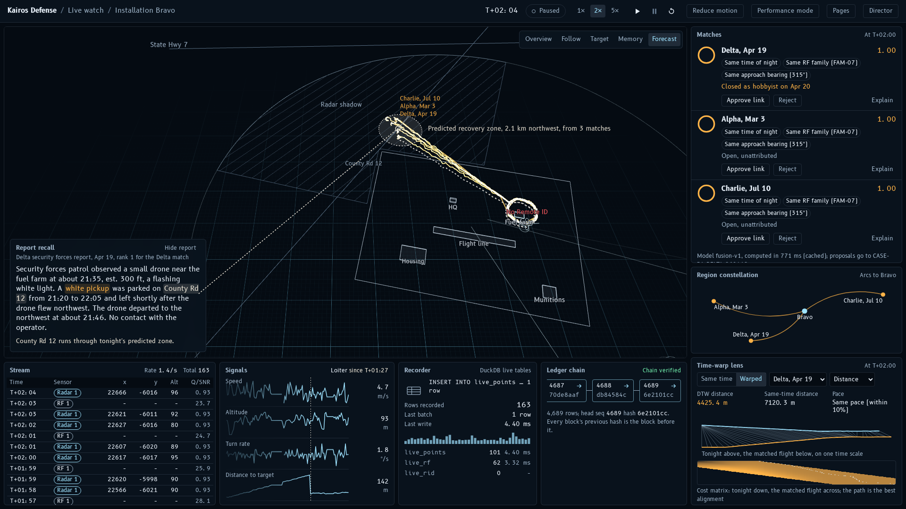

# Kairos Defense (demo)

A cross-installation memory of drone behavior. Kairos Defense matches a live drone track against
every past track at every base (DTW shape matching), retrieves the written reports tied to those
past flights (hybrid vector and keyword search), forecasts where the drone will be recovered,
matches swarm choreography, and keeps a bitemporal, tamper-evident case memory. It runs offline on
DuckDB and LanceDB, with a 3D Command Center in the browser. **All data is synthetic.**



## Documentation

| Document | For | What it covers |
|---|---|---|
| [User guide](docs/USER_GUIDE.md) | Operators, analysts, new users | Install, every screen with real screenshots, the demo, evidence, CLI, MCP, configuration, evaluation, troubleshooting |
| [One-pager](docs/ONE_PAGER.md) | Non-technical readers | The problem, what it does, the demo in five beats, how to run it |
| [Demo runbook](docs/DEMO.md) | Presenters | Before the audience, the four-minute script, keys, fallbacks, likely questions |
| [Rollback guide](docs/ROLLBACK.md) | Maintainers | How the history and tags are organized, how to inspect and roll back a phase |
| [Autopilot](docs/AUTOPILOT.md) | Maintainers | How the phases were built and gated unattended |
| [Specification](docs/SPEC.md) | Builders | The full product and build specification |
| [Progress](docs/PROGRESS.md), [decisions](docs/DECISIONS.md), [phase index](docs/phases/INDEX.md) | Everyone | What was built when, why, and the evidence |

Package READMEs: [kairos_defense](src/kairos_defense/README.md) (CLI, ports, geometry),
[agent](src/kairos_defense/agent/README.md), [api](src/kairos_defense/api/README.md),
[config](src/kairos_defense/config/README.md), [eval](src/kairos_defense/eval/README.md),
[features](src/kairos_defense/features/README.md), [forecast](src/kairos_defense/forecast/README.md),
[live](src/kairos_defense/live/README.md), [match](src/kairos_defense/match/README.md),
[memory](src/kairos_defense/memory/README.md), [recall](src/kairos_defense/recall/README.md),
[sim](src/kairos_defense/sim/README.md), [store](src/kairos_defense/store/README.md),
[web](web/README.md).

## Quick start

Prerequisites: git, [uv](https://docs.astral.sh/uv/), Node 22 LTS, and a C compiler with OpenMP
(dtaidistance builds from source, D-064).

```bash
uv sync && npm --prefix web install
make data index models eval   # exits 1 on the one accepted demo gap (D-081); see docs/DEMO.md
make demo                     # http://localhost:8000, press D on Live watch for Director mode
```

Other targets: `make check` (lint, type checks and fast tests), `make test-all` (with the slow
tests), `make dev` (API and Vite with hot reload), `make e2e` (Playwright, screenshots, axe),
`make mcp` (the MCP server: `claude mcp add kairos-defense -- uv run kairos-defense mcp`),
`make help` (every target).

## Status

| Phase | Title | Status | Docs |
|---|---|---|---|
| 0 | Scaffold | done | [report](docs/phases/phase-00/REPORT.md) |
| 1 | World, flights and radar | done | [report](docs/phases/phase-01/REPORT.md) |
| 2 | Swarms, RF, Remote ID, reports and assessments | done | [report](docs/phases/phase-02/REPORT.md) |
| 3 | Features, windows, Euclidean baseline and eval skeleton | done | [report](docs/phases/phase-03/REPORT.md) |
| 4 | DTW matcher and fusion model | done with one accepted gap (live top 3, [GAPS](docs/phases/phase-04/GAPS.md)) | [report](docs/phases/phase-04/REPORT.md) |
| 5 | Report recall and analog forecast | done | [report](docs/phases/phase-05/REPORT.md) |
| 6 | Case memory (Kairos-lite) | done | [report](docs/phases/phase-06/REPORT.md) |
| 7 | Streaming API and Command Center foundation | done | [report](docs/phases/phase-07/REPORT.md) |
| 8 | Command Center: the memorable moments | done | [report](docs/phases/phase-08/REPORT.md) |
| 9 | Swarms, agent, MCP, hardening and runbook | done | [report](docs/phases/phase-09/REPORT.md) |
| 10 | User guide, one-pager and rollback guide | built; awaiting the gate | [report](docs/phases/phase-10/REPORT.md) |

Latest evaluation (`make eval`): Recall@5 1.000, DTW lift +0.52, copycat-first 0%, time to match
96%, report linkage 1.000, forecast median 341 m at T = 90 s, swarm top-1 1.000 (4 of 4). Every
demo assertion passes except the accepted `live_top3_incidents` gap
([phase 4 GAPS](docs/phases/phase-04/GAPS.md)). Each phase's plan, report and exit-check evidence
is in `docs/phases/phase-NN/`.

## Build it with Claude Code

1. Copy this kit into an empty git repo (`CLAUDE.md`, `docs/`, `.claude/`).
2. Run `claude` in the repo and paste the kickoff prompt from `docs/SPEC.md` §0.1, then type `/phase 0`.
3. Approve each plan, review the exit check, then `/clear` and `/phase <next>`.
   Or run the remaining phases unattended with the autopilot ([docs/AUTOPILOT.md](docs/AUTOPILOT.md)).

Everything else is in [docs/SPEC.md](docs/SPEC.md).
