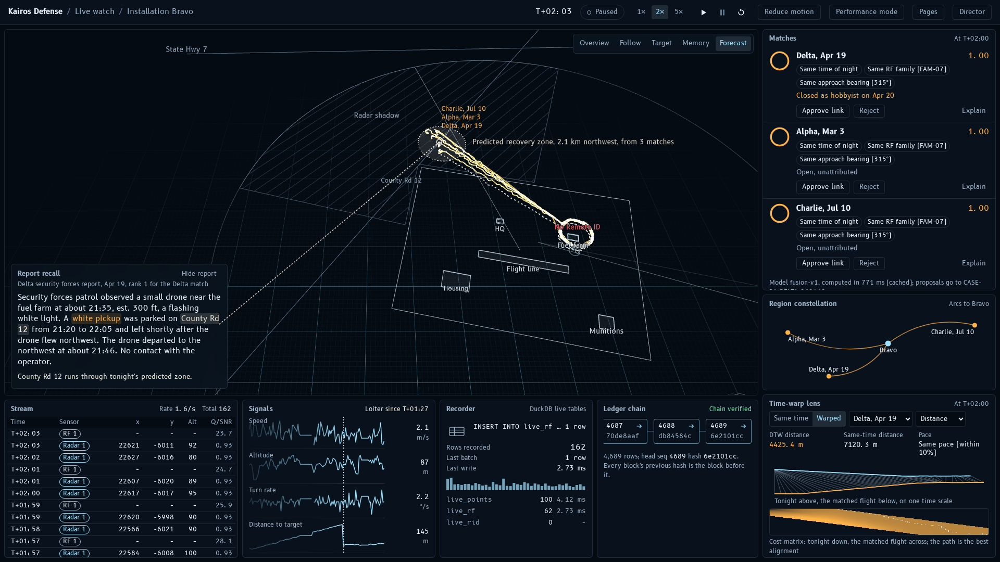

# Kairos Defense in one page



## The problem

Small drones probe military installations at night. Each base sees only its own nights: its own
radar tracks, its own patrol reports, its own assessments. When the same operator flies the same
pattern at another base six weeks later, nobody connects the two, and a flight that was closed as
"a hobbyist" stays closed.

## What Kairos Defense does

Kairos Defense gives every installation one shared memory of every drone flight that has crossed a
fence line, and answers one question while the drone is still in the air: *have we seen this
before, and what happened then?*

- **Recognize.** It compares the shape of the live flight with every past flight at every base,
  even one flown faster or slower, and weighs in radio type, approach direction, time of night,
  launch area, orbit size and altitude.
- **Recall.** It pulls up the written reports about the matching past flights and highlights the
  clues they share, such as a vehicle on a road.
- **Anticipate.** From how those past flights ended, it predicts where the operator will recover
  the drone tonight.
- **Remember.** It keeps a case memory that never forgets and never rewrites: what was known when,
  who decided what, and every change signed and chained so it can be verified.
- **Formations.** It recognizes the choreography of drone swarms seen before.

It also runs live: a simulator flies new flights that the app recognizes as their detections
arrive, and a slow-motion "DTW workbench" shows the matcher's real computation step by step.

People stay in charge: the system only proposes links and exports; an analyst approves them.

## The demo story in five beats

1. **Detection.** A drone comes out of the radar shadow at Installation Bravo's north fence. Every
   detection is recorded as it arrives.
2. **Recognition.** Forty-five seconds of track is enough to start; by the time the drone settles
   into its orbit, three earlier flights at other bases stay on top, one of them flown faster.
3. **Forecast.** Those flights ended about two kilometers northwest, in Bravo's radar shadow: that
   is where the operator will recover tonight's drone.
4. **Recall and memory.** An April report from Installation Delta, which nobody connected,
   mentions a white pickup on the same county road that crosses tonight's predicted zone. The Case
   board shows what Delta knew when it closed that flight as a hobbyist, and what is known now.
5. **Evidence and encore.** The analyst approves the links and exports a signed evidence package
   that verifies. Encore: a five-drone swarm at Echo flies the same choreography as a swarm at Golf
   six weeks earlier, in another region.

## What is synthetic

Everything. The installations, coordinates, flights, radar and radio detections, reports,
assessments and actors are invented by a seeded generator; no real place, person or vehicle
appears. The system links flights, never people.

## Run it in three commands

```bash
uv sync && npm --prefix web install
make data index models eval
make demo        # then open http://localhost:8000 and press D
```

It runs offline on a laptop. The full presenter's script is in [DEMO.md](DEMO.md); the user guide
is in [USER_GUIDE.md](USER_GUIDE.md).
