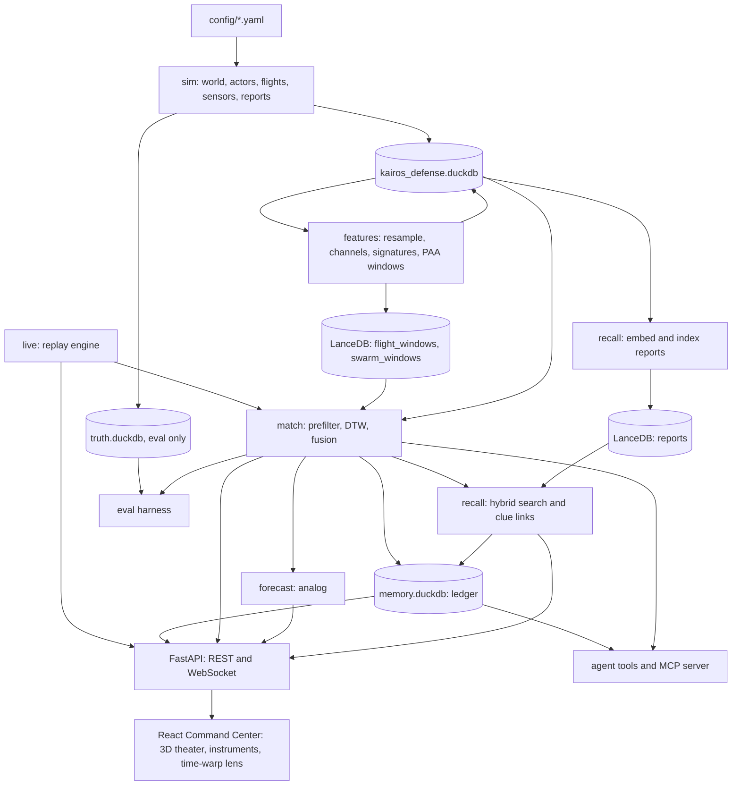

# Kairos Defense — Build Specification (DuckDB + LanceDB edition)

> **What this is.** The complete specification for Kairos Defense, a demo of cross-installation drone pattern
> memory, written to be built phase by phase with Claude Code. **All data is synthetic.**
>
> **Version** 1.2 · 28 Oct 2026 (1.1 plus pre-build fixes D-001 to D-014 in `docs/DECISIONS.md`) · **Stack** Python 3.11+, DuckDB, LanceDB, dtaidistance, FastAPI;
> React, three.js and D3 for the Command Center
> **Later** swap the stores for KDB-X and the memory for Kairos (§22).

## Contents

0. How to use this spec with Claude Code
1. Product summary and demo story
2. Scope
3. Tech stack
4. Architecture
5. Repository layout
6. Configuration
7. Data model
8. Synthetic data generator
9. Features and signatures
10. Matching engine
11. Context joins
12. Report recall
13. Analog forecast
14. Swarm choreography matching
15. Case memory (Kairos-lite)
16. Live replay and streaming API
17. Command Center UI
18. Agent tools and MCP server
19. Evaluation harness
20. Build phases (with Claude Code prompts)
21. Engineering standards and definition of done
22. KDB-X and Kairos swap-in map
23. Guardrails and compliance
24. Glossary
- Appendix A. Report templates
- Appendix B. Demo runbook

---

## 0. How to use this spec with Claude Code

1. Create an empty folder, run `git init`, and copy in this kit: `CLAUDE.md`, `docs/`, `.claude/`.
2. Start Claude Code in the folder with `claude`. It reads `CLAUDE.md` automatically.
3. Type `/phase 0`. The `phase` skill (`.claude/skills/phase/SKILL.md`) makes Claude Code read this spec,
   propose a plan, wait for your approval, build, run the exit check, update `docs/PROGRESS.md` and commit.
4. Review each plan before approving. Plan mode (Shift+Tab cycles modes) is the safest way to review.
5. Run `/clear` between phases. State lives in `docs/PROGRESS.md` and `docs/DECISIONS.md`, not in chat.
6. If a phase misses its exit check, have Claude Code diagnose with the evaluation harness before moving on.
   Never skip an exit check; the demo depends on each one.

If the skill does not load, paste the manual prompt given in each phase block (§20).
Each phase is sized for one to three supervised Claude Code sessions.

### 0.1 Kickoff prompt

Paste this as the first message in a new Claude Code session, then type `/phase 0`:

```text
I'm building Kairos Defense, a demo for a defense audience. Everything is in this repo:
CLAUDE.md (rules), docs/SPEC.md (full spec), docs/PROGRESS.md, docs/DECISIONS.md and the
/phase skill.

Before writing any code:
1. Read CLAUDE.md and all of docs/SPEC.md.
2. In under 20 lines, play back what the product does, the demo story (§1.2), the build
   phases (§20) and the look and feel required by §17.
3. List anything ambiguous, risky or contradictory, each with a proposed resolution.
4. Check the toolchain: git, uv, Python 3.11+, Node 22 LTS and npm. Tell me what is missing.

Stop after that. I will then type /phase 0.
```

After each phase: review the exit-check evidence, then `/clear` and `/phase <next>`.

---

## 1. Product summary and demo story

**Kairos Defense** gives every installation a shared memory of every drone flight that has crossed its fence
line, and answers one question fast: *have we seen this before, and what happened then?*

### 1.1 Capabilities

| # | Capability | Definition |
|---|---|---|
| C1 | Recognize | Match a live, partial track against all *past* tracks at all bases: DTW on flight-behavior features, re-ranked with RF family, approach bearing, time of day, launch area, orbit radius and altitude |
| C2 | Recall | Retrieve reports tied to matched flights with hybrid (vector + keyword) search, filtered by base, time window and distance |
| C3 | Remember | Append-only, bitemporal case memory: what was known when, contradictions, decisions, hash-chained |
| C4 | Anticipate | Analog forecast of exit path and recovery zone from how the matched flights ended |
| C5 | Formations | Match multi-drone swarm choreography against past swarm events |
| C6 | Report | Shift "what changed" brief and an attested evidence package |

### 1.2 The demo script (must work exactly)

Installations, actors, reports and times are synthetic (§8). Times are local. T+ counts from first radar
contact, and the beat times follow the §8.3 kinematics (D-003): BRAVO's radar cannot see past a ridge to the
northwest, and P1 at 15 m/s needs about 80 s to fly from the fence into its orbit.

| Time | What happens | Acceptance test |
|---|---|---|
| T+0 s | Replay starts at first radar contact: a drone comes out of the radar shadow northwest of BRAVO and appears at the north fence, 2026-08-28 21:40 | Track renders on Live Watch; first point within 100 m of the fence, between 21:39:30 and 21:40:30 |
| T+45 s | The matcher runs on its first 45 s of track while the drone is still inbound, about 700 m from the fuel farm | Matcher has run at least once |
| T+80 s | The drone joins a counter-clockwise orbit over BRAVO's fuel farm | Orbit established (within 15 m of a 180 m radius for 10 s) between T+65 and T+100 |
| T+90 s | Top 3 matches: DELTA 2026-04-19, ALPHA 2026-03-03 (flown ~18% slower), ALPHA 2026-05-02 | All three are actor P1 (any order); each shows a score and reasons |
| T+105 s | Predicted recovery zone about 2.1 km northwest of the orbit, inside BRAVO's radar shadow, plus a dashed predicted exit path | Zone center within 400 m of P1's true recovery point |
| T+120 s | Linked report: DELTA security forces, 2026-04-19, white pickup on County Rd 12 from 21:20 to 22:05; UI notes County Rd 12 crosses tonight's zone | That report is rank 1 for the DELTA match |
| Case Board | Known then / known now: DELTA labeled its 04-19 incident "hobbyist" on 04-20, when nobody had linked it to ALPHA 03-03 and ALPHA 05-02 had not yet happened | Toggle shows both states and the diff |
| Evidence | "Build evidence package" (after analyst approval of the links) | JSON + HTML exported; chain and signature verify |
| Encore | Swarm replay at ECHO, 2026-06-14, five drones; best swarm match GOLF 2026-05-03, six weeks earlier in another region | Swarm View shows aligned choreography |

Each row is also a Director-mode beat (§17.10) with its own camera shot and caption.

### 1.3 Users and screens

- Base defense operators: **Live Watch**.
- Analysts: **Match Explainer**, **Case Board**, **Swarm View**.
- Investigators: **Evidence**.
- Commanders and watch officers: **Shift Delta**.

### 1.4 Product guardrails (detail in §23)

Synthetic data only · link flights, never people · humans approve every link and export ·
offline by default · memory is append-only · no look-ahead in any search.

---

## 2. Scope

**In v1:** synthetic generator; DuckDB store; LanceDB vectors and full-text index; features and
signatures; Euclidean baseline; prefilter + DTW matcher; fusion model; hybrid report recall with clue
linking; analog forecast; swarm matching; case memory (as-of, diff, contradictions, hash chain, evidence
export, shift delta); live replay streamed over WebSocket; FastAPI backend; the React Command Center with a 3D theater and animated instruments (§17); agent tools + MCP server; optional LLM chat panel;
evaluation harness.

**Not in v1:** real sensors or real data; authentication or multi-user; security accreditation; map
tiles (maps are drawn in local meters); KDB-X (every store sits behind a port so it can be swapped, §22).

Do not add a server database or a message bus in v1. The only front end is the React app in `web/` (§17).

---

## 3. Tech stack

| Concern | Choice | Notes |
|---|---|---|
| Language and env | Python 3.11+, `uv` | `uv sync`, `uv run …` |
| Structured and time series | DuckDB ≥ 1.1 (verified 2.0.0) | ASOF joins, range joins, table macros |
| Vectors and full text | LanceDB ≥ 0.30 (verified 0.40.0) | ANN with prefilter, native FTS, hybrid with `RRFReranker` |
| DTW | dtaidistance ≥ 2.3 (verified 2.5.1) | C-accelerated `dtw`, `dtw_ndim`, warping paths, subsequence alignment, LB_Keogh |
| Numerics | numpy, scipy, pandas, pyarrow, scikit-learn | Logistic fusion model |
| Geometry | shapely ≥ 2 | Polygons, buffers, intersections in meters |
| Config | pydantic ≥ 2, pyyaml | One model per YAML file |
| CLI | typer, rich | Entry point `kairos-defense` |
| API | FastAPI + uvicorn (WebSocket) | REST plus one replay stream per client (§16) |
| Web app | React 19.3 + TypeScript (strict) + Vite 8; Tailwind CSS 4 | `web/`; the built app is served by FastAPI for offline demos |
| 3D | three.js via @react-three/fiber 9, drei 10, postprocessing 3 | Live theater, bloom, instanced particles; R3F needs React < 19.4 |
| Motion and charts | Motion 14 (`motion/react`), D3 7 | Transitions; time-warp lens, signal lanes, heatmaps, case graph |
| Client state | Zustand 5 | High-frequency data read in render loops, not React state |
| Fonts | @fontsource B612 and B612 Mono | Self-hosted; no CDNs |
| Web tests | Vitest 5 + Testing Library; Playwright 1.64; @axe-core/playwright | Unit, end-to-end, screenshots, accessibility |
| Static figures | matplotlib | Data card and evidence PNGs |
| Embeddings | Hashing embedder (default, offline); fastembed `BAAI/bge-small-en-v1.5` (optional, 384-d) | Same `Embedder` port |
| Agent | MCP Python SDK (`mcp`, FastMCP); optional LLM adapters | Provider set in `config/app.yaml` |
| Integrity | `hashlib` (SHA-256), `cryptography` (Ed25519) | Ledger chain and evidence signing |
| Quality | pytest, ruff; hypothesis optional | `make check` |

---

## 4. Architecture



### 4.1 Ports (`src/kairos_defense/ports.py`)

Business logic depends only on these Protocols. Adapters implement them for DuckDB and LanceDB now,
and for KDB-X and Kairos later.

```python
from __future__ import annotations
from datetime import datetime
from typing import Protocol, Sequence
import numpy as np
import pandas as pd

class TrackStore(Protocol):
    def track_points(self, track_id: str) -> pd.DataFrame: ...
    def features(self, track_id: str) -> pd.DataFrame: ...          # 1 Hz rows, §9
    def signature(self, track_id: str) -> dict: ...                 # §9.4
    def tracks_before(self, ts: datetime, exclude_incident: str | None = None) -> pd.DataFrame: ...
    def context_asof(self, track_id: str) -> pd.DataFrame: ...      # weather and events per point, §11
    def sql(self, query: str, params: dict | None = None) -> pd.DataFrame: ...

class VectorStore(Protocol):
    def upsert(self, table: str, rows: Sequence[dict]) -> None: ...
    def search(self, table: str, vector: np.ndarray, where: str | None, k: int) -> pd.DataFrame: ...

class ReportIndex(Protocol):
    def hybrid(self, text: str, vector: np.ndarray, where: str | None, k: int) -> pd.DataFrame: ...
    def fts(self, text: str, where: str | None, k: int) -> pd.DataFrame: ...

class Embedder(Protocol):
    dim: int
    def embed(self, texts: Sequence[str]) -> np.ndarray: ...        # (n, dim) float32, L2-normalized

class CaseMemory(Protocol):
    def append(self, event: dict) -> int: ...                       # returns ledger seq
    def as_of(self, case_id: str, t: datetime) -> "CaseSnapshot": ...
    def diff(self, case_id: str, t1: datetime, t2: datetime) -> list[dict]: ...
    def verify_chain(self) -> int | None: ...                # first broken seq; None if intact (D-014)

class LLM(Protocol):
    def chat(self, messages: list[dict], tools: list[dict] | None = None) -> dict: ...
```

### 4.2 Module map

| Package | Responsibility |
|---|---|
| `kairos_defense.config` | Pydantic models for every YAML file; one loader |
| `kairos_defense.geo` | Bearings, angle wrap, polygon helpers, frame transforms (region ↔ installation ↔ target-relative) |
| `kairos_defense.rng` | Stable per-component seeding (§8.9) |
| `kairos_defense.sim` | World, calendar, actors, kinematics, patterns, sensors, swarms, reports, assessments, planted scenario, writers |
| `kairos_defense.store` | DuckDB and LanceDB adapters, DDL, truth-isolation guard |
| `kairos_defense.features` | Resampling, channels, signatures, PAA windows, swarm descriptors |
| `kairos_defense.match` | Euclidean baseline, prefilter, DTW re-rank, fusion model, explanations |
| `kairos_defense.recall` | Embedders, report indexing, hybrid search, clue extraction and linking |
| `kairos_defense.forecast` | Analog forecast |
| `kairos_defense.memory` | Ledger, hash chain, as-of, diff, contradictions, evidence export, shift delta |
| `kairos_defense.live` | Replay engine and live matcher loop |
| `kairos_defense.agent` | Tool functions, MCP server, LLM adapters |
| `kairos_defense.eval` | Harness, metrics, reports. **The only package allowed to read truth** |
| `kairos_defense.api` | FastAPI app: REST, WebSocket replay stream, static hosting of the built web app |
| `web/` (TypeScript) | React Command Center: 3D theater, instruments, pages (§17) |
| `kairos_defense.cli` | Typer entry point |

---

## 5. Repository layout

```text
kairos-defense/
├── CLAUDE.md
├── README.md
├── pyproject.toml
├── Makefile
├── .claude/skills/phase/SKILL.md
├── config/
│   ├── app.yaml
│   ├── world.yaml
│   ├── actors.yaml
│   ├── scenario_demo.yaml
│   └── scoring.yaml
├── docs/
│   ├── SPEC.md
│   ├── PROGRESS.md
│   ├── DECISIONS.md
│   └── DEMO.md                  # written in phase 9 (Appendix B)
├── data/                        # git-ignored
│   ├── kairos_defense.duckdb
│   ├── truth.duckdb
│   ├── memory.duckdb
│   ├── lancedb/
│   ├── cache/                   # optional LLM paraphrase cache
│   └── keys/ed25519.pem
├── models/                      # fusion_vN.json, dtw_calibration.json
├── reports/                     # data_card.md, eval_<date>.md, figures/
├── exports/                     # evidence packages
├── src/kairos_defense/
│   ├── __init__.py  cli.py  config.py  geo.py  rng.py  ports.py
│   ├── sim/        world.py calendar.py actors.py kinematics.py patterns.py sensors.py
│   │               swarm.py reports.py assessments.py scenario.py writers.py generate.py
│   ├── store/      ddl.py duck.py lance.py guard.py
│   ├── features/   resample.py channels.py signatures.py windows.py swarm_features.py
│   ├── match/      baseline.py prefilter.py dtw_rerank.py fusion.py explain.py matcher.py
│   ├── recall/     embed.py index.py search.py clues.py
│   ├── forecast/   analog.py
│   ├── memory/     ledger.py canonical.py asof.py diff.py evidence.py delta.py seed.py
│   ├── live/       replay.py loop.py
│   ├── agent/      tools.py mcp_server.py llm.py prompts.py
│   ├── eval/       harness.py metrics.py report.py
│   └── api/        app.py routes.py stream.py schemas.py static.py
├── tests/
│   ├── unit/
│   └── slow/
└── web/                         # React + TypeScript + Vite (§17)
    ├── package.json  vite.config.ts  index.html
    ├── src/
    │   ├── app/      App.tsx routes.tsx CommandBar.tsx director/ (beats.ts captions.tsx camera.ts)
    │   ├── theme/    tokens.css motion.ts fonts.ts
    │   ├── api/      client.ts stream.ts types.gen.ts
    │   ├── state/    replayStore.ts matchStore.ts caseStore.ts
    │   ├── three/    Theater Installation Radar Rf Drone Packets Core Ghosts Forecast Swarm Effects (.tsx)
    │   ├── panels/   Stream Signals Recorder LedgerChain TimeWarpLens MatchList Constellation ReportOverlay (.tsx)
    │   └── pages/    LiveWatch MatchExplainer CaseBoard SwarmView Evidence ShiftDelta Eval (.tsx)
    ├── tests/        Vitest
    └── e2e/          director.spec.ts pages.spec.ts (Playwright)
```

Makefile targets: `check` (Python and web), `test-all`, `data`, `index`, `models`, `eval`, `api`, `web`,
`dev` (API and Vite together), `demo` (build the web app and serve everything from FastAPI, offline),
`e2e`, `mcp`, `clean`. Python targets call `uv run kairos-defense …`; web targets call `npm --prefix web …`.

---

## 6. Configuration

All YAML is validated by pydantic models in `kairos_defense.config`. Values below are the defaults to ship.

### 6.1 `config/app.yaml`

```yaml
paths:
  duckdb: data/kairos_defense.duckdb
  truth: data/truth.duckdb          # eval only (CLAUDE.md rule 2)
  memory: data/memory.duckdb
  lancedb: data/lancedb
  models: models
  reports: reports
  exports: exports
embeddings:
  provider: hashing                 # hashing | fastembed
  dim: 384
  fastembed_model: BAAI/bge-small-en-v1.5
reports_llm_paraphrase: false       # if true, cache outputs under data/cache/llm/
llm:
  provider: none                    # none | anthropic | openai | ollama
  model: ""
  base_url: ""                      # for ollama or other OpenAI-compatible servers
signing:
  enabled: true
  key_path: data/keys/ed25519.pem   # generated on first use
replay:
  default_speed: 1.0                # 1.0, 2.0 or 5.0
```

### 6.2 `config/world.yaml`

Three regions, twelve notional installations (NATO-alphabet names). Each region has its own ENU frame
in meters; installation origins are offsets within that frame. Roads and parks live in region frames.
`rotation_deg` turns the installation template clockwise (compass sense), and every bearing in the config is
a true bearing in the region frame, clockwise from north (D-007). Each installation has a park 2.2 km from its
origin for hobbyist launches (D-005).

```yaml
seed: 42
calendar:
  start_local: "2025-03-01"
  end_local: "2026-08-31"
  night_window_local: ["19:00", "03:00"]
regions:
  - id: COASTAL
    utc_offset_hours: -5            # fixed offset, no daylight saving in the synthetic world
    installations:
      - {id: ALPHA,   origin_m: [0, 0],         rotation_deg: 0}
      - {id: BRAVO,   origin_m: [22000, -6000], rotation_deg: 12,
         terrain_mask: {bearing_deg: [285, 20], beyond_fence_m: 50, below_alt_m: 200}}   # wooded ridge, northwest (D-003)
      - {id: CHARLIE, origin_m: [41000, 4000],  rotation_deg: -8}
      - {id: DELTA,   origin_m: [9000, -24000], rotation_deg: 20}
    parks:
      - {id: COASTAL-PARK-1, center_m: [5200, 6100], radius_m: 600}
      - {id: COASTAL-PARK-2, center_m: [25800, -1200], radius_m: 500}
      - {id: COASTAL-PARK-3, center_m: [12500, -19500], radius_m: 450}
      - {id: COASTAL-PARK-4, center_m: [2200, 0], radius_m: 300}         # ALPHA launch park (D-005)
      - {id: COASTAL-PARK-5, center_m: [22000, -8200], radius_m: 300}    # BRAVO
      - {id: COASTAL-PARK-6, center_m: [43200, 4000], radius_m: 300}     # CHARLIE
      - {id: COASTAL-PARK-7, center_m: [10905, -22900], radius_m: 300}   # DELTA
    roads:
      - {name: "County Rd 12", construct: through_launch_points, actor: P1, extend_m: 4000}
      - {name: "State Hwy 7", points_m: [[-6000, -3000], [46000, -1500]]}
  - id: PLAINS
    utc_offset_hours: -6
    installations:
      - {id: ECHO,    origin_m: [0, 0],          rotation_deg: 0}
      - {id: FOXTROT, origin_m: [30000, 8000],   rotation_deg: 15}
      - {id: HOTEL,   origin_m: [12000, -20000], rotation_deg: -10}
      - {id: INDIA,   origin_m: [-18000, -9000], rotation_deg: 5}
    parks:
      - {id: PLAINS-PARK-1, center_m: [4000, 5000], radius_m: 700}
      - {id: PLAINS-PARK-2, center_m: [26000, 12000], radius_m: 500}
      - {id: PLAINS-PARK-3, center_m: [0, -2200], radius_m: 300}         # ECHO launch park (D-005)
      - {id: PLAINS-PARK-4, center_m: [28586, 6315], radius_m: 300}      # FOXTROT
      - {id: PLAINS-PARK-5, center_m: [10095, -18900], radius_m: 300}    # HOTEL
      - {id: PLAINS-PARK-6, center_m: [-16900, -7095], radius_m: 300}    # INDIA
    roads:
      - {name: "Farm Rd 300", points_m: [[-25000, 3000], [40000, 6000]]}
  - id: DESERT
    utc_offset_hours: -7
    installations:
      - {id: GOLF,   origin_m: [0, 0],          rotation_deg: 0}
      - {id: JULIET, origin_m: [35000, -5000],  rotation_deg: 25}
      - {id: KILO,   origin_m: [15000, 22000],  rotation_deg: -15}
      - {id: LIMA,   origin_m: [-20000, 10000], rotation_deg: 8}
    parks:
      - {id: DESERT-PARK-1, center_m: [6000, -4000], radius_m: 800}
      - {id: DESERT-PARK-2, center_m: [1414, -1685], radius_m: 300}      # GOLF launch park (D-005)
      - {id: DESERT-PARK-3, center_m: [34248, -7067], radius_m: 300}     # JULIET
      - {id: DESERT-PARK-4, center_m: [12800, 22000], radius_m: 300}     # KILO
      - {id: DESERT-PARK-5, center_m: [-21905, 11100], radius_m: 300}    # LIMA
    roads:
      - {name: "Route 66B", points_m: [[-30000, 0], [45000, -2000]]}

installation_template:              # installation-local meters before rotation
  fence: [[-1300, -1000], [1300, -1000], [1300, 1000], [-1300, 1000]]
  assets:
    fuel_farm:   {center: [600, 300],   size: [120, 80]}
    flight_line: {center: [100, -160],  size: [1000, 90]}
    munitions:   {center: [900, -700],  size: [150, 150]}
    hq:          {center: [-300, 400],  size: [80, 60]}
    housing:     {center: [-700, -500], size: [300, 200]}
  jitter_m: 60                      # seeded per-base offset of each asset center

sensors_template:                   # installation-local positions
  - {kind: radar, at: [0, 0],     range_m: 3500, rate_hz: 1.0, pos_sigma_m: 8,
     alt_sigma_m: 5, p_detect_near: 0.98, p_detect_far: 0.70, min_alt_m: 15}
  - {kind: rf,    at: [200, 150], range_m: 4000, rate_hz: 0.5, bearing_sigma_deg: 4}
  - {kind: rid,   at: [0, 0],     range_m: 3000, rate_hz: 1.0}
```

`construct: through_launch_points` builds County Rd 12 from straight segments (no corner-cutting smoothing)
through P1's nominal launch points at ALPHA, BRAVO and DELTA (target centroid + 2,100 m at bearing 315°),
extended 4 km at both ends (D-006). This keeps the demo geography consistent: the road passes about 2.1 km
northwest of each fuel farm. P1 snaps its launch to the road only where the road is within 500 m, so
CHARLIE keeps its nominal launch point.

BRAVO's `terrain_mask` stands for a wooded ridge northwest of the base: none of BRAVO's sensors can see a
target below 200 m that is more than 50 m outside the fence with a bearing from the installation origin
between 285° and 20° (through north). P1 launches in that shadow, so BRAVO first sees it at the north
fence (§8.6, D-003).

### 6.3 `config/actors.yaml`

```yaml
hobbyists:
  rate_per_night_per_base: 0.27     # ≈1,780 flights over 18 months and 12 bases
  duration_s: [180, 720]
  altitude_m: [30, 120]
  speed_ms: [4, 12]
  rid_on_prob: 0.9
  rf_families: [FAM-01, FAM-02, FAM-03, FAM-04, FAM-05]
  launch_from: [parks, public_events]
  cross_fence_prob: 0.3
  pattern: random_walk

probers:
  - id: P1
    nickname: County Rd operator
    bases: [ALPHA, BRAVO, CHARLIE, DELTA]
    flights: planted_only           # every P1 flight comes from scenario_demo.yaml
    target: fuel_farm
    pattern: {type: orbit, radius_m: 180, direction: ccw, laps: [2, 3], angular_speed_dps: 3}   # 9.4 m/s, slower than cruise (D-004)
    approach_bearing_deg: 315       # bearing from the target toward where the drone comes from
    launch: {bearing_deg: 315, distance_m: 2100, jitter_m: 150, snap_to_road: "County Rd 12"}   # snap only within 500 m (D-006)
    altitude_m: [90, 120]
    cruise_speed_ms: 15             # D-003
    rf_family: FAM-07
    rid: off
    clues: {vehicle: white pickup, road: "County Rd 12"}
    time_local: ["21:00", "22:30"]
  - id: P2
    nickname: Flight-line surveyor
    bases: [CHARLIE, DELTA]
    flights: 12
    target: flight_line
    pattern: {type: lawnmower, leg_m: 600, spacing_m: 80, legs: [4, 6]}
    approach_bearing_deg: 200
    launch: {bearing_deg: 200, distance_m: 1600, jitter_m: 200}
    altitude_m: [60, 80]
    cruise_speed_ms: 9
    rf_family: FAM-11
    rid: spoofed
    clues: {vehicle: dark SUV}
    time_local: ["23:00", "01:00"]
  - id: P3
    nickname: Munitions figure-eight
    bases: [ECHO, FOXTROT, HOTEL]
    flights: 16
    target: munitions
    pattern: {type: figure8, lobe_radius_m: 120, loops: [2, 3]}
    approach_bearing_deg: 90
    launch: {bearing_deg: 90, distance_m: 2500, jitter_m: 200}
    altitude_m: [110, 140]
    cruise_speed_ms: 14
    rf_family: FAM-07               # same family as P1 on purpose: RF alone must not decide a match
    rid: off
    clues: {vehicle: silver sedan}
    time_local: ["20:00", "21:30"]
  - id: P4
    nickname: Fence runner
    bases: [GOLF, JULIET]
    flights: 10
    target: fence
    pattern: {type: perimeter, offset_m: 200, fraction: [0.4, 0.7]}
    approach_bearing_deg: 0
    launch: {bearing_deg: 0, distance_m: 1200, jitter_m: 150}
    altitude_m: [40, 60]
    cruise_speed_ms: 15
    rf_family: FAM-03               # a common hobby family: harder case
    rid: off
    clues: {vehicle: motorcycle}
    time_local: ["22:00", "23:30"]
  - id: P5
    nickname: Hover-and-stare
    bases: [KILO, LIMA, INDIA]
    flights: 12
    target: hq
    pattern: {type: hover, dwell_s: [240, 360], jitter_m: 6}
    approach_bearing_deg: 135
    launch: {bearing_deg: 135, distance_m: 1800, jitter_m: 150}   # lands inside the fence: pushed out (§8.3, D-005)
    altitude_m: [140, 160]
    cruise_speed_ms: 10
    rf_family: FAM-15
    rid: off
    clues: {vehicle: red hatchback}
    time_local: ["19:30", "20:30"]
  - id: P6
    nickname: High transit with dips
    bases: [BRAVO, CHARLIE, GOLF]   # spans two regions
    flights: 10
    target: housing
    pattern: {type: transit_dips, transit_alt_m: 300, dip_alt_m: 80, dips: 3}
    approach_bearing_deg: 250
    launch: {bearing_deg: 250, distance_m: 3000, jitter_m: 300}
    altitude_m: [80, 300]
    cruise_speed_ms: 18
    rf_family: FAM-21
    rid: off
    clues: {}
    time_local: ["01:00", "03:00"]

copycats:
  - id: C1
    mimics: P1                      # same loiter shape, different RF and launch area
    bases: [BRAVO, DELTA]
    flights: 15
    pattern_overrides: {radius_m: [170, 190]}
    launch: {bearing_deg: 120, distance_m: 900, jitter_m: 200, from: parks}   # `from` only labels the site in reports (D-005)
    rf_family: FAM-02
    rid_on_prob: 0.5
    time_local: ["19:00", "20:30"]
  - id: C2
    mimics: P3
    bases: [ECHO, INDIA]
    flights: 15
    launch: {bearing_deg: 270, distance_m: 700, jitter_m: 200, from: parks}   # inside the fence: pushed out (D-005)
    rf_family: FAM-04
    rid_on_prob: 0.6
    time_local: ["19:30", "21:00"]

swarms:
  - id: S1
    drones: 5
    bases: [GOLF, ECHO, HOTEL]
    random_events: 2                # after 2026-06-14 (D-009), plus the planted events in scenario_demo.yaml
    rf_family: FAM-30
    altitude_m: [80, 100]
    target: flight_line
    choreography:                   # executed in order
      - {formation: line_abreast, spacing_m: 40, duration_s: 60}
      - {action: rotate, degrees: 90, direction: cw, duration_s: 30}
      - {action: split, groups: [2, 3], separation_m: 250, duration_s: 45}
      - {formation: v, spacing_m: 35, duration_s: 40}
      - {action: orbit_target, radius_m: 220, duration_s: 90}
  - id: S2
    drones: 3
    bases: [JULIET, KILO]
    random_events: 5
    rf_family: FAM-31
    altitude_m: [60, 80]
    target: munitions
    choreography:
      - {formation: triangle, spacing_m: 50, duration_s: 50}
      - {action: expand, factor: 2.0, duration_s: 30}
      - {action: rotate, degrees: 180, direction: ccw, duration_s: 40}
      - {formation: trail, spacing_m: 30, duration_s: 60}
```

### 6.4 `config/scenario_demo.yaml`

The demo is planted so that it works every time; everything else is random but seeded. `start_local` is the
launch time, which only truth records; an incident's recorded start is its first detection (D-003).
`jitter: none` turns off the per-flight launch, approach and radius jitter of §8.5.

```yaml
live_incident: DEMO-BRAVO-0828
p1_flights:
  - {incident_id: P1-BRAVO-251114, base: BRAVO, start_local: "2025-11-14T21:12:00",
     time_warp: 1.0, sensor_outage_s: [120, 260]}            # early, partial track
  - {incident_id: P1-ALPHA-260303, base: ALPHA, start_local: "2026-03-03T21:52:00",
     time_warp: 1.22}                                        # speed × 0.82 ("18% slower")
  - incident_id: P1-DELTA-260419
    base: DELTA
    start_local: "2026-04-19T21:35:00"
    time_warp: 1.0
    reports:
      - source: security_forces
        report_local: "2026-04-19T22:40:00"
        grade: B2
        clues:
          - {type: vehicle, value: white pickup, road: "County Rd 12",
             seen_local: ["21:20", "22:05"], true: true}
    assessment: {label: hobbyist, assessed_local: "2026-04-20T09:10:00",
                 author: DELTA BDOC}                         # wrong on purpose
  - {incident_id: P1-ALPHA-260502, base: ALPHA, start_local: "2026-05-02T22:05:00",
     time_warp: 0.95}
  - {incident_id: P1-CHARLIE-260710, base: CHARLIE, start_local: "2026-07-10T21:30:00",
     time_warp: 1.0, target_override: flight_line}           # weaker match on purpose
  - {incident_id: DEMO-BRAVO-0828, base: BRAVO, start_local: "2026-08-28T21:38:45",
     time_warp: 1.0, jitter: none, status: live}             # first radar contact ≈ 21:40:00 at the north fence
swarm_events:
  - {incident_id: S1-GOLF-260503, team: S1, base: GOLF, start_local: "2026-05-03T22:10:00"}
  - {incident_id: DEMO-SWARM-ECHO-0614, team: S1, base: ECHO,
     start_local: "2026-06-14T21:50:00", status: live}
expectations:                       # asserted by tests in phases 1, 4, 5, 7 and 9
  live_first_contact_local: ["2026-08-28T21:39:30", "2026-08-28T21:40:30"]   # within 100 m of the fence
  live_orbit_established_s: [65, 100]                                        # after first contact
  live_top3_at_s: 90
  live_top3_incidents: [P1-DELTA-260419, P1-ALPHA-260303, P1-ALPHA-260502]   # any order
  live_rank1_report_for: P1-DELTA-260419                                      # at T+120
  forecast_at_s: 105
  forecast_error_max_m: 400
  swarm_top1: S1-GOLF-260503
```

### 6.5 `config/scoring.yaml`

```yaml
features:
  resample_hz: 1
  max_interp_gap_s: 10
  channels: [speed_ms, turn_rate_dps, dist_target_m, alt_m, vspeed_ms]
  channel_weights: [1.0, 1.0, 1.2, 0.6, 0.4]
windows:
  sizes_s: [60, 120, 300]
  stride_s: 10
  paa_segments: 16                  # vector dim = 5 channels × 16 = 80
prefilter:
  k_windows: 200
  candidate_tracks: 50
dtw:
  band_fraction: 0.25               # Sakoe-Chiba window = 25% of the longer series
  anchor_before: 0.5                # anchor segment = [start − 0.5W, start + 1.5W]
  anchor_after: 1.5
  tau: auto                         # calibrated in phase 4, saved to models/dtw_calibration.json
fusion:
  model: logistic
  features: [shape_sim, rf_match, bearing_sim, tod_sim, launch_sim, radius_sim, alt_sim]
live:
  min_track_s: 45
  rerun_every_s: 5
recall:
  hours_window: 3
  radius_m: 5000
  k: 5
forecast:
  top_k: 3
  min_radius_m: 150
  radius_factor: 1.5
swarm:
  min_drones: 3
  max_spacing_m: 300
  min_duration_s: 60
```

---

## 7. Data model

Three DuckDB files and one LanceDB directory. All times in DuckDB are UTC `TIMESTAMP`; local times are
derived with the region's `utc_offset_hours`. All coordinates are region-frame meters unless a column
name ends in `_rel_m` (target-relative, §9.2).

### 7.1 `data/kairos_defense.duckdb` — raw tables (written by the generator)

```sql
CREATE TABLE regions (region_id VARCHAR PRIMARY KEY, utc_offset_hours INTEGER);
CREATE TABLE installations (
  installation_id VARCHAR PRIMARY KEY, name VARCHAR, region_id VARCHAR,
  origin_x_m DOUBLE, origin_y_m DOUBLE, rotation_deg DOUBLE, fence_wkt VARCHAR);
CREATE TABLE assets (
  asset_id VARCHAR PRIMARY KEY, installation_id VARCHAR, kind VARCHAR,  -- fuel_farm|flight_line|munitions|hq|housing
  polygon_wkt VARCHAR, centroid_x_m DOUBLE, centroid_y_m DOUBLE);
CREATE TABLE roads (road_id VARCHAR PRIMARY KEY, region_id VARCHAR, name VARCHAR, line_wkt VARCHAR);
CREATE TABLE parks (park_id VARCHAR PRIMARY KEY, region_id VARCHAR, center_x_m DOUBLE, center_y_m DOUBLE, radius_m DOUBLE);
CREATE TABLE sensors (
  sensor_id VARCHAR PRIMARY KEY, installation_id VARCHAR, kind VARCHAR,  -- radar|rf|rid
  x_m DOUBLE, y_m DOUBLE, range_m DOUBLE, params JSON);
CREATE TABLE incidents (
  incident_id VARCHAR PRIMARY KEY, installation_id VARCHAR, region_id VARCHAR,
  start_ts TIMESTAMP, end_ts TIMESTAMP,               -- first and last detection by any sensor (D-003)
  n_tracks INTEGER, is_swarm BOOLEAN,
  status VARCHAR);                                    -- history | live
CREATE TABLE track_points (
  incident_id VARCHAR, track_id VARCHAR, installation_id VARCHAR, region_id VARCHAR,
  sensor_id VARCHAR, ts TIMESTAMP, x_m DOUBLE, y_m DOUBLE, alt_m DOUBLE, quality DOUBLE);
CREATE TABLE rf_detections (
  installation_id VARCHAR, sensor_id VARCHAR, ts TIMESTAMP, band VARCHAR,       -- 2.4GHz|5.8GHz|900MHz
  protocol_family VARCHAR, bearing_deg DOUBLE, snr_db DOUBLE);
CREATE TABLE remote_id (
  installation_id VARCHAR, ts TIMESTAMP, serial VARCHAR,
  drone_x_m DOUBLE, drone_y_m DOUBLE, op_x_m DOUBLE, op_y_m DOUBLE);
CREATE TABLE weather (region_id VARCHAR, ts TIMESTAMP, wind_ms DOUBLE, wind_dir_deg DOUBLE, visibility_km DOUBLE);
CREATE TABLE base_events (
  installation_id VARCHAR, start_ts TIMESTAMP, end_ts TIMESTAMP,
  kind VARCHAR, label VARCHAR);                       -- exercise|vip_visit|shift_change
CREATE TABLE public_events (
  region_id VARCHAR, start_ts TIMESTAMP, end_ts TIMESTAMP, kind VARCHAR, label VARCHAR,
  x_m DOUBLE, y_m DOUBLE);
CREATE TABLE reports (
  report_id VARCHAR PRIMARY KEY, incident_id VARCHAR, installation_id VARCHAR,
  source VARCHAR,                                     -- security_forces|bdoc_log|faa|local_pd
  source_grade VARCHAR,                               -- A1..F6 (reliability letter, credibility digit)
  event_ts TIMESTAMP, report_ts TIMESTAMP, text VARCHAR, x_m DOUBLE, y_m DOUBLE);
CREATE TABLE assessments (
  assessment_id VARCHAR PRIMARY KEY, incident_id VARCHAR,
  label VARCHAR,                                      -- hobbyist|unknown|probing|swarm
  rationale VARCHAR, assessed_ts TIMESTAMP, author VARCHAR);
```

Track ids are `<incident_id>-T<n>` (one track per drone per incident; dropouts leave gaps, no
fragmentation in v1). Track points carry no speed or heading: those are derived in §9.

### 7.2 `data/kairos_defense.duckdb` — derived tables (written by `make index`)

```sql
CREATE TABLE track_features (                         -- 1 Hz, gaps marked
  track_id VARCHAR, incident_id VARCHAR, installation_id VARCHAR, t_s INTEGER, ts TIMESTAMP,
  x_m DOUBLE, y_m DOUBLE, x_rel_m DOUBLE, y_rel_m DOUBLE, alt_m DOUBLE,
  speed_ms DOUBLE, vspeed_ms DOUBLE, heading_deg DOUBLE, turn_rate_dps DOUBLE,
  dist_target_m DOUBLE, bearing_rel_deg DOUBLE, in_gap BOOLEAN);
CREATE TABLE track_signatures (
  track_id VARCHAR PRIMARY KEY, incident_id VARCHAR, installation_id VARCHAR, region_id VARCHAR,
  start_ts TIMESTAMP, end_ts TIMESTAMP, duration_s DOUBLE,
  target_asset_id VARCHAR, target_kind VARCHAR,
  approach_bearing_deg DOUBLE, loiter_radius_m DOUBLE, loiter_dir VARCHAR,   -- cw|ccw|none
  dwell_s DOUBLE, alt_median_m DOUBLE, tod_minutes INTEGER,                   -- local minutes after midnight
  launch_x_rel_m DOUBLE, launch_y_rel_m DOUBLE, recovery_x_rel_m DOUBLE, recovery_y_rel_m DOUBLE,
  rf_family VARCHAR, rid_present BOOLEAN, rid_serial VARCHAR);
CREATE TABLE swarm_features (
  incident_id VARCHAR, t_s INTEGER, n_drones INTEGER,
  centroid_x_rel_m DOUBLE, centroid_y_rel_m DOUBLE, centroid_speed_ms DOUBLE,
  spread_m DOUBLE, pd_q25_m DOUBLE, pd_q50_m DOUBLE, pd_q75_m DOUBLE,
  axis_angle_deg DOUBLE, rot_rate_dps DOUBLE);
CREATE TABLE report_clues (report_id VARCHAR, clue_type VARCHAR, clue_value VARCHAR);   -- extracted, §12.4
```

### 7.3 `data/truth.duckdb` — ground truth (eval only)

```sql
CREATE TABLE track_truth (
  track_id VARCHAR PRIMARY KEY, incident_id VARCHAR, actor_id VARCHAR,
  actor_type VARCHAR,                                 -- hobbyist|prober|copycat|swarm
  launch_ts TIMESTAMP,                                -- true launch time (D-003)
  time_warp DOUBLE, launch_x_m DOUBLE, launch_y_m DOUBLE, recovery_x_m DOUBLE, recovery_y_m DOUBLE);
CREATE TABLE true_paths (track_id VARCHAR, t_s DOUBLE, x_m DOUBLE, y_m DOUBLE, alt_m DOUBLE);  -- noiseless
CREATE TABLE clue_truth (report_id VARCHAR, clue_type VARCHAR, clue_value VARCHAR, is_true BOOLEAN);
CREATE TABLE assessment_truth (incident_id VARCHAR PRIMARY KEY, correct_label VARCHAR);
```

### 7.4 `data/memory.duckdb` — case memory

Defined in §15.1.

### 7.5 LanceDB tables (`data/lancedb/`)

| Table | Columns | Notes |
|---|---|---|
| `flight_windows` | `window_id` str, `track_id` str, `incident_id` str, `installation_id` str, `region_id` str, `window_s` int32, `offset_s` int32, `start_ts_ms` int64 (track start), `win_ts_ms` int64 (window start), `rf_family` str, `tod_minutes` int32, `vector` float32[80] | History tracks only; one row per sliding window (§9.5) |
| `swarm_windows` | `incident_id` str, `installation_id` str, `start_ts_ms` int64, `n_drones` int32, `vector` float32[96] | 6 descriptors × 16 PAA segments (§14) |
| `reports` | `report_id` str, `incident_id` str, `installation_id` str, `source` str, `source_grade` str, `event_ts_ms` int64, `report_ts_ms` int64, `x_m` float64, `y_m` float64, `text` str, `vector` float32[384] | FTS index on `text` |

Filters only use plain columns (strings, ints, floats). Never filter on timestamps inside LanceDB: use
the `*_ts_ms` integers.

### 7.6 Truth isolation guard (`kairos_defense.store.guard`)

- `connect_app_db()` refuses any path equal to `paths.truth`.
- `tests/unit/test_truth_isolation.py` scans `src/kairos_defense/**/*.py` and fails if the strings
  `truth.duckdb`, `paths.truth` or `truth_path` appear outside `kairos_defense/eval/`, `kairos_defense/sim/writers.py`
  and `kairos_defense/store/guard.py` (the guard has to name the path it refuses, D-008).

---

## 8. Synthetic data generator (`kairos_defense.sim`)

Goal: 18 months of believable nights at 12 installations, with a few persistent actors whose habits
are learnable, plenty of noise, and a planted demo. Ground truth goes to `truth.duckdb`.

### 8.1 World build (`world.py`)

1. For each installation: rotate the template fence and asset rectangles by `rotation_deg`, jitter each
   asset center by `N(0, jitter_m)`, translate by `origin_m`. Store WKT polygons and centroids.
2. Place sensors from `sensors_template` (rotated and translated the same way).
3. Build roads: explicit `points_m`, or `construct: through_launch_points` (County Rd 12): compute P1's
   nominal launch point at each of ALPHA, BRAVO and DELTA (fuel-farm centroid + 2,100 m at bearing 315°),
   order them west to east, join them with straight segments (no corner-cutting smoothing), extend both
   ends by `extend_m`, and densify to 50 m spacing (D-006).
4. Parks are circles; public events (weekend fairs, games) are generated per region with positions in parks.

### 8.2 Calendar and scheduling (`calendar.py`, `actors.py`)

- A *night* runs from 19:00 to 03:00 local. Each night has a weather series (hourly wind speed from a
  Weibull with mean 5 m/s, direction as a slow random walk, visibility 2–15 km).
- Base events: exercises (about one per base per week, 2–6 h), VIP visits (about one per base per
  month, 4–8 h), shift changes (daily at 22:00 local).
- Hobbyists: Poisson(`rate_per_night_per_base`) flights per base-night, launched from the base's park (or a
  public event within 3 km), start time uniform in 19:00–23:00; the rate doubles on nights with a public
  event within 5 km (D-005).
- Probers (except P1): `flights` spread over the window, uniformly by month; start time uniform in
  `time_local`; base chosen uniformly from `bases`; nights with a VIP visit at that base get 3× weight.
- Copycats: like probers, own `time_local`.
- Swarm teams: `random_events` placed on random nights at their bases, plus planted events. S1's random
  events fall after 2026-06-14, so GOLF 05-03 is its only earlier event when the encore runs (D-009).
- P1 and planted swarm events: exactly as listed in `scenario_demo.yaml` (§8.10).

### 8.3 Kinematics (`kinematics.py`)

Point-mass model integrated at 10 Hz:

- Guidance produces a desired 3-D velocity toward the next waypoint or pattern point.
- First-order lag on velocity (τ = 1.5 s); turn rate capped at 45°/s; climb or descent capped at 4 m/s.
- Ground velocity = air velocity + 0.3 × wind vector (wind from `weather`, as of the current time).
- Altitude holds the actor's band with N(0, 3 m) noise; hover adds N(0, 1 m) position jitter.
- Random pauses (hover in place 5–20 s) with probability 0.08 per minute outside the loiter pattern.

Flight phases: **takeoff** (climb at launch point to band) → **transit** to an entry point
(`target centroid + (pattern size + 300 m)` along `approach_bearing_deg`) → **pattern** (§8.4) →
**egress** to the recovery point (P1: launch point ± 120 m; others: launch point ± 300 m) → **landing**.

The pattern starts by flying to its nearest pattern point (for an orbit, the nearest point on the circle)
and then follows it. A launch point that falls inside the fence, or less than 300 m outside it, is pushed
outward along the launch bearing to 300 m outside the fence (D-005).

### 8.4 Patterns (`patterns.py`)

| Type | Parameters | Path |
|---|---|---|
| `orbit` | radius, direction, laps, angular speed | Circle around target centroid |
| `lawnmower` | leg length, spacing, legs | Boustrophedon aligned with target's long axis |
| `figure8` | lobe radius, loops | Lemniscate of Gerono centered on target |
| `perimeter` | offset, fraction | Follow fence buffered outward by `offset_m` for a fraction of its length |
| `hover` | dwell, jitter | Hold above target centroid |
| `transit_dips` | transit alt, dip alt, dips | Straight pass across the base at transit altitude, descending over targets |
| `random_walk` | — | Hobbyists: wander between goal points within 400 m of launch, occasionally crossing the fence |

### 8.5 Time warp and variation

`time_warp` w multiplies every phase duration and divides every speed by w; geometry is unchanged.
For non-planted prober flights draw w uniformly in [0.7, 1.4]. Per-flight jitter: radius ±8%,
approach bearing ±10°, altitude within band, laps from range. This is what makes DTW necessary.
Planted flights marked `jitter: none` skip the launch, approach and radius jitter; altitude, laps, wind and
sensor noise stay seeded.

### 8.6 Sensors (`sensors.py`)

- **Radar:** at `rate_hz`, detect if within `range_m` and above `min_alt_m`; detection probability falls
  linearly from `p_detect_near` (at 0 m) to `p_detect_far` (at range). Position noise
  `N(0, pos_sigma_m + 0.004 × range)`, altitude noise `N(0, alt_sigma_m)`. Dropouts follow a two-state
  Markov chain (mean outage 6 s, 3% chance per second of entering one). Planted `sensor_outage_s`
  windows force no detections.
- **RF:** while airborne and within `range_m` of the RF sensor, emit detections at `rate_hz` with the
  actor's `protocol_family`, band from the family table (FAM-0x → 2.4 GHz, FAM-1x → 5.8 GHz,
  FAM-2x/3x → 900 MHz), bearing from sensor to drone + `N(0, bearing_sigma_deg)`, SNR falling with range.
- **Remote ID:** `rid: on` broadcasts a stable per-drone serial and operator position (launch ± 10 m)
  at 1 Hz within range; `spoofed` broadcasts a new random serial per flight and an operator position
  1–3 km from the true launch; `off` broadcasts nothing.
- **Terrain masks:** an installation's `terrain_mask` hides a target from all of its sensors (radar, RF and
  Remote ID) while the target's bearing from the installation origin is inside `bearing_deg` (the sector
  may wrap through north), it is more than `beyond_fence_m` outside the fence, and it is below
  `below_alt_m` (D-003).

### 8.7 Swarms (`swarm.py`)

- The swarm centroid flies approach → choreography near the target → egress, using §8.3 kinematics.
- Formations give each drone an offset in the swarm frame: `line_abreast`, `v`, `triangle`, `trail`,
  each with `spacing_m`. Actions transform the offsets over their duration: `rotate` (by degrees and
  direction), `expand` (scale factor), `split` (two groups separate by `separation_m`), `orbit_target`
  (centroid orbits the target).
- Each drone = centroid + rotated offset + `N(0, 2 m)`; each is its own track in the incident.
- The same team flies the same choreography each event with ±10% timing jitter and its own time warp.

### 8.8 Reports, clues and assessments (`reports.py`, `assessments.py`)

Reports per incident: probers and copycats 1–3; swarms 2–3; hobbyists 0–1 (60% none).

| Source | Delay after event end | Grades (sampled) | Style |
|---|---|---|---|
| `bdoc_log` | 0–10 min | A2, B2 | Terse log line |
| `security_forces` | 20–90 min | B2, B3, C3 | Blotter or narrative, per base style |
| `local_pd` | 2–48 h | C3, C4 | Plain narrative |
| `faa` | 1–5 days | B3 | Formal summary |

Clue model:
- Each actor has a clue profile (`clues` in actors.yaml). For each report, a vehicle is observed with
  p = 0.35; if observed, it is the actor's true vehicle with p = 0.8, otherwise a random wrong one.
  A road is mentioned with p = 0.3 (nearest road to the launch point if true).
- Also sampled: light pattern, sound, duration, direction of departure, actions taken.
- Allowed clue types: vehicle color and type (never plates), road name, lights, sound, launch-site
  description, departure direction. **Never** names, faces, plates or addresses.
- Every clue's truth goes to `clue_truth`.

Text: fill the templates in Appendix A, choosing the base's style profile. If
`reports_llm_paraphrase: true`, paraphrase with the configured LLM, keyed and cached by `report_id`
so reruns are identical.

Assessments: one per incident, recorded 2–36 h after the event. If Remote ID with a stable serial is
present, label `hobbyist`; swarms are `swarm`; otherwise `unknown`, with 20% of prober incidents
mislabeled `hobbyist`. Correct labels go to `assessment_truth`.

### 8.9 Determinism (`rng.py`)

```python
import hashlib
import numpy as np

def stable_int(name: str) -> int:
    return int.from_bytes(hashlib.sha256(name.encode()).digest()[:8], "little")

def rng_for(seed: int, *names: str) -> np.random.Generator:
    """Independent stream per component, e.g. rng_for(42, "P2", "flight", "7")."""
    return np.random.default_rng(np.random.SeedSequence(seed, spawn_key=tuple(stable_int(n) for n in names)))
```

Adding an actor must not change any other actor's draws. A test generates twice with the same seed and
compares a SHA-256 of every table (ordered by primary key and timestamp).

### 8.10 Planted scenario (`scenario.py`)

- Generate every P1 flight and planted swarm event from `scenario_demo.yaml` using the normal engine,
  with the stated base, start time, time warp, outages and overrides.
- Insert the planted DELTA report (text must contain "white pickup", "County Rd 12", "21:20" and
  "22:05") and the planted wrong assessment. P1-DELTA-260419 gets no other reports; the other P1 flights
  get normal generated reports and assessments (D-011).
- `DEMO-BRAVO-0828` launches inside BRAVO's terrain mask, so its first detection comes about 50 m outside
  the north fence, about 77 s after launch (21:40:00 nominal). That first contact is T+0 in §1.2. Tests
  assert `expectations.live_first_contact_local` and `live_orbit_established_s` (D-003).
- Mark `status = 'live'` for `DEMO-BRAVO-0828` and `DEMO-SWARM-ECHO-0614`. Live incidents are written to
  DuckDB (the replay reads them) but are **excluded** from LanceDB indexes and from history queries.

### 8.11 Writers and data card (`writers.py`, `generate.py`)

- Build pandas/Arrow tables in memory, then bulk insert (`con.register("df", df)` then
  `INSERT INTO t SELECT * FROM df`). Truth tables go to `truth.duckdb` only.
- `kairos-defense gen --seed 42` regenerates everything from scratch (drops and recreates the three DuckDB files).
- A flight that no sensor ever detects produces no incident; the data card counts these (D-003).
- Write `reports/data_card.md`: row counts per table; incidents per base and actor type; report-delay
  histogram; clue rates; three sample flights per pattern type plotted to `reports/figures/`.

Expected volumes (± 15%): ≈1,900 incidents; ≈1,950 tracks; ≈1 M track points at 1 Hz; ≈0.5 M RF
detections; ≈1,000 reports; ≈1,900 assessments. Raise radar `rate_hz` to stress-test larger volumes.

---

## 9. Features and signatures (`kairos_defense.features`)

### 9.1 Resampling (`resample.py`)

1. Sort a track's points by `ts`; drop duplicate timestamps (keep highest `quality`).
2. Interpolate `x_m`, `y_m`, `alt_m` linearly onto whole seconds from the first to the last point.
   Do not interpolate across gaps longer than `max_interp_gap_s` (10 s): mark those seconds `in_gap`.
3. Smooth with a centered rolling median (3 s) then a rolling mean (3 s), within non-gap runs only.
4. Derive: `speed_ms = hypot(dx, dy)`; `vspeed_ms = d(alt)`; `heading_deg = atan2(dx, dy)` in [0, 360);
   `turn_rate_dps = wrap180(d(heading))`, clipped to ±60. Use central differences; NaN inside gaps.

### 9.2 Target and frames (`channels.py`)

- **Target asset:** among the installation's assets (plus `fence` as a pseudo-asset whose distance is
  distance to the fence line), the one with the smallest mean distance over the slowest 50% of the
  track's seconds. For a live, partial track, recompute every update.
- **Target-relative frame:** `x_rel_m = x_m − target.cx`, `y_rel_m = y_m − target.cy`. All cross-base
  comparisons use target-relative quantities, so different base layouts do not matter.
- `dist_target_m`: distance to the target polygon (0 inside). `bearing_rel_deg`: bearing from the
  target centroid to the drone.

### 9.3 Channels

Shape matching uses five channels per second: `speed_ms`, `turn_rate_dps`, `dist_target_m`, `alt_m`,
`vspeed_ms`, with `channel_weights` from `scoring.yaml`. Before any comparison, z-normalize each channel
over the series being compared (σ floor 1e-3), then multiply by its weight.

### 9.4 Signatures (`signatures.py`)

| Field | Definition |
|---|---|
| `approach_bearing_deg` | Bearing from target centroid to the first point within 1,000 m of the target |
| `loiter_radius_m` | Median `dist_target_m` + target radius over the loiter segment (seconds with speed < 1.2 × median speed and within 600 m of target) |
| `loiter_dir` | Sign of the mean rate of change of `bearing_rel_deg` during loiter (`ccw` if positive), `none` if coverage < 180° |
| `dwell_s` | Seconds within 1.5 × `loiter_radius_m` of the target |
| `alt_median_m` | Median altitude outside takeoff and landing |
| `tod_minutes` | Local minutes after midnight at track start (wrap past midnight: 01:00 → 1500) |
| `launch_*_rel_m` | Remote ID operator position if present and serial stable; else the first point if it is below 30 m altitude (seen at takeoff); else unknown (NULL). Target-relative (D-003) |
| `recovery_*_rel_m` | Last point if it is below 30 m altitude (seen landing); else unknown (NULL). Target-relative (D-003) |
| `rf_family` | Mode of `protocol_family` from RF detections within ±30 s of track points (§11.2); `unknown` if none |
| `rid_present`, `rid_serial` | From Remote ID within ±5 s and 100 m of track points |

### 9.5 Windows and vectors (`windows.py`)

For every **history** track and each window size W in `sizes_s` (60, 120, 300):

1. Slide over the 1 Hz feature series with `stride_s` = 10; skip windows with more than 20% gap seconds.
2. Build the (W, 5) channel matrix; z-normalize and weight per §9.3.
3. Piecewise aggregate approximation (PAA): split each channel into 16 equal segments and average,
   giving 5 × 16 = 80 numbers; flatten channel-major; L2-normalize; store as float32.
4. Upsert into LanceDB `flight_windows` with metadata (§7.5). Also store per-track full feature matrices
   in `track_features` (DuckDB) for DTW.

Live tracks are never indexed. A live query builds the same 80-d vector from its most recent W seconds.

---

## 10. Matching engine (`kairos_defense.match`)

### 10.1 Pipeline

```text
live track (≥ 45 s) ──► query vector (last W s, W = largest window ≤ elapsed)
   ──► prefilter: LanceDB ANN over flight_windows, only tracks that started before the live track
   ──► candidate tracks (best window each, top 50)
   ──► DTW re-rank on an anchored segment of each candidate (multichannel, banded)
   ──► fusion: logistic model over shape + context features
   ──► ranked matches with scores, reasons and warp ratio
```

### 10.2 Euclidean baseline (`baseline.py`)

Rank candidate tracks by their best `_distance` from the prefilter alone. This is the baseline for
"DTW lift" (§19) and must remain runnable via `kairos-defense match --method euclidean`.

### 10.3 Prefilter (`prefilter.py`)

```python
flt = (f"window_s = {W} AND start_ts_ms < {live_start_ms} "
       f"AND incident_id != '{live_incident_id}'")
hits = (windows_tbl.search(q_vec).where(flt, prefilter=True)
        .limit(cfg.prefilter.k_windows).to_pandas())
best = hits.sort_values("_distance").groupby("track_id", as_index=False).first()
candidates = best.nsmallest(cfg.prefilter.candidate_tracks, "_distance")
```

The `start_ts_ms < live_start_ms` filter is mandatory (no look-ahead). For evaluation of a history
flight, use that flight's own start time and exclude its own incident. The LanceDB call lives in the
adapter (`store/lance.py`) behind `VectorStore.search`; `prefilter.py` builds the filter and groups the hits
(CLAUDE.md rule 6, D-014).

### 10.4 DTW re-rank (`dtw_rerank.py`)

For each candidate with best window offset `o` (seconds) and size W:

1. Anchor segment = candidate features over `[o − 0.5W, o + 1.5W]`, clipped to the track.
2. Live matrix L (W×5) and segment S (m×5): z-normalize and weight per §9.3; replace NaN by linear
   interpolation (or 0 after normalization if a whole channel is missing).
3. `d = dtw_ndim.distance(L, S, window=int(band_fraction × max(len(L), len(S))))`. Use the C
   implementation (`dtw_ndim.distance_fast`, or `use_c=True`) and fail loudly if the C extension is
   missing (D-013).
4. Normalize `d_norm = d / sqrt(len(L))`; `shape_sim = exp(−d_norm / τ)`. τ = median `d_norm` of
   same-actor pairs from calibration (phase 4), saved in `models/dtw_calibration.json`.
5. Warp ratio: from `dtw_ndim.warping_path(L, S, window=…)`, regress segment index on live index;
   slope `k` gives the candidate's pace relative to tonight. Report "flown X% slower" when `k > 1.1`
   (X = round((1 − 1/k) × 100)) and "X% faster" when `k < 0.9`.
6. For the Match Explainer only: also compute `subsequence_alignment(L[:, dist_channel], full_series)`
   to show where tonight's window falls inside the whole past flight.

Optional speed-up: skip candidates whose `dtw.lb_keogh` lower bound on the `dist_target_m` channel is
worse than the current 20th-best distance.

### 10.5 Fusion features (`fusion.py`)

| Feature | Formula (live signature vs candidate signature) |
|---|---|
| `shape_sim` | §10.4 |
| `rf_match` | 1.0 same family; 0.5 same band or either `unknown`; 0.0 otherwise |
| `bearing_sim` | (1 + cos Δapproach) / 2 |
| `tod_sim` | (1 + cos(2π Δtod / 1440)) / 2 |
| `launch_sim` | exp(−‖Δlaunch_rel‖ / 1000 m); 0.5 if either launch is unknown |
| `radius_sim` | exp(−\|Δloiter_radius\| / 50 m); 0.5 if either has no loiter |
| `alt_sim` | exp(−\|Δalt_median\| / 30 m) |

Live signatures are partial: compute what is available at the current second and use 0.5 for unknowns.

### 10.6 Fusion model training (`kairos-defense models`)

- Pairs come from history only and respect time: for each query track q (prober, copycat or swarm
  drone in the first 12 months), candidates c with `c.start < q.start` from the prefilter.
- Label 1 if same actor (from truth, read **only** inside `kairos_defense.eval`, which builds the training
  set and hands back features and labels as plain arrays); 0 otherwise. Copycats and hobbyists are
  the hard negatives.
- Fit `sklearn.linear_model.LogisticRegression(class_weight="balanced")`. Validate on months 13–18.
- Save `models/fusion_vN.json`: version, created_at, feature order, coefficients, intercept, τ,
  training-set hash, validation metrics. The matcher records the model version in every
  `match_proposed` ledger event (§15).

### 10.7 Explanations (`explain.py`)

Contribution of feature i = `coef_i × x_i`. Show the top three contributions as reasons:

| Condition | Reason text |
|---|---|
| `rf_match = 1` | Same RF family (FAM-07) |
| `bearing_sim > 0.9` | Same approach bearing (315°) |
| `radius_sim > 0.8` | Same orbit radius (~180 m) |
| `launch_sim > 0.7` | Same launch area |
| `tod_sim > 0.9` | Same time of night |
| warp ratio outside 0.9–1.1 | Same shape, flown 18% slower / faster |

### 10.8 Output

```python
@dataclass(frozen=True)
class Match:
    query_incident_id: str
    track_id: str
    incident_id: str
    installation_id: str
    start_ts: datetime
    score: float                      # fused, 0..1
    shape_sim: float
    features: dict[str, float]
    reasons: list[str]
    warp_ratio: float
    window_offset_s: int
    model_version: str
```

### 10.9 Performance targets

On a laptop with the default dataset: prefilter p95 ≤ 50 ms; DTW re-rank of 50 candidates p95 ≤ 800 ms;
end-to-end live update p95 ≤ 1.5 s. Measure in the eval harness (§19).

---

## 11. Context joins (`kairos_defense.store.duck`)

### 11.1 Weather and base events as of each point

```sql
SELECT f.track_id, f.ts, f.speed_ms, w.wind_ms, w.wind_dir_deg
FROM track_features f
JOIN installations i USING (installation_id)
ASOF LEFT JOIN weather w ON i.region_id = w.region_id AND f.ts >= w.ts
WHERE f.track_id = $track_id
ORDER BY f.ts;

-- base events overlapping the flight (VIP visits raise prior interest)
SELECT e.kind, e.label
FROM track_signatures s JOIN base_events e
  ON e.installation_id = s.installation_id
 AND e.start_ts <= s.end_ts AND e.end_ts >= s.start_ts
WHERE s.track_id = $track_id;
```

### 11.2 RF detections within ±30 s of track points

```sql
SELECT p.track_id, r.protocol_family, count(*) AS n
FROM track_points p
JOIN rf_detections r
  ON r.installation_id = p.installation_id
 AND r.ts BETWEEN p.ts - INTERVAL 30 SECOND AND p.ts + INTERVAL 30 SECOND
WHERE p.track_id = $track_id
GROUP BY ALL ORDER BY n DESC;
```

With concurrent drones (swarms, overlapping hobbyists), also require the RF bearing to fall within
15° of the bearing from the RF sensor to the track point.

### 11.3 Tracks before a time (history query, no look-ahead)

```sql
SELECT * FROM track_signatures
WHERE start_ts < $t AND incident_id <> $exclude_incident;
```

---

## 12. Report recall (`kairos_defense.recall`)

### 12.1 Embedders (`embed.py`)

- `HashingEmbedder(dim=384)` (default, offline, deterministic): lowercase; tokens plus character
  3-grams; each feature hashed (`stable_int`) to an index and a ±1 sign; sum; L2-normalize.
- `FastEmbedEmbedder("BAAI/bge-small-en-v1.5")`: used when `embeddings.provider = fastembed` and the
  model is cached locally. Never download at runtime unless the user runs `kairos-defense fetch-models`.

### 12.2 Index build (`index.py`)

Create LanceDB `reports` (§7.5) from history reports only, then `tbl.create_fts_index("text")`.
Rebuild on `make index`. Live-incident reports, if any, are appended at replay time.

### 12.3 Query per match (`search.py`)

For a match m (a past incident) and tonight's live incident:

- Text query: tonight's most recent report text if one exists; otherwise a query built from tonight's
  signature, for example `"drone orbit fuel farm vehicle road launch northwest"`.
- Vector: `embedder.embed([text])[0]`.
- Filter: `installation_id = '{m.installation_id}' AND event_ts_ms BETWEEN {m.start − 3 h} AND
  {m.end + 3 h} AND x_m BETWEEN … AND y_m BETWEEN …` (5 km box around m's loiter and launch points).
- Search: hybrid with `RRFReranker`, k = 5. Return report rows with `_relevance_score`.

### 12.4 Clues and links (`clues.py`)

- Extract clues with a small gazetteer and regexes: road names from the `roads` table; vehicle phrases
  as `<color> <type>` from fixed lexicons (white, black, dark, silver, red, blue… × pickup, SUV, sedan,
  hatchback, van, truck, motorcycle). Write `report_clues`.
- A clue is **linked** when it appears in reports of two or more matched incidents, or when its road
  geometry intersects tonight's predicted recovery zone (shapely `LineString.intersects(circle)`).
- The UI highlights linked clue text and states the link, e.g. "County Rd 12 runs through tonight's
  predicted zone."

### 12.5 Fallback hybrid

If the installed LanceDB lacks hybrid search with explicit vector and text, run the vector query and
the FTS query separately with the same filter and fuse with reciprocal rank fusion:
`score = Σ 1 / (60 + rank)`. Keep the same output columns.

---

## 13. Analog forecast (`kairos_defense.forecast.analog`)

1. Take the top `top_k` matches (default 3) by fused score among matches with a known recovery point (§9.4).
2. For each, find the aligned index j* in the matched track: the segment index paired with the last
   live index on the DTW warping path (§10.4), mapped back to the matched track's timeline.
3. Remainder = the matched track's target-relative positions after j*. Its last point is the matched
   recovery point (target-relative).
4. Map into tonight's frame: tonight's target centroid + the relative vector. If the approach bearings
   differ by more than 30°, first rotate the relative vectors by the bearing difference.
5. Predicted recovery center = score-weighted mean of mapped recovery points. Radius =
   max(`min_radius_m`, `radius_factor` × weighted RMS distance of points to the center).
6. Predicted exit path = the highest-scoring match's mapped remainder, resampled to 60 points.
7. Roads intersecting the zone are listed (feeds §12.4).
8. Evaluation: forecast error = distance from predicted center to the true recovery point (truth, eval only).

---

## 14. Swarm choreography matching (`features/swarm_features.py`, `match/`)

- **Detection:** an incident is a swarm when at least `min_drones` tracks are airborne together for at
  least `min_duration_s` with all pairwise distances under `max_spacing_m`.
- **Per-second descriptors** (permutation-invariant): centroid (target-relative), centroid speed,
  spread (RMS distance to centroid), quartiles of pairwise distances (q25, q50, q75), principal-axis
  angle (PCA of drone positions, unwrapped), rotation rate (derivative of the axis angle).
- **Series for matching:** `[spread, pd_q25, pd_q50, pd_q75, rot_rate, centroid_speed]`, z-normalized.
- **Search:** PAA vectors (6 × 16 = 96-d) in LanceDB `swarm_windows` for a prefilter, then
  `dtw_ndim.distance` against every past swarm incident that started earlier (there are few).
- **Output:** top swarm matches with similarity, aligned descriptor curves and formation snapshots at
  aligned times (Swarm View, §17).

---

## 15. Case memory: Kairos-lite (`kairos_defense.memory`)

An append-only, hash-chained ledger in `data/memory.duckdb`. It records **transaction time** (when
Kairos Defense learned something) and **valid time** (when it was true in the world), so any case can be
rebuilt as known at any moment. The `CaseMemory` port keeps it swappable for Kairos (§22).

### 15.1 Schema

```sql
CREATE TABLE IF NOT EXISTS ledger (
  seq BIGINT PRIMARY KEY,              -- assigned by the single writer: last seq + 1
  recorded_at TIMESTAMP NOT NULL,      -- transaction time
  event_type VARCHAR NOT NULL,         -- §15.2
  case_id VARCHAR,
  subject_id VARCHAR,                  -- incident_id, track_id or report_id
  predicate VARCHAR,                   -- assessment | member_of | linked_clue | decision | …
  object_json JSON,
  valid_from TIMESTAMP, valid_to TIMESTAMP,   -- valid time
  source_type VARCHAR, source_id VARCHAR, source_grade VARCHAR, confidence DOUBLE,
  actor VARCHAR NOT NULL,              -- generator | matcher@fusion_v3 | analyst:<handle> | agent:<model>
  supersedes_seq BIGINT,               -- retraction, rejection or correction of an earlier event
  prev_hash VARCHAR NOT NULL,
  hash VARCHAR NOT NULL);

-- Everything known at time t (transaction time), minus events superseded by then
CREATE OR REPLACE MACRO ledger_asof(t) AS TABLE
  SELECT l.* FROM ledger l
  WHERE l.recorded_at <= t
    AND l.seq NOT IN (SELECT supersedes_seq FROM ledger
                      WHERE recorded_at <= t AND supersedes_seq IS NOT NULL);
```

The app never issues `UPDATE` or `DELETE` against `ledger` (CLAUDE.md rule 7). One process writes; seq
assignment happens under a lock.

### 15.2 Event types

| `event_type` | Written by | Meaning | Key fields |
|---|---|---|---|
| `incident_recorded` | seed, live | An incident is known | `subject_id`=incident, `valid_from`=start, `object_json`={base, n_tracks} |
| `report_recorded` | seed, live | A report arrived | `subject_id`=report, `valid_from`=event time, `recorded_at`=report time |
| `assessment_asserted` | seed, analyst | A label claim | `predicate`=assessment, `object_json`={label, rationale}, `source_grade` |
| `case_opened` | seed, analyst | A case exists | `case_id`, `subject_id`=first incident |
| `match_proposed` | matcher, agent | Candidate link | `object_json`={query_incident, score, features, reasons, model_version} |
| `link_approved` | analyst | Incident belongs to case | `predicate`=member_of |
| `link_rejected` | analyst | Proposal rejected | `supersedes_seq`=proposal |
| `claim_retracted` | analyst, source | Earlier claim withdrawn | `supersedes_seq` |
| `decision_recorded` | analyst, commander | E.g. close, escalate, notify law enforcement | `object_json`={decision, rationale} |
| `evidence_exported` | system | Package exported | `object_json`={manifest_sha256, path} |
| `model_registered` | system | Model version in use | `object_json`={version, sha256, metrics} |

Case ids are `CASE-<first member incident_id>`.

### 15.3 Hash chain (`canonical.py`, `ledger.py`)

- Canonical JSON of the row without `prev_hash` and `hash`: keys sorted, separators `(",", ":")`,
  timestamps ISO 8601 UTC with `Z`, floats rounded to 9 decimals, `None` as `null`.
- `hash = sha256(prev_hash + canonical_json).hexdigest()`; genesis `prev_hash` = 64 zeros.
- `verify_chain()` recomputes every hash in seq order and returns the first broken seq or `None`.
- A test tampers with one row via raw SQL and asserts verification fails at exactly that seq.

### 15.4 Snapshots, contradictions and diffs (`asof.py`, `diff.py`)

- `as_of(case_id, t)` → `CaseSnapshot`: member incidents (approved links), proposals pending, active
  claims per (subject, predicate), contradictions, decisions, exports, and the chain head at t.
- **Contradiction:** two active claims with the same subject and predicate but different values (for
  example `assessment = hobbyist` from DELTA BDOC and `assessment = probing` from an analyst). Both
  stay visible with sources and times until someone retracts one. Never auto-resolve.
- `diff(case_id, t1, t2)` → events recorded in (t1, t2] that touch the case's subjects, grouped as
  added members, new proposals, new or retracted claims, new contradictions, decisions and exports.
- Valid-time queries ("what was true in the world at t") filter `valid_from <= t < coalesce(valid_to, ∞)`
  and are exposed separately from transaction-time queries.

### 15.5 Seeding history (`seed.py`)

Replay what Kairos Defense *would have learned* over 18 months, with realistic transaction times:

- `incident_recorded` at incident end + 5 min; `report_recorded` at `report_ts`;
  `assessment_asserted` at `assessed_ts`, all with `actor = generator`.
- Planted DELTA case: `case_opened` CASE-P1-DELTA-260419, the wrong `hobbyist` assessment and
  `decision_recorded` {decision: close, rationale: "assessed hobbyist"}, all recorded at 2026-04-20 09:10
  local in that seq order, so "known then" (09:10) already shows the case closed (D-011).
- No cross-base links exist in history: that is the point of the demo.

### 15.6 Live behavior

- The matcher appends `match_proposed` events at the replay clock (deduplicated: only when the top-3
  set changes or a score moves by more than 0.05).
- Analysts approve or reject proposals in the UI, producing `link_approved` or `link_rejected`.
- Demo "known then / known now": `then` = 2026-04-20 09:10 local; `now` = replay clock.
- Transaction time comes from the replay clock, so the writer stamps `recorded_at = max(replay clock,
  chain head recorded_at)`: it never goes backwards when a replay is re-run or seeked back. A proposal
  already in the ledger for the same query incident and top-3 set is not appended again. The swarm encore
  does not write to the ledger. Reset between demo runs with `memory reseed` (D-010).

### 15.7 Evidence package (`evidence.py`)

Requires explicit approval (UI confirm or CLI `--approve`). Writes `exports/<case_id>_<yyyymmddThhmmss>/`:

| File | Content |
|---|---|
| `case.json` | Snapshot as of export, every ledger row touching the case (with hashes), chain head, verification result, model versions |
| `case.html` | Self-contained summary: timeline, matches with reasons, report excerpts, static maps (matplotlib PNGs inlined as base64) |
| `manifest.json` | SHA-256 of every file |
| `manifest.sig`, `pubkey.pem` | Ed25519 signature of `manifest.json` and the public key |

`kairos-defense verify-evidence <dir>` checks file hashes, the signature and chain continuity, and prints a
pass or fail table. Exporting appends an `evidence_exported` event.

### 15.8 Shift delta (`delta.py`)

`delta(since, until=now, installation_id=None)` returns events recorded in (since, until], grouped:
new incidents, new matches proposed, links approved or rejected, assessments added or retracted,
contradictions opened, decisions, exports. Each item carries its seq and evidence references.

---

## 16. Live replay and streaming API (`kairos_defense.live`, `kairos_defense.api`)

### 16.1 Replay engine

- `ReplayEngine(incident_id, speed)`: loads the live incident's points (`status = 'live'`), keeps a
  replay clock in incident time that advances by `speed × wall seconds`, and exposes
  `visible_points()`, `elapsed_s`, `play()`, `pause()`, `reset()`, `seek(seconds)`.
- `LiveLoop`: once `elapsed_s ≥ min_track_s`, and then every `rerun_every_s` of incident time, it
  recomputes live features, runs the matcher (history filter: started before the live start), the
  forecast and report recall, appends deduplicated `match_proposed` events, and caches results by replay
  second (same second ⇒ identical results; seeking is instant). For the two demo incidents,
  `kairos-defense replay --precompute` (run by `make demo` when stale) computes every rerun second ahead
  of time into `data/cache/live/`, so Director at 5× and seeking never wait on the matcher; the cached
  results are the ones the loop would compute (D-013).
- T+0 of a replay is the incident's first detection (`incidents.start_ts`).
- "Now" everywhere in the UI is the replay clock while a replay is active.

### 16.2 Recording is real

Each replay tick appends the newly visible detections to DuckDB scratch tables `live_points` and
`live_rf` (same columns as `track_points` and `rf_detections`) in one batch, times the write and emits
an `ingest` message. Every ledger append emits a `ledger` message. The Recorder and Ledger panels (§17.6)
show these real writes. `kairos-defense replay --reset` empties only the `live_*` scratch tables, never the ledger.
While the API is running, `replay --reset` and `memory reseed` call `POST /api/admin/reset` and
`POST /api/admin/reseed` instead of opening the files, because DuckDB allows one writing process per file (D-010).

### 16.3 WebSocket protocol: `/ws/replay/{incident_id}`

Client → server (JSON): `{"type":"play"}`, `{"type":"pause"}`, `{"type":"seek","t_s":60}`,
`{"type":"speed","value":2}`, `{"type":"dtw","match_track_id":"…","channel":"dist_target_m"}`.

Server → client: one JSON object per message, discriminated by `type`.

| `type` | When | Main fields |
|---|---|---|
| `hello` | On connect | incident_id, installation_id, start_ts, duration_s, speed |
| `clock` | 10 Hz | t_s, ts, speed, playing |
| `point` | Each radar detection | track_id, sensor_id, t_s, x_m, y_m, alt_m, quality |
| `rf` | Each RF detection | sensor_id, t_s, bearing_deg, protocol_family, snr_db |
| `rid` | Each Remote ID message | serial, op_x_m, op_y_m (none for P1) |
| `features` | 1 Hz | t_s, speed_ms, alt_m, turn_rate_dps, dist_target_m, vspeed_ms, phase (approach, loiter, egress) |
| `ingest` | Each write batch | table, rows, total_rows, write_ms, statement (e.g. `INSERT INTO live_points … 3 rows`) |
| `match` | Each matcher rerun | t_s, model_version, matches (§10.8 fields), elapsed_ms |
| `dtw` | With each `match` (top match) or on request | match_track_id, channel, query[], candidate[], path [[i, j]…], cost (≤ 128 × 128, float32 base64), band, dtw_distance, euclid_distance, warp_ratio |
| `forecast` | With each `match` | center_x_m, center_y_m, radius_m, path [[x, y]…], roads[] |
| `recall` | With each `match` | per match: reports (id, source, grade, event_ts, text, clues with character spans and `linked` flags) |
| `ledger` | Each ledger append | seq, event_type, actor, recorded_at, hash, prev_hash |
| `error` | On failure | message, recoverable |

At 1× the stream averages under 20 messages per second; `dtw` and `recall` are sent only when results change.

### 16.4 REST endpoints

| Method and path | Returns |
|---|---|
| `GET /api/installations` | Installations with region |
| `GET /api/installations/{id}/scene` | Fence, assets, roads, parks and sensors in local meters, for the 3D theater |
| `GET /api/incidents?status=live` | Incident list (`live` or `history`) |
| `GET /api/match/{incident_id}?at=90` | Matches at a replay second |
| `GET /api/dtw/{incident_id}/{match_track_id}?at=90&channel=dist_target_m` | Lens payload (same shape as the `dtw` message) |
| `GET /api/history/{track_id}?frame=target` | A past track in target-relative meters (ghost trails) |
| `GET /api/cases/{case_id}?as_of=…` | Case snapshot (§15.4) |
| `GET /api/cases/{case_id}/diff?t1=…&t2=…` | Diff |
| `GET /api/cases/{case_id}/graph?as_of=…` | Nodes and edges for the Case board |
| `POST /api/cases/{case_id}/links` | Approve or reject a proposal (proposal_seq, decision, analyst) |
| `POST /api/cases/{case_id}/evidence` | Export with `approve=true`; streams real hashing progress |
| `GET /api/ledger/verify` | Chain verification result |
| `POST /api/admin/reset`, `POST /api/admin/reseed` | Empty the `live_*` tables; regenerate memory from seed (used by the CLI and Director's R key, D-010) |
| `GET /api/delta?since=…` | Shift delta |
| `GET /api/eval/latest` | Latest evaluation JSON |
| `GET /api/schema/stream` | One `StreamMessage`; exists so OpenAPI includes every stream type |

### 16.5 Schemas and generated types

- Pydantic models in `api/schemas.py`; `StreamMessage` is a discriminated union on `type`.
- `kairos-defense api --dump-openapi web/openapi.json`, then `npm --prefix web run gen:types` runs
  `openapi-typescript` to write `web/src/api/types.gen.ts`. Never hand-edit generated types.
- A contract test builds one example of every message type and validates it against the models;
  `npm --prefix web run typecheck` must pass against the generated types.

### 16.6 Serving

- `make dev`: uvicorn with reload on :8000 and the Vite dev server on :5173 (proxying `/api` and `/ws`),
  started together with `concurrently`.
- `make demo`: builds the web app and serves `web/dist` from FastAPI at `/`, with `/api` and `/ws` on the
  same origin: one process, no internet needed.

---

## 17. Command Center UI (`web/`)

The UI is the demo. It must feel like near-future mission control: calm, precise, luminous and alive
with real data. Everything that moves is driven by a real event from §16 (CLAUDE.md rule 10).

### 17.1 Design direction: phosphor and afterglow

The look borrows from real air-defense and cockpit displays, not from generic dark dashboards.

- **The metaphor.** Radar scopes coated with P7 phosphor flashed blue-white where the beam hit a target
  and left a long amber afterglow. Kairos Defense works the same way: tonight's live data flashes
  blue-white; memory (past flights, matches, history) glows amber; forecasts are dotted bone-white
  because they have not happened yet. Red appears only for alerts and contradictions; green only for
  approved or verified states.
- **The typeface.** B612 and B612 Mono, the open typeface family Airbus designed for cockpit displays,
  chosen for at-a-glance legibility. B612 for all interface text, in sentence case; B612 Mono only for
  telemetry numbers and hashes, with tabular figures.
- **The symbol.** The live drone is an unknown-air-track glyph inspired by MIL-STD-2525 symbology (a
  quatrefoil frame with a heading tick), drawn in flash blue.
- **The layout.** The 3D theater is the hero, edge to edge. Instruments dock around it like a cockpit's
  multi-function displays: a memory rail on the right and an instrument rail along the bottom. No card grid.

Tokens live in `web/src/theme/tokens.css` and are exposed to Tailwind 4 through `@theme`:

```css
:root {
  --scope:      #050b12;               /* background: scope glass */
  --glass:      rgb(11 21 32 / 0.74);  /* docked panels, with a 14px backdrop blur */
  --hairline:   rgb(155 176 196 / 0.16);
  --ink-hi:     #e6eef7;
  --ink-mid:    #9bb0c4;
  --ink-low:    #61758a;               /* 18px+ or non-essential text only */
  --flash:      #9fe3ff;               /* live: tonight */
  --afterglow:  #ffb347;               /* memory: past flights and matches */
  --bone:       #e8e2d4;               /* forecasts, always dotted */
  --alert:      #ff5a5f;
  --verified:   #6ee7a8;
  --font-ui:    "B612", system-ui, sans-serif;
  --font-data:  "B612 Mono", ui-monospace, monospace;
  --dur-micro: 120ms;  --dur-panel: 240ms;  --dur-reveal: 600ms;  --dur-cinema: 1200ms;
  --ease-out:   cubic-bezier(0.22, 1, 0.36, 1);
  --ease-inout: cubic-bezier(0.65, 0, 0.35, 1);
}
```

- **Radii by hierarchy:** theater 0 (edge to edge); docked panels 6 px; buttons 4 px; chips fully rounded.
  No drop shadows: depth comes from glass blur and light.
- **Type scale:** 12, 13, 15, 18, 24 and 32 px. Panel titles 13 px bold in `--ink-mid`; numbers 13 px mono;
  Director captions 24 px.
- **Glow is earned:** only live or just-changed elements glow, and glow decays over about 1.2 s, like phosphor.
- **Avoid (they read as templated):** all-caps labels and eyebrows; middle-dot meta strings; identical
  rounded cards; purple gradients; neon on everything; random decorative data; arrows appended to buttons.

### 17.2 Layout (Live watch; designed at 1920 × 1080, must hold at 1440 × 900)

```text
┌ Command bar ───────────────────────────────────────────────────────────────────────────┐
│ Kairos Defense / Live watch / Installation Bravo    T+01:02   ● Live   1×  ▶ ❚❚ ⟲  Director │
├──────────────────────────────────────────────────────────────┬─ Memory rail ───────────┤
│                                                              │ Matches                  │
│                                                              │   Delta, Apr 19    0.94  │
│                  Live theater (3D, the hero)                 │   Alpha, Mar 3     0.92  │
│   holographic base, radar ring and sweep, drone glyph with   │   Alpha, May 2     0.91  │
│   phosphor trail, data packets flowing to the Kairos core,   ├──────────────────────────┤
│   amber afterglow ghosts, dotted forecast and recovery zone  │ Region constellation     │
│                                                              ├──────────────────────────┤
│   [report overlay and Director captions appear in here]     │ Time-warp lens           │
│                                              ◇ Kairos core   │   curves and connectors  │
│                                                              │   cost matrix and path   │
├─ Instrument rail ────────────────────────────────────────────┴──────────────────────────┤
│ Stream (live rows)  │ Signals (four lanes)     │ Recorder (DuckDB)   │ Ledger chain       │
└─────────────────────────────────────────────────────────────────────────────────────────┘
```

Other pages share the command bar: Match explainer, Case board, Swarm view, Evidence, Shift delta, Eval.
Below 1280 px wide the rails stack under the theater.

### 17.3 Live theater (react-three-fiber)

- **Frame.** 1 unit = 1 m; scene origin = installation origin; `x_m → x`, `y_m → −z`, altitude → `y`. No map tiles.
- **Ground.** Scope-glass plane with a fine grid (drei `Grid`: 50 m cells, 500 m sections, fading beyond
  6 km) in flash blue at 6% opacity.
- **Installation.** Fence as a hairline loop; assets extruded 6–20 m with 8% fill and crisp edges (drei
  `Edges`); the targeted asset's edges turn flash blue once the target is identified (§9.2). Labels with
  drei `Text` in B612.
- **Roads.** Thin `--ink-low` lines with names. The County Rd 12 segment inside the forecast zone turns bone
  with a slowly moving dotted pattern.
- **Radar shadow.** An installation's terrain-mask sector (§8.6) is drawn as a faint, static hatched wedge
  beyond the fence, labeled "Radar shadow", so the audience sees why the drone first appears at the fence.
- **Radar.** True range ring on the ground plus a sweep wedge rotating once per detection interval (1 s at
  `rate_hz = 1`). Each real detection flashes where the sweep meets the drone.
- **RF.** Each real RF detection draws its measured bearing line, noise included, and an expanding ring at
  the sensor (0 → 300 m over 1.2 s).
- **Remote ID.** A small red "No Remote ID" tag follows any drone that broadcasts none.
- **Drone.** Constant-screen-size glyph (quatrefoil frame and heading tick) in flash blue, with a drop line,
  a ground ring and a phosphor trail of the last 60 s that decays from flash blue to transparent.
- **Data packets.** For every real detection, a packet travels drone → detecting sensor → Kairos core
  along a curved arc (0.9 s + 0.6 s). Instanced mesh; at most 300 in flight. The core pulses when the
  matching `ingest` batch arrives.
- **Kairos core.** A ringed octahedron near the scene edge that turns a few degrees with each `ingest`
  batch and is still when nothing is written (D-012), labeled "Kairos core: DuckDB and LanceDB". When a `match` arrives, three afterglow beams leave the core toward where the ghosts appear.
- **Ghost trails.** Matched past flights, mapped into tonight's target frame (`GET /api/history`),
  materialize in afterglow amber (dissolve over 1.2 s, staggered 150 ms), labeled with base and date.
  Hovering a match brightens its ghost.
- **Forecast.** Predicted exit path as a dotted bone line with a slow flowing dash; recovery zone as a
  ground disc with a 1.6 s pulse, labeled "Predicted recovery zone, 2.1 km northwest, from 3 matches"
  (computed values).
- **Camera.** Presets: overview, follow (chase 400 m behind), target (orbit the fuel farm at 900 m),
  memory (pull back to frame the ghosts), swarm. Damped transitions over 1.2 s; free orbit when Director is off.
- **Effects.** Bloom (mipmap blur, threshold about 0.2), light vignette, faint static film grain (D-012). All off in
  reduce-motion and performance modes.

### 17.4 Stream

Live detection rows, newest on top (keep 200): time, sensor, kind badge (radar, RF, Remote ID), x, y,
altitude, quality or SNR, numbers in B612 Mono. A new row fades in over 120 ms with a flash-blue left
edge that decays. Above the list: the real detection rate over the last 5 s and the running total.
Hovering pauses scrolling.

### 17.5 Signals

Four canvas lanes over a 120 s window: speed, altitude, turn rate, distance to target. Lines draw in flash
blue and fade toward the left edge like phosphor; a bone marker appears when loiter is detected; current
values sit at the right in mono.

### 17.6 Recorder and ledger chain

- **Recorder.** The real write path: statement shape (`INSERT INTO live_points … n rows`), rows written,
  last write time in ms and a small history of write times. Each `ingest` drops a stack of row glyphs
  into a table glyph.
- **Ledger chain.** Blocks (seq, event-type icon, first 8 hash characters) slide in from the right and the
  connector to the previous block draws on over 400 ms. A verified badge reflects
  `GET /api/ledger/verify`. Clicking a block opens its full record.

### 17.7 Time-warp lens (the signature moment)

- **Curves.** Tonight's window (flash blue) above the matched flight's segment (afterglow) for one channel
  (default: distance to target).
- **Connectors.** In "Same time" mode, connectors join equal timestamps, which is what Euclidean distance
  compares, and visibly miss when the paces differ. In "Warped" mode they follow the real DTW path.
  Switching animates every connector from its same-time position to its warped position over 1.2 s:
  the moment the audience sees the two shapes lock together.
- **Cost matrix.** Canvas heatmap (≤ 128 × 128, perceptual ramp from scope glass to afterglow) with the
  Sakoe-Chiba band as a faint corridor and the optimal path drawn on over 1 s with a glowing head.
- **Readouts.** DTW distance, Euclidean distance on the same window and the warp ratio in words
  ("Flown 18% slower"). Channel and match selectors.
- **Data.** The `dtw` message or `GET /api/dtw/…`: cost matrix from `dtw.warping_paths(a, b, window=w)`,
  path from `dtw.best_path(paths)` (verified on dtaidistance 2.5.1).

### 17.8 Matches, region constellation and report recall

- **Match list (memory rail).** Three entries, best first: base and date, an animated score ring (600 ms),
  reason chips, status from memory ("Closed as hobbyist on Apr 20", "Open, unattributed") and
  "Approve link" / "Reject". Approving turns the ring green and adds a ledger block. Entries appear once,
  staggered 120 ms, because they are a discovery.
- **Region constellation.** Stylized positions of the region's installations. On a match, arcs draw from
  each matched base to Bravo with a travelling light (1.2 s), labeled with dates.
- **Report recall (theater overlay).** The top report appears at the lower left; its text resolves from
  scrambled glyphs to plain text over 600 ms (a plain fade in reduce-motion); clue spans are highlighted
  (vehicles in afterglow, roads in bone); a thin bone beam joins the "County Rd 12" span to the road
  segment in the theater, using the road's 3D position projected to the screen.

### 17.9 Other pages

- **Match explainer.** The time-warp lens full screen, both flights side by side in target-relative
  frames, and the fusion contributions as horizontal bars.
- **Case board.** An "as of" time scrubber with event ticks and "Known then" / "Known now" jumps; a
  force-directed graph (d3-force) of incidents (colored by base), reports, assessments and links that
  rebuilds as you scrub (nodes appear at their `recorded_at`); contradictions outlined in red; the diff
  beside it; approve, reject and decision controls.
- **Swarm view.** The 3D swarm with formation edges between nearest neighbors, the matched past swarm as
  an afterglow ghost aligned by DTW time, and descriptor curves (spread, distance quartiles, rotation rate).
- **Evidence.** "Export evidence package" shows real per-file hashing progress, then the signature and
  chain checks; "Verify package" re-runs them.
- **Shift delta.** Changes since a chosen time, grouped, each linking to its Case board node.
- **Eval.** Metric tiles against targets, recall versus seconds of flight, DTW versus Euclidean, forecast
  error distribution and the demo assertions.

### 17.10 Director mode (for presenting)

Press D for a scripted run of the §1.2 demo, keyed to the replay clock, one beat per row: detection,
recording, recognition, time warp, forecast, recall, known then and now, evidence, swarm encore. Each beat
sets a camera shot, dims the panels that do not matter and shows a one-line caption (24 px, bottom center,
plain words, e.g. "Forty-five seconds of track is enough to start searching every past flight at every base.").
Keys: Space play/pause, → next beat, ← previous beat, R reset, M reduce motion, F full screen, ? shortcuts.
A thin rail at the bottom shows progress through the beats.

### 17.11 Motion and performance

- Target 60 fps on a recent laptop with integrated graphics, never below 30. If frame time exceeds 25 ms
  for 2 s, drop bloom, then halve particles.
- High-frequency data never re-renders React per message: keep it in Zustand stores read inside `useFrame`
  or requestAnimationFrame loops; panels redraw at most 10 times per second.
- All motion comes from `useFrame`, requestAnimationFrame or Motion; no `setInterval` animation.
- One hero moment per beat; ambient motion only where it carries live data (sweep, packets, trails).
- Reduce motion (OS setting or M): no camera flights, bloom, particles or text scramble; state changes
  become short fades; every number and result stays.

### 17.12 Accessibility and quality floor

WCAG AA contrast for all text (`--ink-low` only at 18 px or larger, or for non-essential labels); visible
focus rings; a text equivalent for every visual (stream rows, match list, report text, ledger table);
shortcuts listed under ?; layout holds at 1440 × 900 and stacks below 1280 px.

### 17.13 Visual QA loop (required for every UI task)

Playwright runs Director mode at 5× and saves a screenshot at every beat, at 1920 × 1080 and 1440 × 900,
to `reports/figures/ui/`. Review every screenshot before declaring UI work done: alignment, overlap,
contrast, glow restraint, and numbers legible from three meters on a 1080p screen. Run
`@axe-core/playwright` on every page: no serious or critical violations. Log findings and fixes in PROGRESS.md.

---

## 18. Agent tools and MCP server (`kairos_defense.agent`)

### 18.1 Tools (`tools.py`)

Pure functions over the ports, JSON-serializable inputs and outputs, no truth access.

| Tool | Arguments | Returns | Writes |
|---|---|---|---|
| `find_similar_flights` | `incident_id`, `window_s=120`, `k=5` | Matches with scores, reasons, warp ratio | No |
| `recall_reports` | `incident_id`, `match_incident_id`, `query=None`, `k=5` | Reports with scores and clue links | No |
| `forecast_recovery` | `incident_id` | Center, radius, exit path, intersecting roads | No |
| `as_of_view` | `case_id`, `as_of_ts` | Case snapshot | No |
| `diff_case` | `case_id`, `t1`, `t2` | Changes | No |
| `shift_delta` | `since_ts`, `installation_id=None` | Grouped deltas | No |
| `propose_link` | `case_id`, `incident_id`, `rationale` | Proposal seq | Proposal only |
| `propose_evidence_export` | `case_id` | Proposal id (export still needs a human) | Proposal only |

### 18.2 MCP server (`mcp_server.py`)

```python
from mcp.server.fastmcp import FastMCP
from kairos_defense.agent import tools

mcp = FastMCP("kairos-defense")

@mcp.tool()
def find_similar_flights(incident_id: str, window_s: int = 120, k: int = 5) -> list[dict]:
    """Past flights most similar to this incident's track. Only flights that started earlier are searched."""
    return tools.find_similar_flights(incident_id, window_s, k)

# … one decorated wrapper per tool in §18.1; proposal tools only when started with --allow-proposals

if __name__ == "__main__":
    mcp.run()  # stdio
```

`make mcp` runs it over stdio. Any MCP client can connect; in Claude Code, for example:
`claude mcp add kairos-defense -- uv run kairos-defense mcp`.

### 18.3 Optional chat panel (`llm.py`, `prompts.py`)

- Provider adapters behind the `LLM` port: `none` (panel hidden), `anthropic`, `openai`, `ollama`
  (OpenAI-compatible endpoint). Choose in `config/app.yaml`; keys from environment variables only.
- System prompt rules: answer only from tool results and cite incident, report and ledger ids; link
  flights, never people; never claim an identity; propose, never commit; say "unknown" when evidence
  is missing.
- Tool calls go through the same functions as §18.1.

---

## 19. Evaluation harness (`kairos_defense.eval`)

The only package that reads `truth.duckdb`.

### 19.1 Query sets

- **Probers and copycats:** their tracks in months 13–18 (2026-03-01 to 2026-08-31), excluding live incidents.
- **Swarms:** swarm incidents in the same period.
- **Demo:** `DEMO-BRAVO-0828` and `DEMO-SWARM-ECHO-0614` against `scenario_demo.yaml` expectations.

### 19.2 Protocol

For each query track, simulate live detection at T ∈ {30, 45, 60, 90, 120, 180} s after the first
point, searching only history that started before the query. Record the ranks of same-actor tracks,
latencies, forecasts and retrieved reports. A query with no earlier track by the same actor (or, for
swarms, team) cannot be answered: exclude it from rank metrics and report how many there were (D-009).

### 19.3 Metrics and v1 targets

| Metric | Definition | Target |
|---|---|---|
| Recall@5 | Same-actor track in top 5 at T = 120 s (probers) | ≥ 0.80 |
| MRR | Mean reciprocal rank of first same-actor track at T = 120 s | report only |
| Time to match | Share of prober queries with a same-actor track in top 3 by T = 90 s | ≥ 70% |
| Copycat-first rate | Share of queries where a copycat outranks every true match | ≤ 5% |
| DTW lift | Recall@5 (DTW + fusion) − Recall@5 (Euclidean baseline) | ≥ +0.10 |
| Report linkage | Share of true clue-bearing reports of matched incidents retrieved in the top 5 | ≥ 0.70 |
| Forecast error | Median and P80 distance, predicted center to true recovery point, at T = 90 s | median ≤ 400 m |
| Swarm top-1 | Correct team ranked first for swarm queries | ≥ 0.80 |
| Latency | p50 and p95 for prefilter, DTW, end to end | §10.9 |
| Demo assertions | Every `expectations` entry in `scenario_demo.yaml` | all pass |

### 19.4 Outputs

`reports/eval_<date>.md` (tables, charts in `reports/figures/`) and `reports/eval_<date>.json`.
`kairos-defense eval --baseline` writes `reports/baseline.json`; later runs fail (non-zero exit) if any metric
worsens by more than 5% relative to the baseline or any demo assertion fails.

---

## 20. Build phases (with Claude Code prompts)

Run each phase with `/phase N`. Every phase ends with an exit check whose output is pasted into
`docs/PROGRESS.md`. If a target is missed, stop, log the gap and a proposed fix in `docs/DECISIONS.md`,
and wait for approval.

### Phase 0 — Scaffold

**Goal.** A runnable skeleton with tooling, configuration models, ports and CLI stubs.
**Read first.** CLAUDE.md, §2–§6, §7.6, §8.9, §17.1, §21.

- [ ] `pyproject.toml` (uv, src layout, package `kairos_defense`, dependencies from §3, scripts entry `kairos-defense`).
- [ ] `Makefile` targets from §5; `make check` = `ruff check`, `ruff format --check`, `pytest -m "not slow"`
  and `npm --prefix web run check` (§21, D-014). Pin Python 3.12 (`.python-version`) and Node 22 (`.nvmrc`,
  `engines`); the Makefile puts `/opt/homebrew/opt/node@22/bin` first on PATH when it exists (D-002).
- [ ] `config/*.yaml` exactly as §6; pydantic models and `load_config()`.
- [ ] `ports.py` (§4.1), `rng.py` (§8.9), `geo.py` (bearing, wrap180, wrap360, rotate, rectangle polygon, frame transforms).
- [ ] Typer CLI stubs: `gen`, `index`, `models`, `eval`, `match`, `recall`, `forecast`, `replay`, `memory`, `export`, `verify-evidence`, `fetch-models`, `api`, `mcp`. Stubs print which phase implements them.
- [ ] `store/guard.py` and the truth-isolation test (§7.6). `.gitignore` for `data/`, `exports/`, caches.
- [ ] `web/` scaffold: Vite + React 19.3 + TypeScript (strict), Tailwind 4 via `@tailwindcss/vite`, ESLint,
  Prettier, Vitest; tokens and B612 fonts from §17.1; one placeholder screen with the command bar.

**Tests.** Config validation; geo helpers (bearing and wrap edge cases); rng stability (same names ⇒ same
draws, different names ⇒ different); truth-isolation scan.

**Exit check.**
```bash
uv sync && npm --prefix web install && make check && uv run kairos-defense --help && npm --prefix web run build
```
All Python and web checks pass; help lists every command; the placeholder screen builds.

**Manual prompt.**
```text
Read CLAUDE.md and docs/SPEC.md §0–§6, §7.6, §8.9, §17.1 and §21. Implement Phase 0 from §20.
Propose a plan first and wait for my approval. Then build it with tests, run the exit check,
update docs/PROGRESS.md, and commit "phase 0: scaffold".
```

### Phase 1 — World, flights and radar

**Goal.** Generate the world, the calendar and every non-swarm flight with radar tracks, plus truth.
**Read first.** §6.2–§6.4, §7.1, §7.3, §8.1–§8.6 (radar only), §8.9–§8.11.

- [ ] `world.py`: installations, assets, sensors, parks, roads including the County Rd 12 construction.
- [ ] `calendar.py`: nights, hourly weather, base events, public events.
- [ ] `kinematics.py` and `patterns.py`: all seven patterns, time warp, pauses, wind drift.
- [ ] `actors.py`: schedule hobbyists, probers P2–P6 and copycats.
- [ ] `scenario.py`: the six planted P1 flights (tracks only); live flag on `DEMO-BRAVO-0828`.
- [ ] `sensors.py`: radar with range-dependent detection, noise, dropouts, planted outages and terrain masks.
- [ ] `writers.py`, `generate.py`, `kairos-defense gen --seed 42`; first version of `reports/data_card.md` and sample flight figures.

**Tests.** Determinism (two runs ⇒ identical table hashes); kinematic limits (speed, turn rate, climb);
altitude within band ± 15 m; orbit radius within ± 10% of the actor's radius on noiseless paths; P1
planted flights at the right base, start time and time warp; County Rd 12 within 250 m of each P1
launch point; live incident flagged; live timing: first contact within 100 m of BRAVO's fence and inside
`expectations.live_first_contact_local`, orbit established within `live_orbit_established_s` (D-003).

**Exit check.**
```bash
make data && uv run pytest tests/unit -q -k "world or kinematics or patterns or scenario or determinism"
```
Data card shows incident and track counts within ± 15% of §8.11; figures exist for every pattern type.

**Manual prompt.**
```text
Read CLAUDE.md, docs/PROGRESS.md and docs/SPEC.md §6.2–§6.4, §7.1, §7.3, §8.1–§8.6 (radar only)
and §8.9–§8.11. Implement Phase 1 from §20. Plan first and wait for approval. Write the
determinism and kinematics tests early. Finish with the exit check, PROGRESS.md and a commit.
```

### Phase 2 — Swarms, RF, Remote ID, reports and assessments

**Goal.** Complete the dataset: swarms, RF, Remote ID, paperwork, assessments and the planted story.
**Read first.** §6.3–§6.4, §7.1, §7.3, §8.6–§8.8, §8.10–§8.11, Appendix A.

- [ ] `swarm.py`: formations and actions; planted and random swarm events.
- [ ] RF detections and Remote ID in `sensors.py` (on, off, spoofed).
- [ ] `reports.py`: sources, delays, grades, base styles, templates (Appendix A), clue model, `clue_truth`.
- [ ] `assessments.py`: labels with planted error; `assessment_truth`.
- [ ] Planted DELTA report and wrong assessment; planted GOLF and ECHO swarm events.
- [ ] Complete the data card: report counts and delays, clue rates, swarm incidents.

**Tests.** Planted DELTA report contains "white pickup", "County Rd 12", "21:20" and "22:05"; every report
has a `clue_truth` row per clue; delays within source ranges; forbidden-content scan (no plates, no
person names: regex and lexicon checks); swarm spacing within ± 20% of formation spec; RF family per
actor; Remote ID modes behave as specified.

**Exit check.**
```bash
make data && uv run pytest tests/unit -q -k "swarm or rf or rid or reports or assessments or planted"
```
Data card updated; planted items present.

**Manual prompt.**
```text
Read CLAUDE.md, docs/PROGRESS.md and docs/SPEC.md §6.3–§6.4, §7.1, §7.3, §8.6–§8.8, §8.10–§8.11
and Appendix A. Implement Phase 2 from §20. Plan first and wait for approval. Then build,
test, run the exit check, update PROGRESS.md and commit.
```

### Phase 3 — Features, windows, Euclidean baseline and eval skeleton

**Goal.** Feature store, signatures, LanceDB windows, a no-look-ahead baseline matcher and a first evaluation.
**Read first.** §7.2, §7.5, §9, §10.1–§10.3, §11, §19.

- [ ] `resample.py`, `channels.py`, `signatures.py`; populate `track_features` and `track_signatures`.
- [ ] `windows.py`: PAA vectors into LanceDB `flight_windows` (history only).
- [ ] Context joins (§11) in the DuckDB adapter.
- [ ] `baseline.py` and `prefilter.py`; `kairos-defense match --method euclidean --incident <id> --at <s>`.
- [ ] `eval/harness.py`, `metrics.py`, `report.py`: query sets, protocol, Recall@5, MRR, time to match, latency.

**Tests.** Resampling on synthetic straight lines and circles (speed and turn rate correct); P1 planted
signatures (approach 315° ± 15°, radius 180 ± 25 m, `ccw`); no look-ahead (results never start after the
query); live incidents absent from LanceDB; LanceDB filters return only the requested window size.

**Exit check.**
```bash
make index && make eval
```
Eval report shows baseline Recall@5, MRR, time to match and latency. Record them in PROGRESS.md as the
baseline; no targets yet.

**Manual prompt.**
```text
Read CLAUDE.md, docs/PROGRESS.md and docs/SPEC.md §7.2, §7.5, §9, §10.1–§10.3, §11 and §19.
Implement Phase 3 from §20. Plan first and wait for approval. Enforce the no-look-ahead rule
with a test before writing the matcher. Run the exit check, update PROGRESS.md and commit.
```

### Phase 4 — DTW matcher and fusion model

**Goal.** The real matcher: DTW re-rank, calibrated similarity, fused score, explanations.
**Read first.** §10, §19.

- [ ] `dtw_rerank.py`: anchored segments, banded `dtw_ndim`, normalization, τ calibration, warp ratio, optional LB_Keogh pruning.
- [ ] `fusion.py`: features, training-set builder inside `kairos_defense.eval`, logistic model, `models/fusion_v1.json`, `models/dtw_calibration.json`.
- [ ] `explain.py` and `matcher.py`; `make models`; `kairos-defense match --method dtw`.

**Tests.** DTW of a series with itself ≈ 0; a time-warped copy of a flight scores high with warp ratio
≈ its warp; a copycat of P1 fuses lower than a true P1 flight; model artifact round-trip; deterministic results.

**Exit check.**
```bash
make models && make eval && uv run kairos-defense match --method dtw --incident DEMO-BRAVO-0828 --at 90
```
Recall@5 ≥ 0.80; DTW lift ≥ +0.10; copycat-first ≤ 5%; latency within §10.9; the match command's top 3
are P1-DELTA-260419, P1-ALPHA-260303 and P1-ALPHA-260502 (any order), with reasons. Then run
`uv run kairos-defense eval --baseline`.

**Manual prompt.**
```text
Read CLAUDE.md, docs/PROGRESS.md and docs/SPEC.md §10 and §19. Implement Phase 4 from §20.
Plan first and wait for approval. Truth may be read only inside kairos_defense.eval, which builds the
training pairs. If a target is missed, stop and propose fixes in DECISIONS.md before tuning.
```

### Phase 5 — Report recall and analog forecast

**Goal.** Find the paperwork behind each match and predict the recovery zone.
**Read first.** §7.5, §12, §13, §19.

- [ ] `embed.py`: hashing embedder (default); fastembed adapter; `kairos-defense fetch-models`.
- [ ] `index.py`: LanceDB `reports` with FTS; `search.py`: hybrid with filters, RRF fallback.
- [ ] `clues.py`: extraction, `report_clues`, linking across matches and to the forecast zone.
- [ ] `forecast/analog.py`; `kairos-defense recall …` and `kairos-defense forecast --incident <id> --at <s>`.

**Tests.** Hashing embedder deterministic and L2-normalized; FTS finds an exact phrase; filters exclude
other bases and times; the planted DELTA report is rank 1 for the DELTA match using tonight's default
query; demo forecast error ≤ 400 m; "County Rd 12 intersects the zone" is true for the demo.

**Exit check.**
```bash
make index && make eval && uv run kairos-defense forecast --incident DEMO-BRAVO-0828 --at 105
```
Report linkage ≥ 0.70; forecast median ≤ 400 m; demo assertions for the report and forecast pass.

**Manual prompt.**
```text
Read CLAUDE.md, docs/PROGRESS.md and docs/SPEC.md §7.5, §12, §13 and §19. Implement Phase 5 from
§20. Plan first and wait for approval. Keep the hashing embedder as the offline default.
Run the exit check, update PROGRESS.md and commit.
```

### Phase 6 — Case memory (Kairos-lite)

**Goal.** The append-only, bitemporal, hash-chained memory with snapshots, diffs, evidence and deltas.
**Read first.** §15.

- [ ] `ledger.py` and `canonical.py`: schema, single writer, canonical JSON, hash chain, `verify_chain`.
- [ ] `asof.py` and `diff.py`: snapshots, contradictions, transaction-time and valid-time queries.
- [ ] `seed.py`: history seeding including the planted DELTA case; `kairos-defense memory seed|verify|reseed`.
- [ ] `evidence.py`: export with approval, Ed25519 signing, `kairos-defense verify-evidence`.
- [ ] `delta.py`: shift delta.

**Tests.** No `UPDATE` or `DELETE` on `ledger` anywhere in `src/` (scan); chain verifies and tampering is
caught at the right seq; DELTA case as of 2026-04-20 10:00 local shows `hobbyist`, closed, no links;
after approving the three demo links it shows three members and the diff lists them; evidence verify
passes, then fails after editing one file; delta grouping.

**Exit check.**
```bash
uv run kairos-defense memory reseed && uv run kairos-defense memory verify && uv run pytest tests/unit -q -k memory
```
Plus a terminal demo printing the DELTA case "known then" and "known now" side by side.

**Manual prompt.**
```text
Read CLAUDE.md, docs/PROGRESS.md and docs/SPEC.md §15. Implement Phase 6 from §20. Plan first and
wait for approval. The ledger is append-only: corrections are new events. Write the tamper test
first. Run the exit check, update PROGRESS.md and commit.
```

### Phase 7 — Streaming API and Command Center foundation

**Goal.** Real data flowing from the replay into a living 3D theater and instrument rail.
**Read first.** §1.2, §16, §17.1–§17.6, §17.11–§17.13, Appendix B.

- [ ] `api/`: FastAPI app, REST endpoints, WebSocket replay stream, recording to `live_*` tables, `ingest`
  and `ledger` messages, `api --dump-openapi`.
- [ ] `schemas.py` with the `StreamMessage` union; `gen:types`; contract test.
- [ ] `web/`: app shell, command bar, routing, tokens and fonts (§17.1), WebSocket client with reconnect,
  Zustand stores.
- [ ] Live theater: ground, installation, roads, radar ring and sweep, RF rings and bearings, drone glyph and
  phosphor trail, data packets, Kairos core, camera presets.
- [ ] Instrument rail: stream, signals, recorder, ledger chain. Memory rail: match list wired to `match`
  messages, with approve and reject wired to the API.
- [ ] `make dev`, `make demo`, `make e2e`.

**Tests.** API tests with FastAPI `TestClient`, WebSocket included; replay determinism (same second ⇒ same
messages); contract test; Vitest for stores and formatting; Playwright: open Live watch, play at 5×, assert
stream rows and recorder totals rise, matches appear by T+90 and the ledger gains a block; axe check.

**Exit check.** `make demo`, then `make e2e`; screenshots reviewed per §17.13; median frame rate and the
machine it was measured on recorded in PROGRESS.md.

**Manual prompt.**
```text
Read CLAUDE.md, docs/PROGRESS.md and docs/SPEC.md §1.2, §16, §17.1–§17.6 and §17.11–§17.13.
Implement Phase 7 from §20. Plan first and wait for approval. Every animation must be driven by
a real stream event. Review your own UI with Playwright screenshots and iterate before declaring
it done. Run the exit check, update PROGRESS.md and commit.
```

### Phase 8 — Command Center: the memorable moments

**Goal.** Time-warp lens, afterglow ghosts, forecast, report recall, Case board, Evidence and Director mode.
**Read first.** §1.2, §13, §15, §17.3, §17.7–§17.13, Appendix B.

- [ ] Time-warp lens with the same-time → warped connector morph, cost matrix and path reveal; Match explainer page.
- [ ] Ghost trails, core beams and region constellation; forecast path, pulsing zone and road highlight.
- [ ] Report recall overlay with clue highlights and the beam to the road.
- [ ] Case board (scrubber, graph, diff, approvals); Evidence; Shift delta; Eval.
- [ ] Director mode: beats, captions, camera shots and keys; reduce-motion and performance modes.

**Tests.** Lens math (connector endpoints equal the DTW path; warp-ratio wording); Case board graph as of
2026-04-20 10:00 local shows the hobbyist assessment and no links; Playwright runs Director mode end to end
at 5× and asserts each beat's key element is visible; axe check on every page.

**Exit check.** Director mode at 1× through every §1.2 row with times recorded; screenshots of every beat
at both sizes reviewed and fixes logged; median frame rate ≥ 50 fps on the dev machine; `make eval` demo
assertions pass.

**Manual prompt.**
```text
Read CLAUDE.md, docs/PROGRESS.md and docs/SPEC.md §1.2, §13, §15, §17.3 and §17.7–§17.13.
Implement Phase 8 from §20. Plan first and wait for approval. Spend the boldness on the
time-warp morph and the afterglow ghosts; keep everything else quiet. Review screenshots of
every Director beat and iterate. Run the exit check, update PROGRESS.md and commit.
```

### Phase 9 — Swarms, agent, MCP, hardening and runbook

**Goal.** The swarm encore, agent tools, MCP server, a full evaluation and a rehearsed runbook.
**Read first.** §14, §17.9 (Swarm view), §18, §19, §21, Appendix B.

- [ ] `swarm_features.py`, `swarm_windows`, swarm matching; Swarm view with formation edges and the
  afterglow ghost; the Director encore beat.
- [ ] `agent/tools.py`; `mcp_server.py` (read-only by default, `--allow-proposals` flag); optional chat
  slide-over in the web app (§18.3).
- [ ] Performance pass on Python and the web app: profile, cache, LB_Keogh pruning if needed.
- [ ] `docs/DEMO.md` from Appendix B; README run instructions.

**Tests.** Demo swarm top 1 = S1-GOLF-260503; tool outputs are JSON-serializable; the FastMCP server
registers every read-only tool; only proposal tools can append, and only `match_proposed` events;
Playwright covers the encore beat.

**Exit check.**
```bash
make clean && make data index models eval && make demo
```
Then `make e2e`. All §19 targets met (or gaps approved in DECISIONS.md); the encore works; an MCP client
lists the tools (`make mcp`); `docs/DEMO.md` complete.

**Manual prompt.**
```text
Read CLAUDE.md, docs/PROGRESS.md and docs/SPEC.md §14, §17.9, §18, §19, §21 and Appendix B.
Implement Phase 9 from §20. Plan first and wait for approval. Then build, test, run the exit
check, write docs/DEMO.md, update PROGRESS.md and commit.
```

---

## 21. Engineering standards and definition of done

**A phase is done when:**
- `make check` passes and new code has tests (algorithms: unit tests with known answers).
- The exit check ran and its output is in PROGRESS.md.
- `make clean data index models eval` reproduces results from scratch.
- Every new dependency and non-obvious choice has a DECISIONS.md entry.
- No `TODO` without a matching "Open issues" line in PROGRESS.md.

**Code:**
- Vectorize: no Python loops over track points where numpy or DuckDB can do it.
- Fail loudly on configuration errors; user-facing CLI errors via `rich`, never raw tracebacks.
- Public functions document units and array shapes. Pure functions for algorithms; I/O in adapters.
- One commit per phase (`phase N: <summary>`), plus small fix commits if needed.

**Front end:**
- TypeScript strict; function components; no `any` without a comment saying why.
- Colors, type, radii and durations come only from the tokens in §17.1; no ad-hoc hex values.
- Components stay under about 250 lines; 3D objects in `three/`, panels in `panels/`.
- API types are generated (§16.5), never hand-written.
- `npm --prefix web run check` (lint, typecheck, Vitest) is part of `make check`.

---

## 22. KDB-X and Kairos swap-in map

The demo is designed to upgrade without changing tests, evaluation or UI: only adapters change.

| Kairos Defense v1 (DuckDB, LanceDB, Python) | KDB-X / Kairos equivalent |
|---|---|
| DuckDB `track_points` with Python resampling | KDB-X tick ingest; time bucketing in q |
| DuckDB `ASOF LEFT JOIN` | q `aj` |
| DuckDB range join (±30 s) | q `wj` window join |
| LanceDB PAA window vectors + ANN prefilter | KDB.AI transformed temporal similarity search |
| Recent-window scan on live data | KDB.AI non-transformed temporal similarity search |
| dtaidistance DTW re-rank | KDB.AI DTW search |
| LanceDB hybrid (vector + FTS, RRF) | KDB.AI hybrid dense + sparse search |
| Python fusion across separate result sets | q post-processing in the same process |
| DuckDB ledger + SHA-256 chain + Ed25519 | Kairos temporal memory with cryptographic attestation |
| `as_of()` and `diff()` | Kairos replay and forensic compare |
| FastMCP server | KDB-X MCP server |

Adapters to write later: `KdbxTrackStore`, `KdbaiVectorStore`, `KdbaiReportIndex`, `KairosCaseMemory`.
Re-run §19 on both stacks and compare latency and results side by side.

---

## 23. Guardrails and compliance

- **Synthetic only.** Notional installations, arbitrary coordinates, invented actors.
- **Flights, not people.** No plates, names, faces or addresses in any generated text; the clue lexicon
  is fixed (§8.8) and tested.
- **Humans decide.** The matcher and agent propose; only a user action approves links and exports.
- **Temporal correctness.** No look-ahead in any search; truth isolated to `kairos_defense.eval`.
- **Real deployments (out of scope for v1).** Domestic counter-drone data falls under 10 U.S.C. 130i
  privacy and retention rules; keep derived flight signatures separate from raw RF records, enforce
  retention in the memory layer, and get counsel review before handling real data.
- **Model-agnostic.** The LLM is optional and swappable; nothing in the runtime depends on one provider.
- **Truthful animation.** Every moving or changing element corresponds to a real event or computed
  result; no random or decorative data.
- **Offline assets.** Fonts from `@fontsource`, no CDNs, no remote models or textures; 3D shapes are procedural.
- **Development tooling.** This kit uses Claude Code to build a KX-internal demo. The D.C. Circuit upheld
  the Department of War's supply-chain-risk designation of Anthropic in September 2026, and litigation
  continues; reporting indicates contractors may have to certify they do not use Claude in Department
  workflows. Before any Department engagement, have counsel confirm whether development tooling is covered.

---

## 24. Glossary

| Term | Meaning |
|---|---|
| ANN | Approximate nearest-neighbor vector search |
| As-of join | Join each row to the latest row at or before its timestamp |
| BDOC | Base defense operations center |
| Bitemporal | Recording both valid time (true in the world) and transaction time (learned by the system) |
| Copycat | Synthetic actor that mimics another actor's shape with different RF and launch habits |
| DTW | Dynamic time warping: distance between series that unfold at different speeds |
| ENU | Local east-north-up frame in meters |
| FTS | Full-text (keyword) search |
| Hybrid search | Vector and keyword search fused into one ranking |
| LB_Keogh | Cheap lower bound on DTW distance, used for pruning |
| MCP | Model Context Protocol: a standard way for AI agents to call tools |
| MRR | Mean reciprocal rank |
| PAA | Piecewise aggregate approximation: averages over equal segments of a series |
| Prober | Synthetic persistent actor with stable habits |
| Remote ID | Broadcast drone identification and operator position |
| RRF | Reciprocal rank fusion |
| Sakoe-Chiba band | Limit on how far DTW may warp, as a fraction of series length |
| Subsequence DTW | Finding where a short series best fits inside a longer one |
| TSS | Temporal similarity search (KDB.AI term) |
| Warp ratio | Pace of a matched flight relative to tonight's, from the DTW path |

---

## Appendix A. Report templates

Slots in `{braces}`; each base has a style (`blotter`, `narrative`, `terse`) set in the generator.
Vehicles and roads appear only through the clue model (§8.8). Times use `HH:MM` local.

**`bdoc_log` (terse)**
```text
{HH:MM} BDOC: UAS detected {loc_desc}. Radar track {track_short}. {rid_phrase} SF notified. Track lost {HH:MM_end}.
```

**`security_forces`, narrative style (ALPHA, DELTA, ECHO, KILO)**
```text
Security forces patrol observed a small drone near the {asset_name} at about {HH:MM}, est. {alt_ft} ft,
{lights}. {vehicle_clause}{sound_clause}The drone departed to the {departure_dir} at about {HH:MM_end}.
No contact with the operator.
```
`vehicle_clause` example (planted DELTA report): "A white pickup was parked on County Rd 12 from 21:20 to
22:05 and left shortly after the drone flew northwest. "

**`security_forces`, blotter style (BRAVO, FOXTROT, GOLF, LIMA)**
```text
SF BLOTTER {DD MON YYYY} {HH:MM}: PATROL OBSERVED SUAS VIC {ASSET_NAME}, EST {alt_ft} FT, {LIGHTS}.
{VEHICLE_CLAUSE}UAS DEPARTED {DIR} {HH:MM_end}. NO OPERATOR CONTACT.
```

**`local_pd`**
```text
Deputy responded to a call about a drone near {landmark} at {HH:MM}. {witness_clause}{vehicle_clause}
Area checked; no operator located.
```

**`faa`**
```text
Summary: unauthorized UAS activity reported near {installation_name} on {date}, {HH:MM}–{HH:MM_end} local.
Reported altitude about {alt_ft} ft. Remote ID: {rid_status}. Referred to the appropriate authorities.
```

**Hobbyist variant (any source)**
```text
Operator located in {park_name} flying a small quadcopter; Remote ID serial {serial} matched.
Advised of airspace restrictions. Flight ended {HH:MM_end}.
```

---

## Appendix B. Demo runbook (becomes `docs/DEMO.md` in phase 9)

**Before the audience arrives**
1. `make clean && make data index models eval` (or reuse a verified build).
2. `uv run kairos-defense memory reseed && uv run kairos-defense memory verify`.
3. `make demo`; open http://localhost:8000 in Chrome and press F for full screen; confirm the Eval page
   shows every demo assertion passing; open Live watch for Installation Bravo and press D for Director mode.
4. Rehearse twice on the presentation machine and projector. If the frame rate drops, press M: the
   story still works with reduced motion.

**Script (about four minutes; Director mode, press → to advance)**
1. *Live Watch, T+0.* "A drone just came out of the radar shadow at BRAVO's north fence. Tonight, every
   base sees only its own night."
2. *T+45 to T+90.* "Forty-five seconds of track is enough to start. Kairos Defense compares the shape of this
   flight with every past flight at every base, even one flown slower, and by the time it settles into its
   orbit, the same three flights it has seen before stay on top."
3. *T+105.* "Those flights ended about two kilometers northwest, in BRAVO's radar shadow. That is where the
   operator will recover it."
4. *T+120.* "And this April report from DELTA, which nobody connected, mentions a white pickup on the
   same county road that runs through tonight's predicted zone."
5. *Case Board.* Toggle known then / known now: "DELTA closed this as a hobbyist. Here is exactly what
   was known then, and what changed."
6. *Approve links; Evidence.* Export and verify: "Every step is signed and replayable."
7. *Encore: Swarm View.* "Same choreography, six weeks apart, in another region."

**Fallbacks.** Press → to skip to the next beat; results are cached per replay second, so jumps are
instant. Reset between runs with `uv run kairos-defense replay --reset` and
`uv run kairos-defense memory reseed` (regenerates the memory file from seed; the running app never
mutates ledger rows).

**Likely questions.** How is this different from detection vendors' dashboards? (one memory across all
bases and vendors, tied to the written record) · Why DTW? (the same operator flies at different paces) ·
What about privacy? (flights, not people; humans approve; real use needs 130i-compliant retention) ·
Where does KDB-X come in? (§22: same product, one engine, Kairos memory).
