# Kairos Defense user guide

This guide is for operators, analysts, investigators and presenters who have never seen Kairos
Defense. It explains what the product does, how to install and run it, what every screen shows and
what you can do there, how to run the demo, and how to work with the command line, the agent tools,
the configuration and the evaluation. You do not need to read the specification to use it. Besides the
recorded replay, the app runs **live**: a simulator flies new flights and the app recognizes them
as they arrive; section [13. Live mode](#13-live-mode) shows how.

Every screenshot in this guide was captured from the running app by an automated script
(`web/e2e/guide.spec.ts`, run by `make e2e`), never mocked up or edited.

**All data is synthetic.** Every installation, coordinate, flight, report, assessment and name is
invented by a seeded generator. Nothing describes a real place, person, vehicle or event.

## 1. What Kairos Defense is

Small drones probe military installations at night. Each base sees only its own nights: its own
radar tracks, its own security-forces reports, its own assessments. When the same operator flies the
same pattern at a different base six weeks later, nobody connects the two.

Kairos Defense gives every installation one shared memory of every drone flight that has crossed a
fence line, and answers one question fast: **have we seen this before, and what happened then?**

It does five things:

- **Recognize.** While a drone is still in the air, it compares the shape of the live track with
  every past track at every base, using dynamic time warping (DTW), which matches the shape of a
  flight even when it was flown faster or slower. A small model then weighs the shape against radio
  family, approach bearing, time of night, launch area, orbit radius and altitude.
- **Recall.** For the past flights that match, it retrieves the written reports filed about them
  (security forces, local police, aviation authority) with a search that combines meaning and exact
  keywords, and highlights the clues: a vehicle, a road, a time.
- **Anticipate.** From how the matched flights ended, it forecasts where tonight's drone will be
  recovered, and which roads cross that zone.
- **Remember.** It keeps a case memory that never forgets and never rewrites: every assessment,
  link, decision and export is an appended, hash-chained event with two times (when it was true in
  the world and when the system learned it), so any case can be shown exactly as it was known at
  any moment.
- **Formations.** It matches the choreography of multi-drone swarms against past swarm events.

### Who uses which screen

| Role | Screen | Used for |
|---|---|---|
| Base defense operator | Live watch | Watching a live track, its matches, the forecast and the linked reports |
| Analyst | Match explainer, Case board, Swarm view | Understanding why a match ranked where it did; linking incidents into cases; comparing swarms |
| Investigator | Evidence | Building and verifying a signed evidence package |
| Commander or watch officer | Shift delta | What changed since a chosen time |
| Everyone | Eval | How well the system performs against its targets |

Humans decide: the matcher and the agent tools only propose links and exports. Only an explicit click
or command commits them.

## 2. Install and first run

### Prerequisites

- git, and [uv](https://docs.astral.sh/uv/) (it installs Python 3.11 or later for the project).
- Node.js 22 LTS with npm, for the web app.
- A C compiler with OpenMP: the DTW library (dtaidistance) is built from source. On Linux, gcc is
  enough; on macOS install Xcode's command-line tools and `brew install libomp`.
- About 2 GB of free disk space for data, indexes and the browser used by the end-to-end tests.

### Steps

```bash
git clone <your copy of the repository> kairos-defence && cd kairos-defence
uv sync                          # Python dependencies (builds dtaidistance from source)
npm --prefix web install         # web dependencies
make data index models eval      # synthetic data, indexes, models, evaluation
make demo                        # serve everything on http://localhost:8000
```

Then open http://localhost:8000 in Chrome. The root page opens Live watch for the live incident.

What each step does, and roughly how long it takes on a laptop:

| Step | What it does | Time |
|---|---|---|
| `make data` | Generates the seeded synthetic world: 12 installations in three regions, 18 months of flights, swarms, radar, radio and Remote ID detections, reports, assessments, and the ground truth that only the evaluation reads | 1–2 min |
| `make index` | Builds per-second flight features, signatures, the search vectors (LanceDB), the swarm descriptors and the report index with full-text search | 1–3 min |
| `make models` | Trains the fusion model and calibrates DTW from history | 1–3 min |
| `make eval` | Runs the evaluation and writes `reports/eval_<date>.md` and `.json` | 2–4 min |
| `make demo` | Builds the web app, precomputes the live replay results and serves the API, the replay stream and the web app from one process | 1 min to start |

`make eval` ends with "demo assertion failed: live_top3_incidents …" and exit code 1. That is the one
accepted gap in this build (see section 10): one of the three expected flights ranks fifth instead of
third at T+90. Everything else passes.

The generator is seeded: the same seed gives identical data on every machine. The trained model can
differ in its last digits between platforms (floating point), so your numbers match the ones in this
guide within rounding. Nothing needs the internet once the dependencies are installed.

## 3. A tour of every screen

### Colors

The look borrows from radar scopes coated with P7 phosphor, which flashed blue-white where the beam hit
a target and left a long amber afterglow:

| Color | Means |
|---|---|
| Flash blue-white | Live: tonight's data |
| Amber afterglow | Memory: past flights, matches, history |
| Dotted bone-white | Forecast: what has not happened yet |
| Red | Alerts and contradictions only |
| Green | Approved or verified states only |

Glow is earned: only live or just-changed elements glow, and the glow fades over about a second.

### The command bar

Every page shares the command bar at the top: the breadcrumb (Kairos Defense / page / installation),
the replay clock (T+mm:ss from first radar contact), the replay status (Live or Paused), speed (1×, 2×,
5×), Play, Pause and Restart, Reduce motion, Performance mode, the Pages menu and Director.

"Now" everywhere is the replay clock while a replay is active: the replay is a faithful re-run of a
synthetic night, and every row you see is written to scratch tables as it arrives.

### Live watch

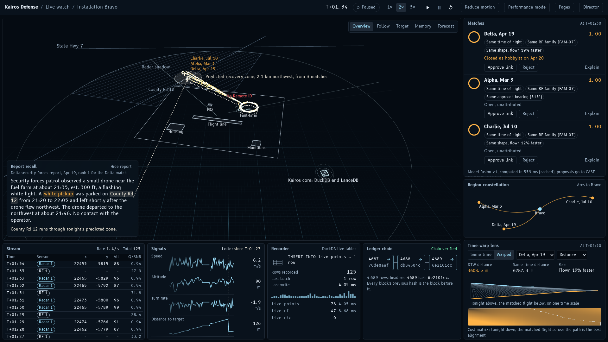

Live watch is the operator's screen. It has three regions.

**The live theater** (the 3D scene, center). One unit is one meter; the scene is centered on the
installation. You see the fence as a hairline, the buildings and assets, the roads with their names,
the radar's range ring and sweep, and a hatched wedge labeled "Radar shadow" where a ridge hides the
northwest approach from BRAVO's radar. The live drone is a blue quatrefoil glyph with a heading tick,
a drop line, a ground ring and a fading phosphor trail of its last minute. A small red "No Remote ID"
tag follows a drone that broadcasts no identification. Each radio detection draws its measured bearing
line from the sensor. Each detection sends a packet from the drone to the sensor and on to the Kairos
core (the ringed shape near the edge), which turns a few degrees when a batch is written and stands
still when nothing is.

The matcher first runs at T+45 (45 seconds of track) and then every 5 seconds. Each time it runs,
three amber beams leave the core and the matched past flights appear as amber **afterglow ghosts**
in tonight's frame, labeled with base and date. The **forecast** comes with them: a dotted
bone-white exit path and a pulsing recovery-zone disc labeled, for example, "Predicted recovery
zone, 2.1 km northwest, from 3 matches"; the part of County Rd 12 inside the zone lights up. The
linked report slides in at the lower left with its clues highlighted and a beam to the road it
mentions. (In Director mode the same results are revealed one beat at a time instead: the ghosts
at T+90, the forecast at T+105, the report at T+120. See section 4.)

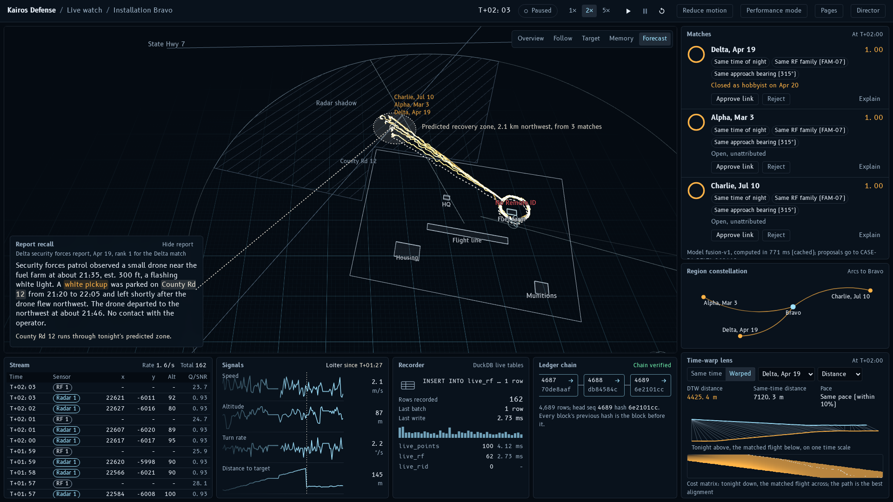

Camera buttons in the theater: Overview, Follow (chase behind the drone), Target (orbit the
targeted asset), Memory (frame the ghosts) and Forecast (frame the zone). Drag to orbit freely when
Director is off.

**The memory rail** (right):

- **Matches**: the best past flights, best first. Each entry shows the base and date, a score ring,
  up to three reasons ("Same time of night", "Same approach bearing" …), the pace relative to tonight
  ("flown 19% faster") when it is clear, what that base concluded at the time ("Closed as hobbyist
  on Apr 20", or "Open, unattributed"), **Approve link** and **Reject** buttons, and **Explain**,
  which opens the Match explainer for that match at the current second. Hovering an entry brightens
  its ghost. A line at the bottom names the model, how long the run took and the case the
  proposals go to, beside the **DTW workbench** button, which replays that rerun's computation in
  slow motion (see [The DTW workbench](#the-dtw-workbench) in section 13).
- **Region constellation**: the bases of tonight's region as points, with arcs from tonight's base
  to the bases of the matched flights: the cross-installation view in one glance.
- **Time-warp lens**: tonight's flight and a matched flight as two curves (choose the match and the
  channel). In **Same time** mode, connectors join equal seconds; switch to **Warped** and the
  connectors morph onto the real DTW alignment, so you see which second of the past flight
  corresponds to which second tonight. Below the curves, the cost matrix with the alignment path
  drawn on, and the DTW and Euclidean distances.

**The instrument rail** (bottom):

- **Stream**: live detection rows, newest first: time, sensor, kind (radar, RF, Remote ID),
  position, altitude, quality or signal strength.
- **Signals**: four lanes (speed, altitude, turn rate, distance to target) with the flight phase
  (approach, loiter, egress) and markers for radar, RF and Remote ID detections.
- **Recorder**: the real writes into the scratch tables: rows per batch, the running total, the
  measured write time and the statement.
- **Ledger chain**: the latest case-memory blocks, each with its sequence number, event type and
  hash, linked to the block before it; it verifies the whole chain on load.

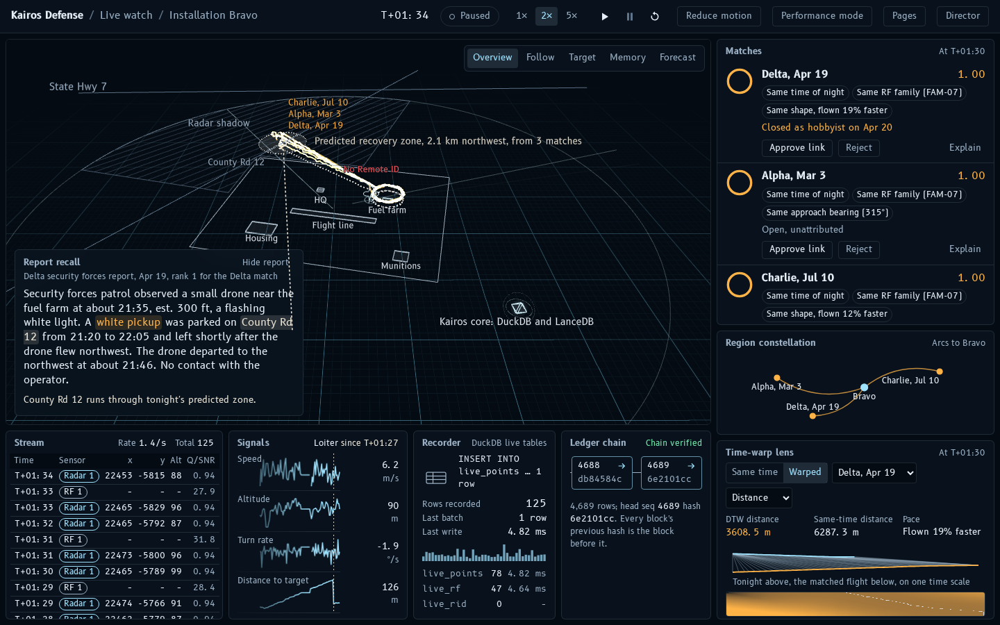

At 1440 × 900 the same layout holds (the lens controls wrap onto two lines and the curves and the
cost matrix shrink to fit); below 1280 px wide the rails stack under the theater.

What you can do here: play, pause, restart and change speed; switch camera; approve or reject a
proposed link (it becomes a ledger event, and the score ring turns green); open the Match explainer;
start Director mode (D).

### Match explainer

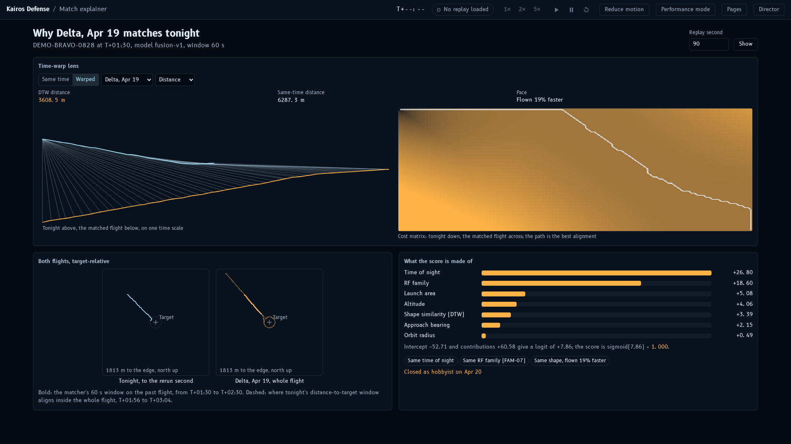

The Match explainer takes one match apart. It shows the time-warp lens full width, both flights side
by side in their target-relative frames (tonight's up to the current second only; the past flight
whole, with the 60-second window the matcher used in bold), and "What the score is made of": one
bar per feature (time of night, RF family, launch area, altitude, shape similarity, approach
bearing, orbit radius), each the trained coefficient times the feature's value, largest first,
then one sentence that adds them up, for example "Intercept −52.71 and contributions +60.58 give a
logit of +7.86; the score is sigmoid(7.86) = 1.000". Screen readers get the same numbers as a table
with each feature's value, coefficient and contribution. Use it to answer "why did this flight rank
first?". Open it from a match's **Explain** link, or from Pages, then type a replay second and press
**Show**. **Watch the matcher work** opens the DTW workbench on the matcher run at that second
(section 13).

### Case board

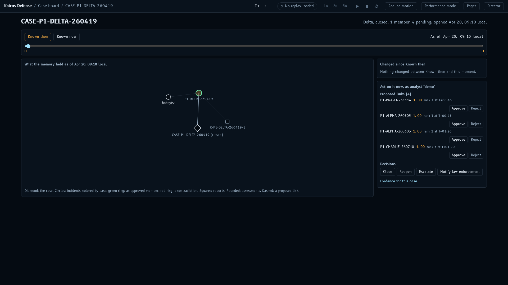

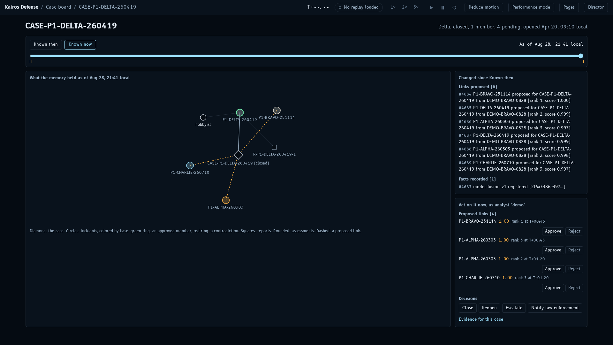

The Case board shows one case (for example `CASE-P1-DELTA-260419`) as the memory knew it at any moment:

- The **as of** scrubber runs from the case's first event to now, with a tick at every change.
  **Known then** jumps to the moment DELTA closed its incident (2026-04-20 09:10 local); **Known now**
  jumps to the head of the ledger.
- The **graph** (force-directed) shows incidents colored by base, reports, assessments and links.
  Nodes appear at the moment they were recorded as you scrub; approved members ring green; a
  contradiction (two active claims that disagree, such as "hobbyist" and "probing") is outlined in red
  and never resolved automatically.
- The **diff** beside it lists what changed between Known then and the scrubbed moment: added
  members, new proposals, new or retracted claims, contradictions, decisions and exports.
- **Act on it now** always acts at the head of the ledger, whatever moment you are viewing:
  **Approve** and **Reject** settle each pending proposal (each shows its score, its rank and the
  replay second that proposed it, so the same flight can appear twice when two runs proposed it);
  the decisions **Close**, **Reopen**, **Escalate** and **Notify law enforcement** each ask for a
  confirmation. **Evidence for this case** opens the Evidence page.

Known then shows the hobbyist assessment, the closed case and no links. Known now shows tonight's
proposals as dashed links to the earlier flights of the same pattern (BRAVO in November 2025, ALPHA
in March, CHARLIE in July) and, once you approve them, those incidents as members of the case.

### Swarm view

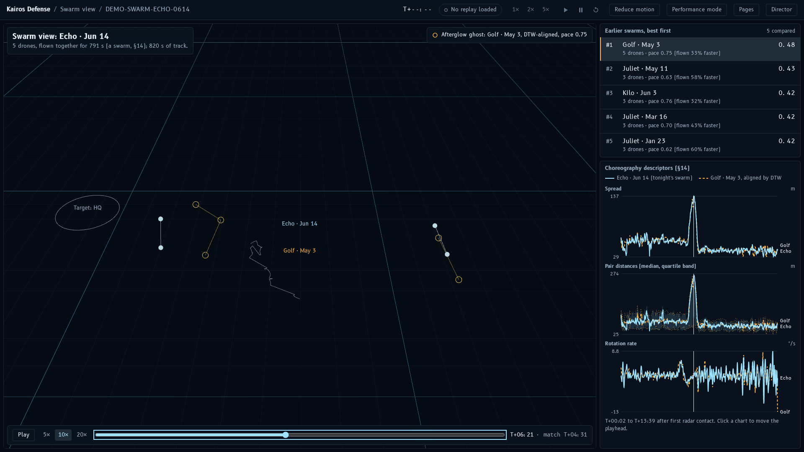

The Swarm view compares a multi-drone swarm with the swarms seen before. The 3D scene shows tonight's
drones in flash blue with formation edges joining each drone to its nearest neighbor, recomputed every
second from the real positions, and the best-matching past swarm as an amber afterglow ghost, placed
on tonight's formation at the second of the past swarm that DTW aligned with tonight's second (the
chip at the top right names it, with its pace). On the right, "Earlier swarms, best first" ranks the
earlier swarms with their similarity, number of drones and pace; click one to compare it instead.
Below the list, the choreography descriptors (spread, the median and quartile band of the distances
between drones, and the rotation rate of the formation's main axis) are drawn for tonight and for
the match, the match resampled onto tonight's seconds through the alignment, with a playhead. Play,
the speeds (5×, 10×, 20×) and the scrubber move through the real recorded seconds; clicking a chart
moves the playhead. The screenshot shows the widest moment of the night, when the formation splits.

For the demo swarm (`DEMO-SWARM-ECHO-0614`, five drones at ECHO on 14 June 2026) the best match is
`S1-GOLF-260503`, five drones at GOLF on 3 May 2026: the same choreography six weeks earlier, in
another region.

### Evidence

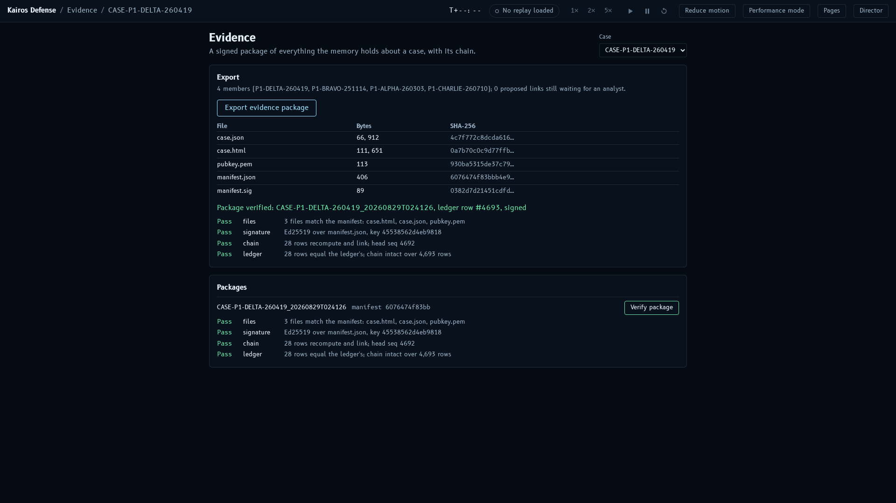

The Evidence page builds a signed evidence package for a case (pick it in the **Case** list). The
first line says who the members are and how many proposed links still wait for an analyst.
**Export evidence package** asks for confirmation (**Approve and export**), then shows real
per-file hashing progress and the checks: file hashes, the Ed25519 signature, chain continuity and
the rows against the ledger. **Packages** lists the packages already exported; **Verify package**
re-runs the checks on one. Section 5 walks through it.

### Shift delta

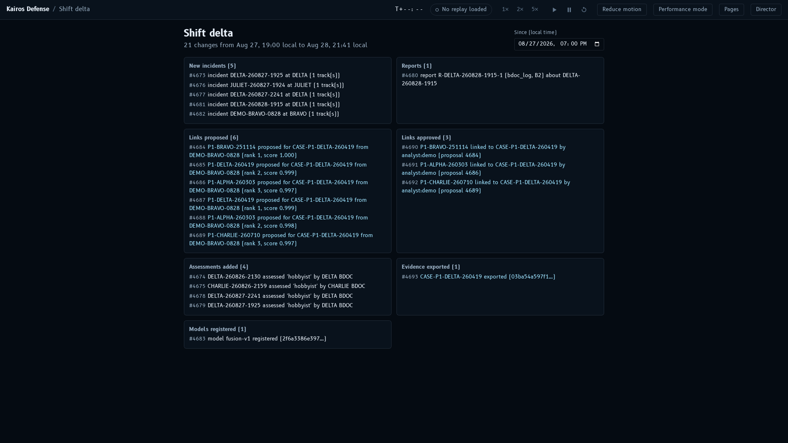

Shift delta lists everything the memory learned since a chosen time (**Since**, in local time),
grouped: new incidents, reports, links proposed, links approved or rejected, assessments added or
retracted, contradictions opened, decisions, evidence exported and models registered. Every item
carries its ledger sequence number, and items about a case link to its node on the Case board. Use
it at a shift change: "what changed since 18:00?".

### Eval

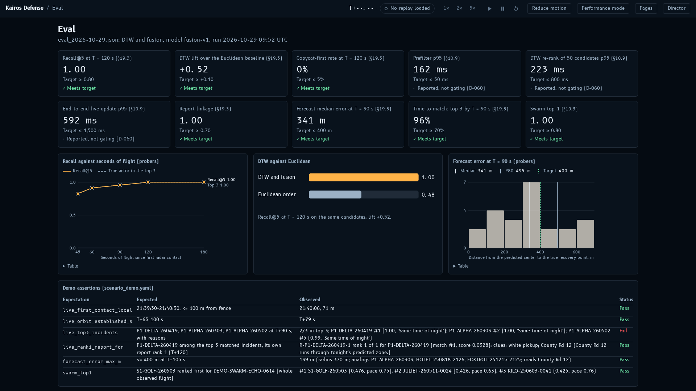

The Eval page shows the latest evaluation: metric tiles against their targets (with a status word and
an icon, not color alone), recall against seconds of flight, DTW against the Euclidean baseline, the
forecast error distribution, and the demo assertions as written by `make eval`, including the one
accepted gap. Section 10 explains each metric.

### Keyboard shortcuts

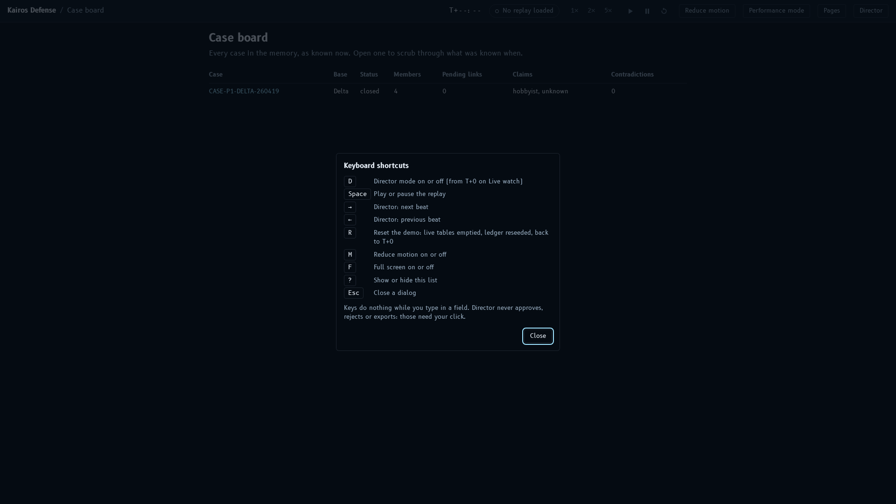

Press **?** on any page for the list. Shortcuts are ignored while you type in a field.

## 4. Running the demo

A narrated two-minute recording of this story is in
[docs/demo/kairos-defense-demo.mp4](demo/kairos-defense-demo.mp4); `make demo-video` records it again
from the running app (on a machine with a GPU, `DEMO_SLOW=1 make demo-video` records in real time).

Director mode plays the demo story one beat at a time, keyed to the replay clock. It sets a camera
shot, dims the panels that do not matter for the beat and shows one plain-language caption at the
bottom center. Every caption is computed from the data on screen, never scripted. A thin rail at the
bottom shows progress through the nine beats.

Start it from Live watch with **D** (or the Director button). Keys:

| Key | Action |
|---|---|
| D | Director on or off |
| Space | Play or pause the replay clock |
| → / ← | Next or previous beat; page beats (Case board, Evidence, Swarm view) start only on → |
| R | Reset: empty the live tables, reseed the memory, back to T+0 |
| M | Reduce motion |
| F | Full screen |
| ? | Shortcuts |

The beats, with what each one shows (screenshots from a Director run):

**1. Detection (T+0, 21:40:06 local).** A drone comes out of the radar shadow at BRAVO's north
fence. The first row appears in the Stream; the caption names the first radar contact.

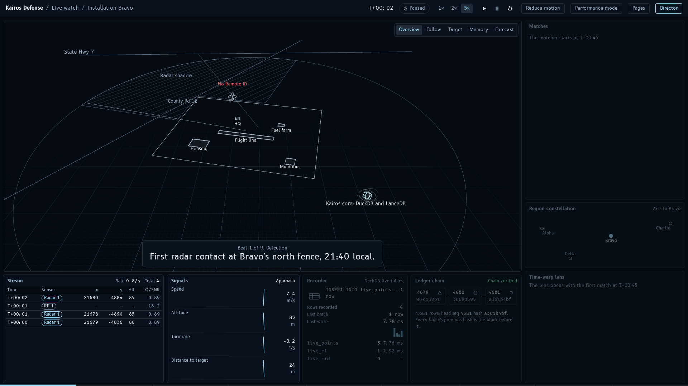

**2. Recording (T+15).** Every detection is written as it arrives: the Recorder's totals and the
Ledger chain grow with real writes.

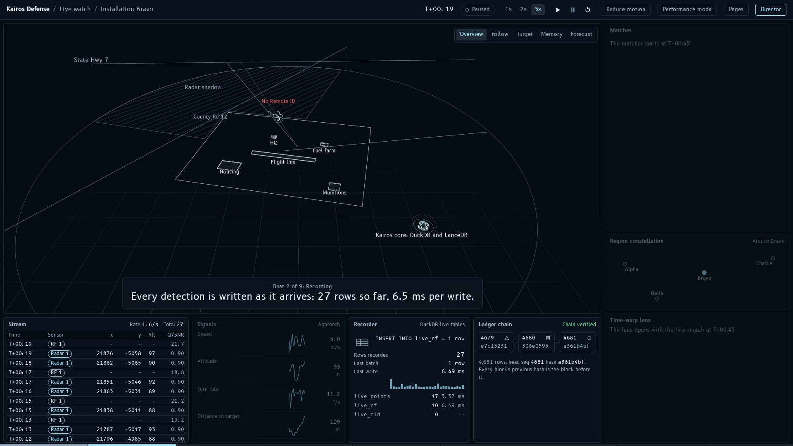

**3. Recognition (T+45).** Forty-five seconds of track is enough to start: the matcher searches
every past flight at every base and the first matches appear. The drone settles into its orbit
around T+80 (the Signals loiter marker).

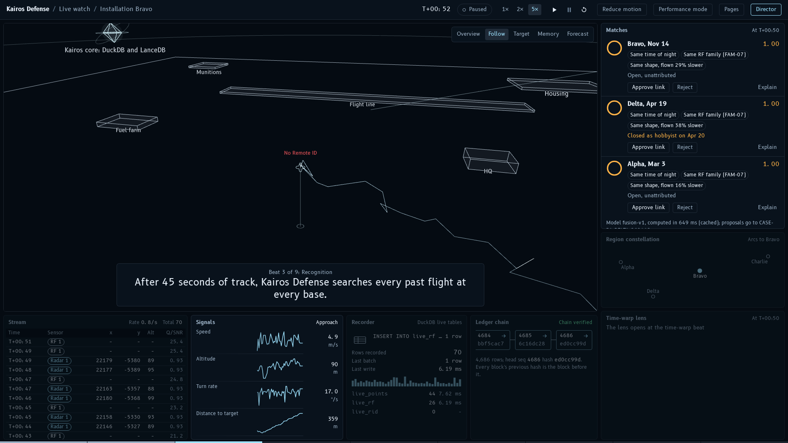

**4. Time warp (T+90).** The camera pulls back; three amber ghosts of the matched past flights
appear in tonight's frame; the region constellation draws its arcs; the time-warp lens holds "Same
time" for a moment, then its connectors morph onto the real DTW alignment. The caption says how the
shapes line up ("the same shape, flown faster").

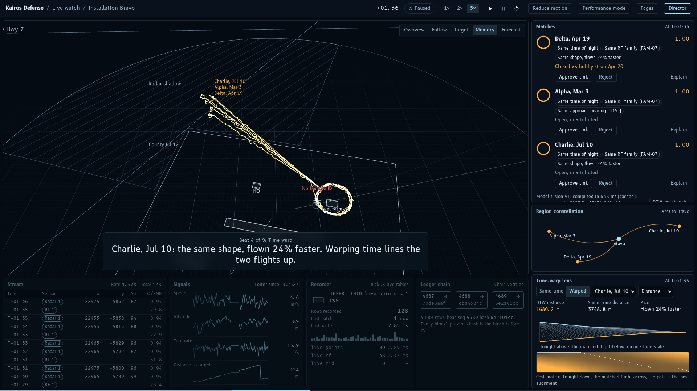

**5. Forecast (T+105).** The dotted exit path and the pulsing recovery zone appear, labeled with
the computed distance and direction ("Predicted recovery zone, 2.1 km northwest, from 3 matches");
County Rd 12 lights up where it crosses the zone, and the caption says where those flights ended.
The top 3 can change between beats as the track grows: here a November flight at BRAVO itself has
moved up, and its ghost ends elsewhere.

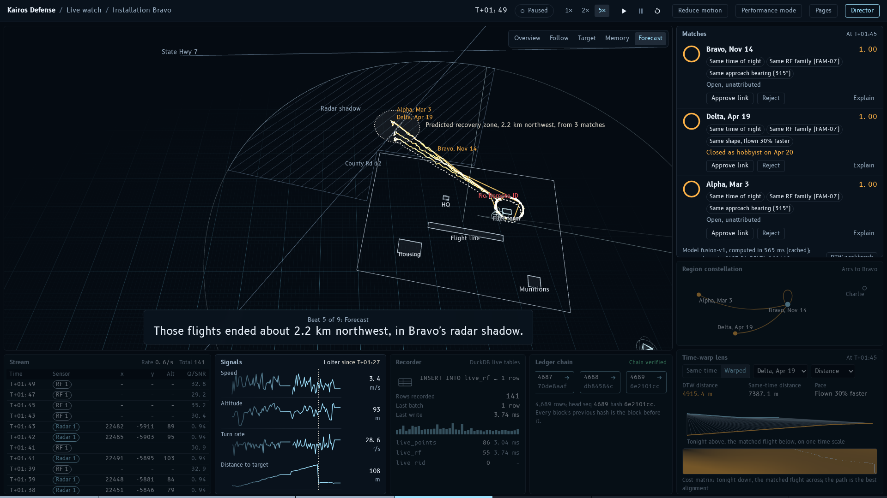

**6. Recall (T+120).** The April report from DELTA resolves at the left, its clues highlighted
(a white pickup, County Rd 12), with a beam to the road inside tonight's zone.

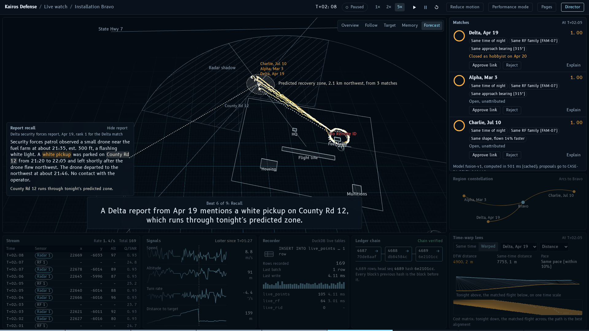

**7. Known then and now (→, Case board).** Known then: DELTA closed its flight as a hobbyist,
with no links. Known now: the matcher's proposals and the diff. Approve the links here (your
clicks).

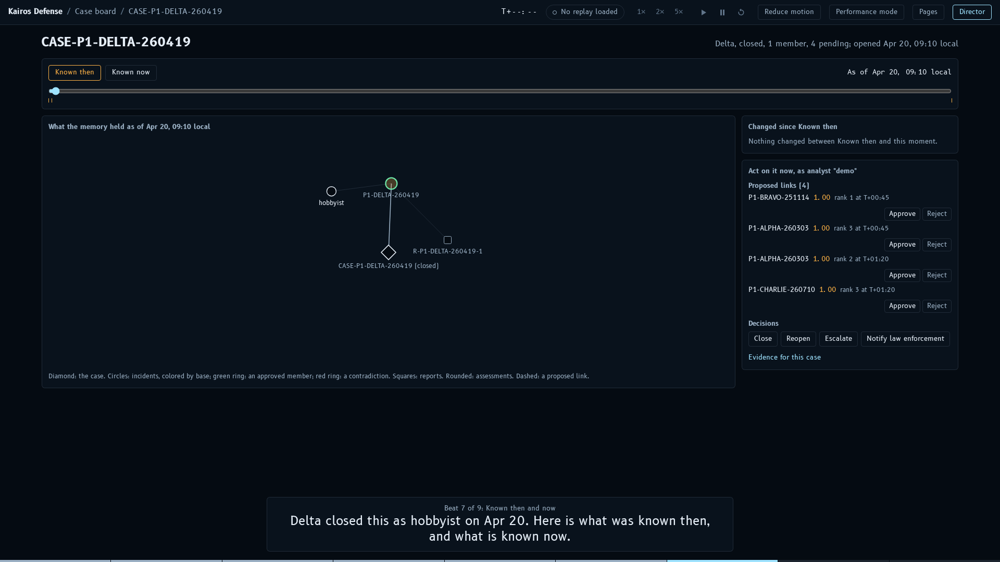

**8. Evidence (→).** Export the evidence package (with its confirmation): per-file hashing, the
signature and chain checks, then Verify package.

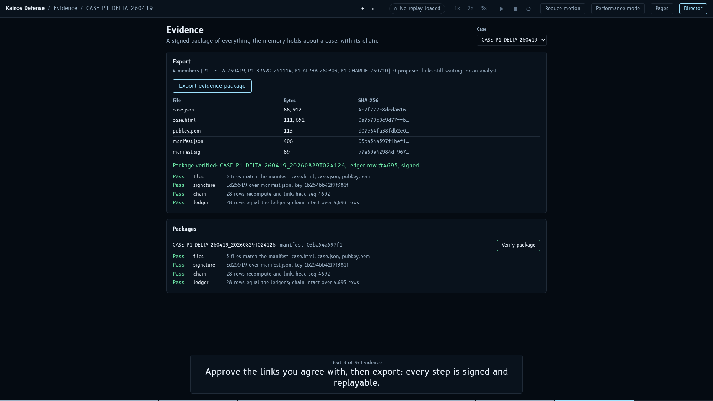

**9. Encore: Swarm view (→).** ECHO's five-drone swarm on 14 June with the GOLF swarm of 3 May as
an afterglow ghost, aligned by DTW time: "Same choreography, six weeks apart, in another region."

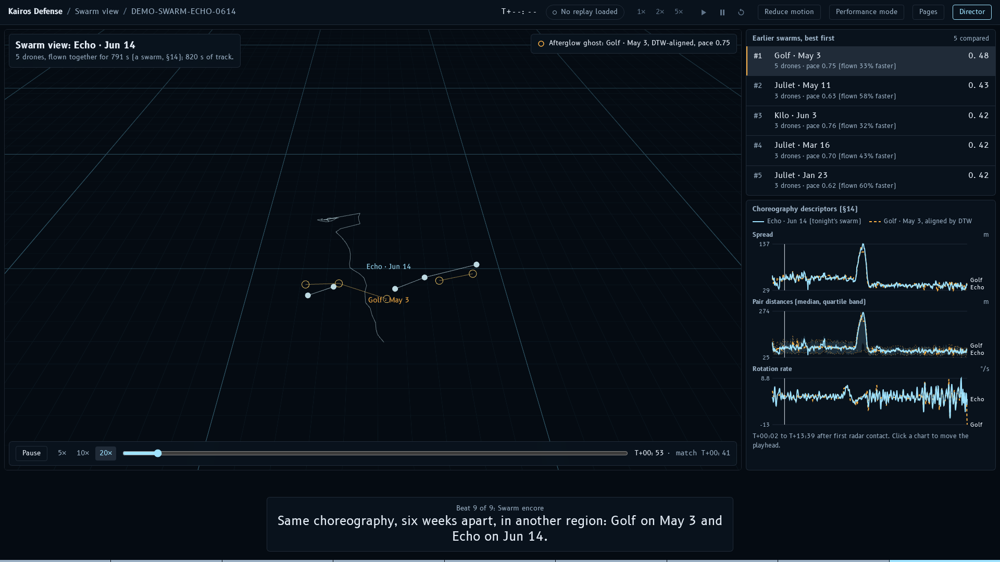

Director never approves, rejects or exports anything by itself: those stay your clicks.

**Reset between runs.** Press R, or from a terminal while `make demo` runs:

```bash
uv run kairos-defense replay --reset     # empties only the live scratch tables
uv run kairos-defense memory reseed      # regenerates the case memory from seed
```

Both go through the running API (DuckDB allows one writing process per file). The full presenter's
script, with what to say at each beat, fallbacks and likely questions, is in `docs/DEMO.md`.

After the replay, the presenter can fly a new flight live and let the app recognize it: see
[13. Live mode](#13-live-mode).

## 5. Approving links and building an evidence package

1. On Live watch, let the replay pass T+90 (or press → to the Time-warp beat). The matcher proposes
   its top matches for the case of the best-ranked incident that already belongs to one (here the
   DELTA case); each proposal is a `match_proposed` event in the ledger.
2. Approve a match with **Approve** in the Matches panel, or open the Case board and approve each
   pending proposal there. Each approval appends a `link_approved` event signed into the chain; the
   incident becomes a member of the case. **Reject** appends a `link_rejected` event instead.
3. Open **Evidence** for the case and press **Export evidence package**, then confirm. The page shows
   each file being hashed, then the checks. The package is a folder
   `exports/<case>_<yyyymmddThhmmss>/` with `case.json` (the snapshot, every ledger row touching the
   case with its hashes, the chain head, the verification result and the model versions), `case.html`
   (a self-contained summary with maps), `manifest.json` (the SHA-256 of every file), and
   `manifest.sig` with `pubkey.pem` (the Ed25519 signature and public key). Exporting appends an
   `evidence_exported` event.
4. **Verify package** re-runs the checks. From a terminal:

```bash
uv run kairos-defense export --case CASE-P1-DELTA-260419 --approve
uv run kairos-defense verify-evidence exports/CASE-P1-DELTA-260419_<time>
```

`verify-evidence` prints a PASS, FAIL or SKIP table (file hashes, signature, chain continuity, the
rows against the ledger) and exits 1 on any FAIL. Change one byte in the package and it fails. Without
`--approve`, `export` exits 1 and writes nothing.

## 6. Command-line reference

Every command is `uv run kairos-defense <command>`; `--help` on any of them lists its options, and
every command takes `--config` (the folder with the five YAML files, `config` by default). Times
take an ISO 8601 form with `Z` or an offset (for example `2026-04-20T10:00-05:00`), because the three
synthetic regions are in different time zones. Commands that fail for a reason you can fix exit 1
with the command that fixes it ("no index: run `make index`").

| Command | What it does | Main options |
|---|---|---|
| `kairos-defense gen` | Generates the synthetic world, flights, swarms, sensors, paperwork and truth (`make data`) | `--seed`, `--figures/--no-figures` |
| `kairos-defense index` | Builds features, signatures, search windows, swarm descriptors and the report index (`make index`) | |
| `kairos-defense models` | Trains the fusion model and calibrates DTW from history (`make models`) | |
| `kairos-defense eval` | Runs the evaluation and writes `reports/eval_<date>.md` and `.json` (`make eval`) | `--baseline`, `--method dtw/euclidean` |
| `kairos-defense match` | Matches an incident's track, seen T seconds in, against every earlier track | `--incident`, `--at`, `--track`, `--top`, `--method` |
| `kairos-defense forecast` | Forecasts the recovery zone from the matched flights | `--incident`, `--at`, `--track`, `--method` |
| `kairos-defense recall` | Retrieves the reports of the matched incidents, with clues | `--incident`, `--at`, `--matches`, `--k`, `--query` |
| `kairos-defense swarm` | Ranks earlier swarms against a swarm incident by choreography | `--incident`, `--at`, `--k` |
| `kairos-defense memory` | The case memory: `seed`, `reseed`, `verify`, `show`, `delta`, `demo` | see below |
| `kairos-defense export` | Exports a signed evidence package for a case | `--case`, `--approve` (required), `--analyst`, `--at`, `--ledger`, `--out` |
| `kairos-defense verify-evidence` | Verifies an evidence package | folder, `--ledger`, `--pubkey` |
| `kairos-defense api` | Serves the REST API, the replay stream and (with `--static`) the web app | `--host`, `--port`, `--static`, `--reload`, `--dump-openapi`, `--memory`, `--live-db`, `--exports`, `--reseed`, `--time-scale` (slow-motion replays for screen capture) |
| `kairos-defense replay` | Lists the live replays, precomputes their results, or resets the live tables | `--incident`, `--precompute`, `--force`, `--reset`, `--api` |
| `kairos-defense simulate` | Live mode: flies one scenario and streams its sensor detections to the app (see [13. Live mode](#13-live-mode)) | `--scenario`, `--base`, `--actor`, `--second-base`, `--speed`, `--seed`, `--url`, `--dry-run`, `--show-actor` |
| `kairos-defense live` | Live mode: `check`, `reset`, `status` | see below |
| `kairos-defense mcp` | Runs the MCP server over stdio | `--allow-proposals`, `--agent`, `--memory`, `--api` |
| `kairos-defense fetch-models` | Downloads the optional embedding model (the only command that downloads) | `--model` |

The `memory` subcommands:

| Command | What it does |
|---|---|
| `kairos-defense memory seed` | Seeds an empty ledger with 18 months of history |
| `kairos-defense memory reseed` | Rebuilds the ledger from seed (through the API while it runs) |
| `kairos-defense memory verify` | Recomputes the hash chain: "chain intact: N rows" or "chain broken at seq N" |
| `kairos-defense memory show` | A case as known at a time: `memory show CASE --as-of TS` |
| `kairos-defense memory delta` | The shift delta: `memory delta --since TS [--until TS] [--installation ID]` |
| `kairos-defense memory demo` | Known then and known now side by side, on a scratch copy (`--approve` links the top 3) |

The `live` subcommands (live mode, phase 11):

| Command | What it does |
|---|---|
| `kairos-defense live check` | Flies every scenario headless against an in-process API and scores it: one `PASS` or `GAP` line per scenario (`--scenarios`, `--speed`, `--timeout`) |
| `kairos-defense live reset` | Removes every live-mode row (detections, live incidents, learned live history, vectors); the history and the ledger stay |
| `kairos-defense live status` | Lists the live incidents since the last reset and the learned live tracks |

### Examples (real output, trimmed)

Every example below is this build's output in the cloud container that built it, trimmed to the
interesting rows (`│` marks a table row; long rows are cut and their padding shortened).

Build the data, the indexes, the models and the evaluation (`make data index models eval` runs
these four with the seed from `config/world.yaml`):

```text
$ uv run kairos-defense gen --seed 42
│ incidents              │    1,878 │            ≈1,900 │
│ swarm incidents        │        9 │                   │
│ live first contact     │ 21:40:06 │ 21:39:30-21:40:30 │
│ live orbit established │   T+79 s │        T+65-100 s │
│ elapsed                │   26.0 s │                   │
$ uv run kairos-defense index
│ history tracks indexed             │                              1,898 │
│ flight_windows 60 s                │                             57,462 │
│ swarm incidents indexed (detected) │   8 (8); swarm_features rows 4,636 │
wrote track_features, track_signatures and report_clues to /home/user/kairos-defence/data/kairos_defense.duckdb, flight_windows and reports to /home/user/kairos-defence/data/lancedb
$ uv run kairos-defense models
│ training queries                        │                       62 │
│ training pairs (same actor)             │          123,404 (1,128) │
│ τ (median same-actor d_norm)            │                   2.2265 │
│ coefficient shape_sim                   │                   +6.756 │
│ coefficient tod_sim                     │                  +26.799 │
│ intercept                               │                  -52.713 │
│ validation ROC AUC                      │                    0.998 │
│ validation Recall@5 T=120 s (probers)   │                    1.000 │
│ training hash                           │         22a4da9f93943ca8 │
wrote /home/user/kairos-defence/models/fusion_v1.json and /home/user/kairos-defence/models/dtw_calibration.json
$ uv run kairos-defense eval
│ Recall@5 at T=120 s                       │                     1.000 │
│ DTW lift                                  │                     0.522 │
│ time to match (top 3 by T=90 s)           │                       96% │
│ report linkage (T=120 s, top 3, k=5)      │          1.000 (65 of 65) │
│ forecast error T=90 s median / P80        │               341 / 495 m │
│ swarm top-1, whole flight (4 answerable)  │                     1.000 │
│ demo live_top3_incidents                  │  fail: 2/3 in top 3; …    │
demo assertion failed: live_top3_incidents (2/3 in top 3; …)
```

The last line and exit code 1 are the accepted gap (section 10). Serve the app (what `make demo`
runs, here on the port and scratch files the end-to-end tests use):

```text
$ uv run kairos-defense api --static web/dist --port 8765 --memory data/cache/e2e/memory.duckdb --live-db data/cache/e2e/live.duckdb --exports data/cache/e2e/exports --reseed
Kairos Defense API on http://127.0.0.1:8765 serving web/dist
INFO:     Application startup complete.
INFO:     Uvicorn running on http://127.0.0.1:8765 (Press CTRL+C to quit)
```

Match the live incident at T+90 (`match` prints the ranked past flights with their reasons):

```text
$ uv run kairos-defense match --incident DEMO-BRAVO-0828 --at 90 --top 3
query DEMO-BRAVO-0828-T1 at T+90 s · 91 s seen · window 60 s (60 s used) · target BRAVO-fuel_farm
dtw matches for DEMO-BRAVO-0828
 # │ track                │ base    │ start (local)    │ score │ shape │ warp │ reasons
 1 │ P1-DELTA-260419-T1   │ DELTA   │ 2026-04-19 21:35 │ 1.000 │ 0.502 │ 0.84 │ Same time of night; Same RF family (FAM-07); Same shape, flown 19% faster
 2 │ P1-ALPHA-260303-T1   │ ALPHA   │ 2026-03-03 21:52 │ 0.999 │ 0.511 │ 1.03 │ Same time of night; Same RF family (FAM-07); Same approach bearing (315°)
 3 │ P1-CHARLIE-260710-T1 │ CHARLIE │ 2026-07-10 21:30 │ 0.997 │ 0.459 │ 0.90 │ Same time of night; Same RF family (FAM-07); Same shape, flown 12% faster
```

Forecast the recovery zone at T+105:

```text
$ uv run kairos-defense forecast --incident DEMO-BRAVO-0828 --at 105
query DEMO-BRAVO-0828-T1 at T+105 s · target BRAVO-fuel_farm · method dtw · 500 candidates
center (21,253, -4,178) m region frame · 2,164 m at 320° (northwest) of BRAVO-fuel_farm · radius 370 m
roads crossing the zone: County Rd 12
```

Recall the reports behind the best match at T+120:

```text
$ uv run kairos-defense recall --incident DEMO-BRAVO-0828 --at 120 --matches 1
match #1 P1-DELTA-260419 (score 1.000)
 1 │ R-P1-DELTA-260419-1 │ security_forces │ B2 │ 2026-04-19 21:35 │ Security forces patrol observed a small
   drone near the fuel farm at about 21:35 … A white pickup was parked on County Rd 12 from 21:20 to 22:05 …
  link: County Rd 12 runs through tonight's predicted zone.
```

Rank the earlier swarms against the demo swarm:

```text
$ uv run kairos-defense swarm --incident DEMO-SWARM-ECHO-0614
kairos-defense swarm · DEMO-SWARM-ECHO-0614 · 5 drones · 812 s described · detected yes (together 791 s)
 # │ Incident           │ Base   │ Start (UTC)      │ Drones │ Similarity │ Distance │ Pace
 1 │ S1-GOLF-260503     │ GOLF   │ 2026-05-04 05:10 │      5 │      0.476 │    1.101 │ 0.75
 2 │ JULIET-260511-0024 │ JULIET │ 2026-05-11 07:25 │      3 │      0.426 │    1.345 │ 0.63
```

The case memory: seed an empty ledger (here a scratch one, through a copy of `config/` whose
`paths.memory` points at it; the scratch folder's long path is shortened to `/tmp/scratch`), or
rebuild the real one from seed:

```text
$ uv run kairos-defense memory seed --config /tmp/scratch/cfg-seed
kairos-defense memory seed → /tmp/scratch/seed-memory.duckdb
│ incident_recorded           │                    1,866 │
│ report_recorded             │                      949 │
│ assessment_asserted         │                    1,864 │
│ rows                        │                    4,681 │
│ cutoff (live first contact) │     2026-08-29 02:40:06Z │
│ head                        │ seq 4,681 a361b4bfe3b24… │
$ uv run kairos-defense memory reseed
kairos-defense memory reseed → /home/user/kairos-defence/data/memory.duckdb (verified)
│ rows                        │                    4,681 │
│ head                        │ seq 4,681 a361b4bfe3b24… │
│ elapsed                     │                   0.99 s │
```

Known then and known now side by side, on a scratch copy (the real ledger is untouched; the two
tables are reflowed to fit):

```text
$ uv run kairos-defense memory demo
query DEMO-BRAVO-0828-T1 at T+90 s · model fusion-v1 · real top 3: P1-DELTA-260419 1.000, P1-ALPHA-260303 0.999, P1-CHARLIE-260710 0.997
CASE-P1-DELTA-260419: known then and known now
│ item              │ known then 2026-04-20 09:10 local │ known now 2026-08-28 21:41 local    │
│ status            │ closed                            │ closed                              │
│ links             │ none                              │ none                                │
│ pending proposals │ none                              │ P1-ALPHA-260303 (rank 2, score 0.999, seq 4685) │
│                   │                                   │ P1-CHARLIE-260710 (rank 3, score 0.997, seq 4686) │
│ assessments       │ hobbyist (DELTA BDOC, seq 3569)   │ hobbyist (DELTA BDOC, seq 3569)     │
3 proposals pending (rerun with --approve to link them); scratch ledger /home/user/kairos-defence/data/cache/memory_demo.duckdb (4,686 rows, chain intact); /home/user/kairos-defence/data/memory.duckdb is unchanged
```

Verify the chain, then show the DELTA case as known on the morning DELTA closed it:

```text
$ uv run kairos-defense memory verify
chain intact: 4,681 rows in data/memory.duckdb, head seq 4,681 hash a361b4bf… recorded 2026-08-29 00:33:38Z
$ uv run kairos-defense memory show CASE-P1-DELTA-260419 --as-of 2026-04-20T10:00-05:00
CASE-P1-DELTA-260419 as known at 2026-04-20 10:00 local (15:00Z)
 status            │ closed
 members           │ 1: P1-DELTA-260419
 links             │ none
 assessments       │ hobbyist (DELTA BDOC, seq 3569)
 decisions         │ close: assessed hobbyist (2026-04-20 09:10 local (14:10Z))
 reports           │ R-P1-DELTA-260419-1 (security_forces, B2)
$ uv run kairos-defense memory delta --since 2026-08-28T00:00Z
shift delta all bases (UTC): 9 items, head seq 4681
 incidents         │ 4673 │ 2026-08-28 00:35Z │ incident DELTA-260827-1925 at DELTA (1 track(s))
 assessments_added │ 4674 │ 2026-08-28 00:55Z │ DELTA-260826-2130 assessed 'hobbyist' by DELTA BDOC
 …
```

Export and verify an evidence package:

```text
$ uv run kairos-defense export --case CASE-P1-DELTA-260419 --approve
exported exports/CASE-P1-DELTA-260419_20260829T003338/ · manifest sha256 adec79f8… · signed, key c63fcf44…
· records head seq 4,681 · appended evidence_exported seq 4,682
$ uv run kairos-defense verify-evidence exports/CASE-P1-DELTA-260419_20260829T003338/
 files     │ PASS │ 3 files match the manifest: case.html, case.json, pubkey.pem
 signature │ PASS │ Ed25519 over manifest.json, key c63fcf448ac7491c
 chain     │ PASS │ 5 rows recompute and link; head seq 4681
 ledger    │ PASS │ 5 rows equal the ledger's; chain intact over 4,682 rows
PASS: the package verifies
```

The live replays and their cache:

```text
$ uv run kairos-defense replay
 Incident             │ Base  │ Duration │ Detections │ Reruns │ Cached │ Precompute
 DEMO-BRAVO-0828      │ BRAVO │    515 s │        696 │     95 │  95/95 │
 DEMO-SWARM-ECHO-0614 │ ECHO  │    830 s │      5,311 │      - │      - │ detections only: swarm matching in `swarm` and the Swarm view
```

And the one command that downloads, without its optional extra installed:

```text
$ uv run kairos-defense fetch-models
EmbedderUnavailable: the fastembed package is not installed: run `uv sync --extra fastembed`, then
`kairos-defense fetch-models`, or set embeddings.provider: hashing
```

### Live-mode commands

Besides the replay, Kairos Defense runs live: a separate simulator process flies new, never-seen
flights on a live calendar after the 18-month history and streams only sensor detections into the
app (`/ws/ingest`, the contract a real sensor adapter would implement). The app forms incidents
itself, reruns the matcher, forecast and report recall every 5 s of feed time on what it has
received, learns each closed incident so the next live flight can match it, and records incidents
and proposals in the case memory. `make live` serves the web app for the Live page;
`kairos-defense simulate --scenario returning-prober --speed 20` flies a known prober again, and
`kairos-defense live check` scores all five scenarios (returning prober, copycat, hobbyist, swarm
repeat, new operator twice). The walkthrough, with screenshots, the ingest contract and the DTW
workbench, is section [13. Live mode](#13-live-mode).

## 7. Agent tools and the MCP server

Kairos Defense exposes its capabilities as tools an AI agent can call, through the Model Context
Protocol (MCP), a standard way for agents to use tools.

```bash
make mcp                                   # the MCP server over stdio
claude mcp add kairos-defense -- uv run kairos-defense mcp     # register it in Claude Code
```

### The tools

| Tool | Arguments | Returns | Writes |
|---|---|---|---|
| `find_similar_flights` | `incident_id`, `window_s` (seconds after first contact, default 120), `k` (5) | Past flights with scores, reasons and pace; only flights that started earlier are searched | No |
| `recall_reports` | `incident_id`, `match_incident_id`, `query` (optional keywords), `k` (5), `at_s` (120) | The matched incident's reports with scores and clue links | No |
| `forecast_recovery` | `incident_id`, `at_s` (default 105) | Recovery-zone center, radius, exit path and the roads crossing the zone | No |
| `as_of_view` | `case_id`, `as_of_ts` | The case as known at that time | No |
| `diff_case` | `case_id`, `t1`, `t2` | What changed in the case between two times | No |
| `shift_delta` | `since_ts`, `installation_id` (optional) | Everything learned since a time, grouped | No |
| `propose_link` | `case_id`, `incident_id`, `rationale` | The proposal's ledger sequence number | One `match_proposed` event |
| `propose_evidence_export` | `case_id` | A proposal id and the human step that would export | Nothing |

The server is **read-only by default**: it registers the six read-only tools. Start it with
`uv run kairos-defense mcp --allow-proposals` to add the two proposal tools. Even then the agent only
proposes: `propose_link` appends a `match_proposed` event signed `agent:mcp`, which an analyst
approves or rejects on the Case board like any matcher proposal; `propose_evidence_export` changes
nothing and tells you the command or button a person must use (`kairos-defense export --case …
--approve`, or **Export evidence package** on the Evidence page). Times need `Z` or an offset. Tool
results are plain JSON.

While `make demo` runs, the API holds the case-memory file (DuckDB allows one writer per file), so the
memory tools read through the API's REST endpoints instead; with no API running they open the file
themselves.

To check a server by hand (this lists the tools and exits):

```text
$ timeout 120 uv run python -m kairos_defense.agent.probe -- make mcp
find_similar_flights
recall_reports
forecast_recovery
as_of_view
diff_case
shift_delta
6 tools from `make mcp`
```

Example questions for an agent: "Which past flights look like DEMO-BRAVO-0828 two minutes in?",
"What did CASE-P1-DELTA-260419 look like on 2026-04-20 at 10:00 local?", "What changed at DELTA since
yesterday 18:00?".

### The optional chat panel

The web app can host a chat slide-over that answers questions with the same read-only tools. It is
hidden by default (`llm.provider: none`). To turn it on, set `llm.provider` in `config/app.yaml` to
`anthropic`, `openai` or `ollama` (an OpenAI-compatible server at `llm.base_url`), optionally
`llm.model`, and put the key in the environment (`ANTHROPIC_API_KEY` or `OPENAI_API_KEY`), then
restart the API. An **Ask** button appears in the command bar. The assistant answers only from tool
results and cites incident, report and ledger ids; it links flights, never people; it never claims
an identity; it says "unknown" when the evidence is missing; and it cannot propose or commit
anything. This is the only feature that calls out to a network service, and only when you configure
it.

## 8. Configuration

All configuration lives in five YAML files in `config/`, validated on load (a bad value stops the
command with a readable message).

| File | What it holds | Settings people change |
|---|---|---|
| `app.yaml` | Paths, embeddings, the optional LLM, signing, replay | `llm.provider` and `llm.model` (turn the chat panel on), `embeddings.provider` (`hashing` offline default, or `fastembed` after `fetch-models`), `replay.default_speed` |
| `world.yaml` | Regions, installations, assets, roads, parks, sensors, the global seed | the seed (then rerun `make data index models eval`) |
| `actors.yaml` | The synthetic actors: probers, copycats, swarm teams and their choreography | rarely; any change needs `make data` |
| `scenario_demo.yaml` | The planted demo flights, the live incidents and the expectations `make eval` asserts | rarely |
| `scoring.yaml` | Features, windows, prefilter, DTW, fusion, live reruns, recall, forecast and swarm settings | `live.rerun_every_s`, `recall.k`, `forecast.top_k`; anything under `windows` or `features` needs `make index`, anything under `dtw` or `fusion` needs `make models` |

Keys for an LLM provider come from environment variables only (`ANTHROPIC_API_KEY`,
`OPENAI_API_KEY`), never from these files.

## 9. Data, guardrails and truth isolation

- **Synthetic only.** The generator invents the installations, coordinates, flights, reports and
  actors; report text uses a fixed lexicon with no names, plates, faces or addresses, and a test
  scans for them.
- **Flights, not people.** Nothing infers, stores or displays a person's identity. Links join
  flights to flights and flights to reports.
- **Humans decide.** The matcher and the agent propose; only an analyst's click or a command with
  `--approve` commits a link, a decision or an export.
- **No look-ahead.** Every search for past flights or reports only considers records that started
  before tonight's flight started, and tests enforce it for every matcher.
- **Truth isolation.** The generator also writes the ground truth (which actor flew which track,
  where each drone really landed) to a separate file, `data/truth.duckdb`. Only the evaluation reads
  it; the matcher, the memory, the UI and the agent never open it, and a test fails if any other
  code mentions it.
- **Append-only memory.** Ledger rows are never updated or deleted; corrections are new events that
  supersede old ones, and every row is hash-chained to the one before.
- **Offline by default.** No network calls at runtime; fonts are bundled; the 3D shapes are
  procedural. The optional embedding model and LLM providers are off unless you configure them.
- **Real deployments are out of scope.** Real counter-drone data falls under 10 U.S.C. 130i privacy
  and retention rules and needs counsel review.

## 10. Evaluation

`make eval` (`kairos-defense eval`) measures the system on the synthetic history with the ground
truth, which only the evaluation may read. For every query flight it simulates live detection at
T = 30, 45, 60, 90, 120 and 180 seconds after the first radar point, searching only flights that
started earlier (at T = 30 the track is still shorter than the 45 seconds the matcher needs, so the
recall chart starts at 45). A query whose actor never flew before cannot be answered and is counted
apart.

| Metric | What it means | Target | This build |
|---|---|---|---|
| Recall@5 | A flight by the same actor is in the top 5 at T = 120 s (probers) | ≥ 0.80 | 1.000 |
| MRR | Mean reciprocal rank of the first same-actor flight at T = 120 s | report only | 1.000 |
| Time to match | Share of prober queries with a same-actor flight in the top 3 by T = 90 s | ≥ 70% | 96% |
| Copycat-first rate | Share of queries where a copycat outranks every true match | ≤ 5% | 0% |
| DTW lift | Recall@5 with DTW and fusion minus Recall@5 of the plain Euclidean baseline | ≥ +0.10 | +0.52 |
| Report linkage | Share of the true clue-bearing reports of matched incidents found in the top 5 | ≥ 0.70 | 1.000 |
| Forecast error | Median distance from the predicted center to the true recovery point at T = 90 s | ≤ 400 m | 341 m |
| Swarm top-1 | The right swarm team ranked first (whole observed flight) | ≥ 0.80 | 1.000 (4 of 4) |
| Latency | Prefilter, DTW re-rank of 50 candidates and end-to-end time per live update, p95 | report only | 162 ms, 223 ms, 592 ms |
| Demo assertions | Every expectation in `config/scenario_demo.yaml` | all pass | all but one (below) |

Latency depends on the machine: the numbers above come from the cloud container that built this
release (4 virtual CPUs, no GPU); the targets (50 ms, 800 ms and 1,500 ms) are reported against, not
enforced.

The one demo assertion that does not pass is accepted (`docs/phases/phase-04/GAPS.md`): at T+90 the
live top 3 is DELTA, ALPHA 2026-03-03 and CHARLIE 2026-07-10 (all the same synthetic actor), and ALPHA
2026-05-02 ranks fifth instead of third. The captions and the lens always show what the matcher
computes.

Outputs: `reports/eval_<date>.md` (tables and the recall chart in `reports/figures/`) and
`reports/eval_<date>.json` (every metric, every outcome, the targets). The Eval page reads the JSON.
`kairos-defense eval --baseline` writes `reports/baseline.json`; later runs exit 1 if an accuracy
metric worsens by more than 5% (latency by more than 50%) or a demo assertion fails, which is why
`make eval` exits 1 on the accepted gap. To rerun: `make eval`; from scratch:
`make clean data index models eval`.

## 11. Troubleshooting

| Problem | What you see | Fix |
|---|---|---|
| Port 8000 in use | `make demo` fails with "address already in use" | Stop the other server (`lsof -i :8000`), or run `uv run kairos-defense api --static web/dist --port 8001` |
| No data | "no data: data/kairos_defense.duckdb is missing; run `make data`" | `make data index models` |
| Stale or missing index | "index is stale: run `make index`", or `swarm_windows is missing` | `make index` (then `make models` if the window settings changed) |
| Missing models | "ModelError … run `make models`" | `make models` |
| The database is busy | "… is in use by a writing process" or "the API holds the ledger" | DuckDB allows one writer per file: stop `make index`/`make demo`, or let `replay --reset` and `memory reseed` go through the running API |
| Stale replay cache | Director waits at a beat, or `kairos-defense replay` shows "stale" | `uv run kairos-defense replay --precompute --force` (`make demo` refreshes stale entries itself) |
| DTW C extension missing | "dtaidistance's C extension is not available" | Install a C compiler with OpenMP (Linux: gcc; macOS: Xcode tools and `brew install libomp`), then `uv sync --reinstall-package dtaidistance` |
| Node version | npm warns about `engines`, or the build fails | Use Node 22 LTS (`nvm install 22`) |
| Playwright browser missing | `make e2e` fails with "Executable doesn't exist" | `cd web && npx playwright install chromium` (on Linux add `--with-deps`) |
| `make eval` exits 1 | "demo assertion failed: live_top3_incidents …" | Expected: the accepted gap (section 10). `python3 scripts/check_targets.py 9` judges the targets |
| A failed gate | `scripts/cloud_gate.py gate N` exits 2 | Read the gate log it names in `docs/phases/phase-NN/`, fix the cause, commit, rerun |
| Low frame rate | The theater stutters on a projector or a machine without a GPU | Press M (reduce motion) or turn on Performance mode; every number stays |
| Ledger looks wrong after a demo | Extra approvals or exports from a previous run | `uv run kairos-defense memory reseed`, or press R in Director |

## 12. Glossary

Military, security and counter-drone terms (recovery zone, BDOC, source grades, egress …) are in
the [glossary of military and security terms](GLOSSARY.md). The technical terms are below.

| Term | Meaning |
|---|---|
| Afterglow | The amber color of memory: past flights, matches and history |
| ANN | Approximate nearest-neighbor vector search |
| As of | A case shown exactly as the memory knew it at a moment (transaction time) |
| BDOC | Base defense operations center |
| Bitemporal | Recording both when something was true in the world and when the system learned it |
| Copycat | A synthetic actor that mimics another actor's flight shape with different radio and launch habits |
| Director mode | The scripted, beat-by-beat demo (D) |
| DTW | Dynamic time warping: a distance between series that unfold at different speeds |
| ENU | Local east-north-up frame in meters |
| Flash | The blue-white color of live data |
| FTS | Full-text (keyword) search |
| Ghost | A matched past flight drawn in amber in tonight's frame |
| Hybrid search | Vector (meaning) and keyword search fused into one ranking |
| LB_Keogh | A cheap lower bound on DTW, used for pruning |
| Ledger | The append-only, hash-chained case memory |
| MCP | Model Context Protocol: a standard way for AI agents to call tools |
| MRR | Mean reciprocal rank |
| PAA | Piecewise aggregate approximation: averages over equal segments of a series |
| Prober | A synthetic persistent actor with stable habits |
| Remote ID | Broadcast drone identification and operator position |
| RRF | Reciprocal rank fusion |
| Sakoe-Chiba band | A limit on how far DTW may warp |
| Swarm | Several drones flown together as one incident |
| Warp ratio, pace | How fast a matched flight was flown relative to tonight's |

## 13. Live mode

The replay in section 4 plays a recorded night. **Live mode** flies new ones. A separate simulator
process flies a never-seen flight on a live calendar that starts after the 18-month history, and
streams only what sensors would report (radar points, radio detections, Remote ID broadcasts) into
the app. The app knows nothing else: it forms incidents from the detections itself, reruns the
matcher, the forecast and the report recall every 5 seconds of feed time on what it has received so
far, writes incidents and proposed links to the case memory, and, when an incident closes, learns
its flights so the next live flight can match them. Who flew each flight is recorded only in the
ground truth, which the app never reads; after an incident closes you can ask for a reveal
(below). Everything is synthetic, like the rest of the product.

### Start it

```bash
make live          # builds the web app and serves it on :8000
```

Open <http://127.0.0.1:8000/live> (or **Live** under Pages in the command bar). `make demo` serves
the same page next to the replay. Nothing is flying until you launch a scenario.

### The Live page

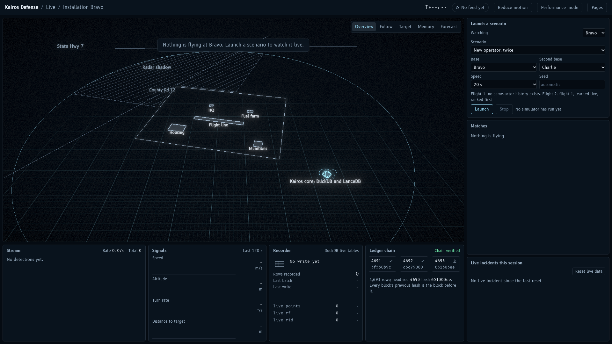

The Live page has the same layout as Live watch: the 3D theater, the memory rail on the right and
the instrument rail at the bottom. The memory rail starts with **Launch a scenario**:

- **Watched installation**: the base whose stream the page shows.
- **Scenario**: one of the five below. Its expectation is printed under the form.
- **Prober**, **Copycat** or **Swarm team** (for the scenarios that have one), **Base** and, for
  "New operator, twice", **Second base** (where flight 2 flies).
- **Speed**: feed seconds per wall second, from 1× (real time) to 50×. 20× flies a 13-minute flight
  in under a minute.
- **Seed**: empty means automatic (derived from the world seed and a launch counter, so the same
  launches give the same flights); type one to repeat a flight.

**Launch** starts the simulator process. The panel then says "Simulator running: returning-prober at
Bravo, 20×, seed …"; the actor is never shown while the flight is live.

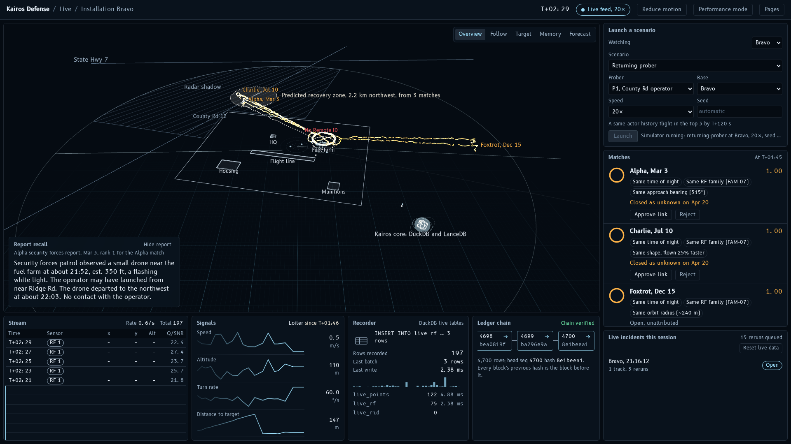

What you see as the flight comes in:

- The first detection opens an **incident** (`LIVE-BRAVO-260901-2100…`): a row in **Incidents** with
  its tracks, its reruns so far and its state (open, closing, closed). The status in the command
  bar reads "Live feed, 20×".
- The theater, the Stream, Signals, Recorder and Ledger chain behave exactly as on Live watch,
  driven by the live stream.
- From 45 seconds of track the **Matches** panel fills, and it updates every 5 seconds of feed
  time. The forecast and the linked report appear as on Live watch. A swarm shows its choreography
  matches instead (the Swarm view's matcher).
- When the feed has been quiet for 30 seconds of feed time, the incident **closes**: its remaining
  reruns run, its flights are learned (they appear in later matches as `LIVE-…` flights with their
  own ghosts), and **Reveal who flew** appears on its row.
- **Stop** (next to Launch, while a simulator runs) ends the flight early and keeps everything:
  the incident closes at once (its last reruns run and it is learned), and **Reveal who flew** works
  on it as on any closed incident. Use it to cut a scenario short without losing it.
- **Reset live data** (in Incidents, behind a confirm) removes every live incident, detection and
  learned flight and stops the simulator. The history and the case memory stay.

### The scenarios and what to expect

| Scenario | Who flies | What the app should do (the expectation) |
|---|---|---|
| Returning prober | A known prober (P1 to P6, or random) at one of its bases | A flight by the same prober in the top 3 by T+120 s |
| Copycat | A copycat (C1, C2) that copies another actor's shape with its own radio and launch habits | A flight by the same copycat in the top 5 by T+120 s, above every flight of the actor it copies |
| Hobbyist | A one-off flyer with no history | No identity to find; the top score is reported |
| Swarm repeat | A known swarm team (S1, S2) | The same team's earlier swarm ranked first |
| New operator, twice | An invented operator with no history flies twice, the second time at the second base | Flight 1: nothing of theirs to find. Flight 2: flight 1, learned live, ranked first |

### Reveal who flew

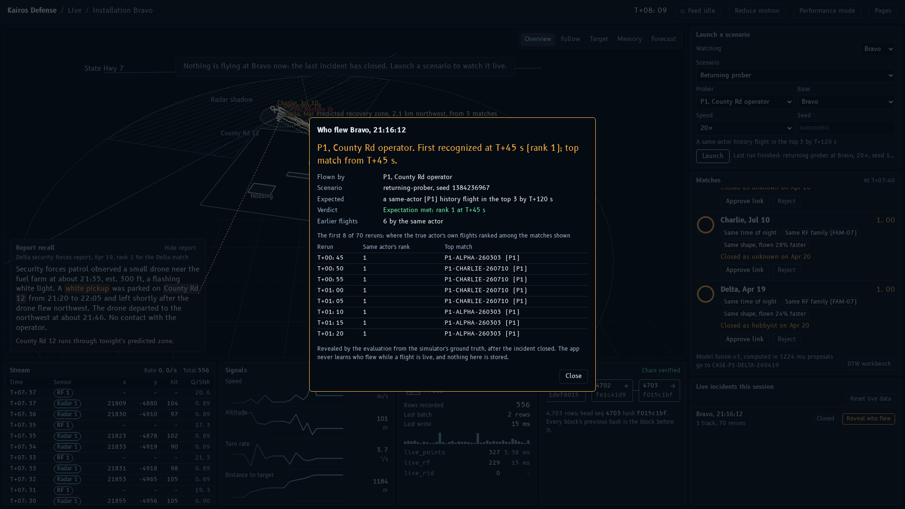

After an incident has closed, **Reveal who flew** shows a card with the actor (for example "P1,
County Rd operator"), the scenario and seed, how many earlier flights by the same actor the history
holds, whether the expectation was met and why, and, for the first reruns, where that actor's own
flights ranked among the matches shown. The reveal is computed
on request by the evaluation code, the only code allowed to read the ground truth; nothing it
shows is stored, and the matcher, the memory and the agents never see it. It is refused while the
incident is still open.

### The DTW workbench

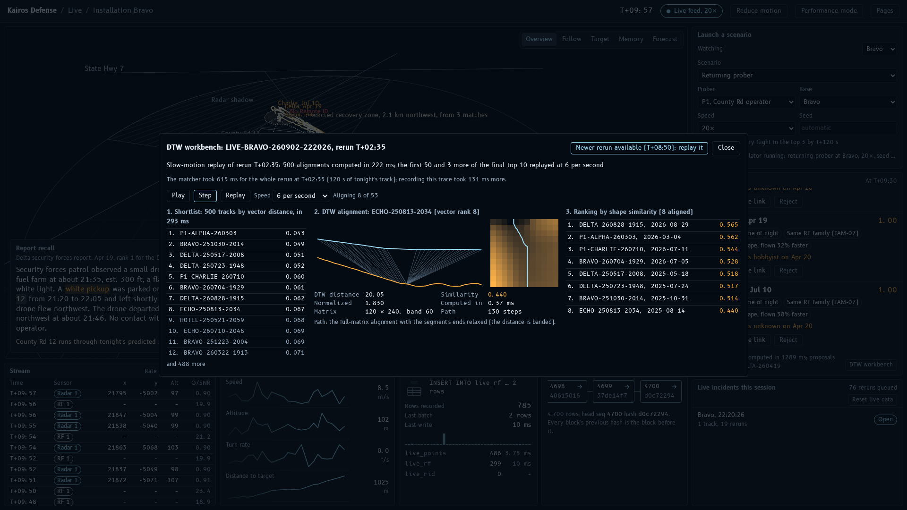

Each matcher run takes a fraction of a second: a vector search shortlists 500 past tracks, dynamic
time warping (DTW) aligns tonight's track with each of them, and a fusion model scores the
shortlist with the other features. The **DTW workbench** replays one run in slow motion from a
record the matcher made while it ran, so every number on it is real. Its header says which run it
replays and how long that run took, for example "Slow-motion replay of rerun T+01:20: 500 alignments
computed in 202 ms; the first 50 and 6 more of the final top 10 replayed at 6 per second" (the
first 50 in the order computed, plus any final top-10 track computed later).

1. **Shortlist**: the past tracks nearest to tonight's in the vector index, with their distances
   (a swarm's drones are told apart by their track, for example `ECHO-260806-2049 T3`).
2. **DTW alignment**: one candidate at a time, tonight's distance to the target (blue) above the
   candidate's (amber), joined along the warping path; the cost matrix with the path drawn on
   ("the full-matrix alignment with the segment's ends relaxed"; the distance itself is computed
   within the band); and a readout: DTW distance, similarity, normalized distance, the time that
   alignment took, the matrix size and band, and the path length.
3. **Ranking**: the aligned candidates by shape similarity, re-sorting as each one lands.
4. **Fusion**: the final top 5 after fusion, with their scores and reasons; they are the Matches
   panel's entries for that run.

Controls: **Pause** or **Play**, **Step** (one candidate), **Replay**, and the speed (3, 6 or 10
candidates per second). With reduced motion (M) it opens on the final state. The workbench keeps
the run it opened with: when a newer run arrives, a **Newer rerun available: replay it** button
appears and nothing changes until you press it.

Open it from **DTW workbench** under the Matches panel (on the Live page and on Live watch: the
latest run) or from **Watch the matcher work** on the Match explainer (the run at that replay
second).

### From the command line

The simulator can also be run by hand against a running app (`make live` or `make demo`):

```bash
uv run kairos-defense simulate --scenario returning-prober --base BRAVO --speed 20
```

`--dry-run` plans and flies the scenario without sending anything (real output):

```text
$ uv run kairos-defense simulate --scenario returning-prober --base BRAVO --seed 7 --dry-run
live scenario returning-prober at BRAVO: seed 7, launch 2026-09-01 21:00:00 local (2026-09-02T02:00:00.000Z), speed 1x; 1 flight(s), 859 detections over 768 s of feed time
dry run: nothing sent, no ground truth written, the clock not moved
```

`kairos-defense live check` flies every scenario headless against its own in-process app and scores
each one (real output, speed 50):

```text
PASS returning-prober: P1 at BRAVO (LIVE-BRAVO-260901-210136, 111 reruns): rank 1 at T+45 s; seed 1101, 83 s
PASS copycat: C1 at BRAVO (LIVE-BRAVO-260902-190008, 91 reruns): at T+120 s: C1 rank 1, P1 rank none; seed 1102, 61 s
PASS hobbyist: H-LIVE-1103 at BRAVO (LIVE-BRAVO-260902-191013, 79 reruns): top match BRAVO-250721-2030 at score 1.0 at T+475 s; seed 1103, 55 s
PASS swarm-repeat: S1 at GOLF (LIVE-GOLF-260902-200005, 97 reruns): final rerun T+525 s: first ECHO-260806-2049 (S1); seed 1104, 26 s
PASS new-operator-twice: flight 1: N1 at BRAVO (LIVE-BRAVO-260902-221029, 99 reruns): 0 earlier flight(s) of N1; top match INDIA-260413-2206 at T+605 s; flight 2: N1 at CHARLIE (LIVE-CHARLIE-260902-222217, 64 reruns): final rerun T+385 s: first LIVE-BRAVO-260902-221029-T1; seed 1105, 108 s
live check: 5 of 5 scenario(s) pass at speed 50 in 335 s
```

`kairos-defense live status` lists this session's live incidents and learned flights;
`kairos-defense live reset` removes every live-mode row (through the running app when one is up),
like **Reset live data**.

### The ingest contract (for real sensor adapters)

The simulator is the first adapter of a contract a real radar, radio or Remote ID adapter would
implement. Send JSON messages on the WebSocket `/ws/ingest` (one object or an array per frame) or
`POST /api/ingest` with `{"messages": [...]}`; each frame or request is answered with an
acknowledgement (`accepted`, `detections`, and `rejected` with each refused message's index and
reason). Every message carries `v: 1`, `type`, `installation_id` and `ts` (ISO 8601 with `Z` or an
offset). Positions are the region's local east-north-up meters, bearings degrees clockwise from
north.

| `type` | Fields | Meaning |
|---|---|---|
| `point` | `sensor_id`, `sensor_track_id`, `x_m`, `y_m`, `alt_m`, `quality` | One radar detection of one radar track |
| `rf` | `sensor_id`, `band`, `protocol_family`, `bearing_deg`, `snr_db` | One radio detection of a control link |
| `rid` | `serial`, `drone_x_m`, `drone_y_m`, `op_x_m`, `op_y_m` | One Remote ID broadcast |
| `heartbeat` | `rate` (feed seconds per wall second, 1 for a real sensor) | The adapter is alive; advances the installation's feed time |

No message names a person, an operator or an incident. The app refuses unknown installations, a
sensor that is not that installation's sensor of that kind, times inside the history, and messages
more than 10 seconds behind the installation's feed time (`live.max_lateness_s`). The full schema
is in the API's OpenAPI document (`/docs`; the models `IngestPoint`, `IngestRf`, `IngestRid`,
`IngestHeartbeat` and `IngestAck`).
