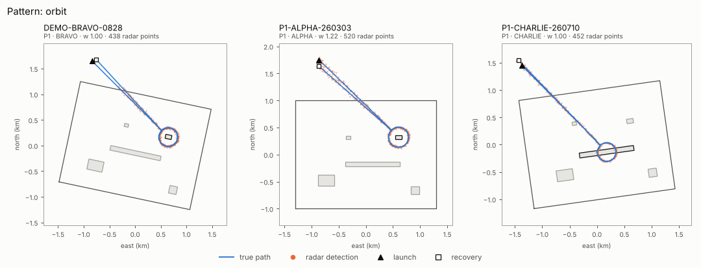
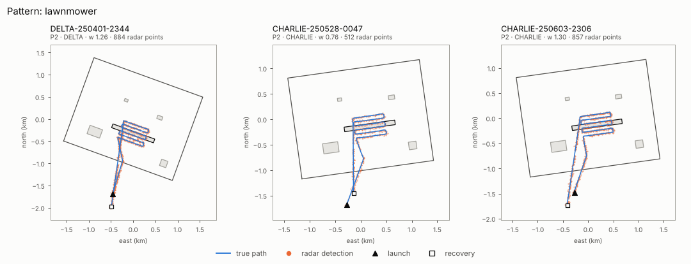
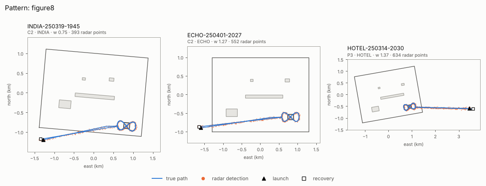
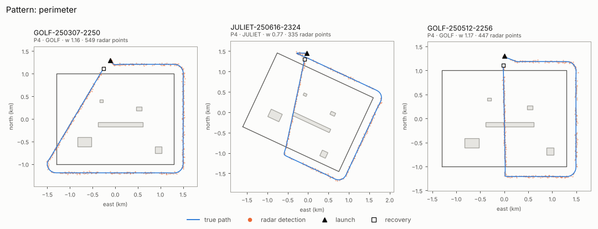
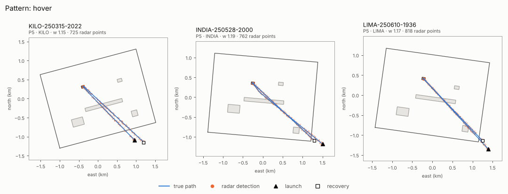
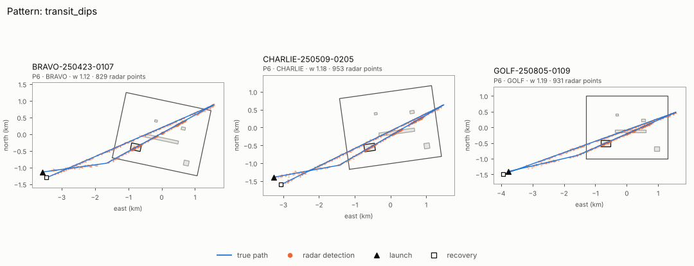
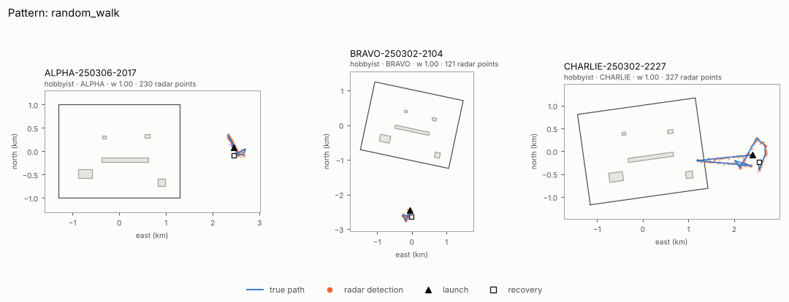
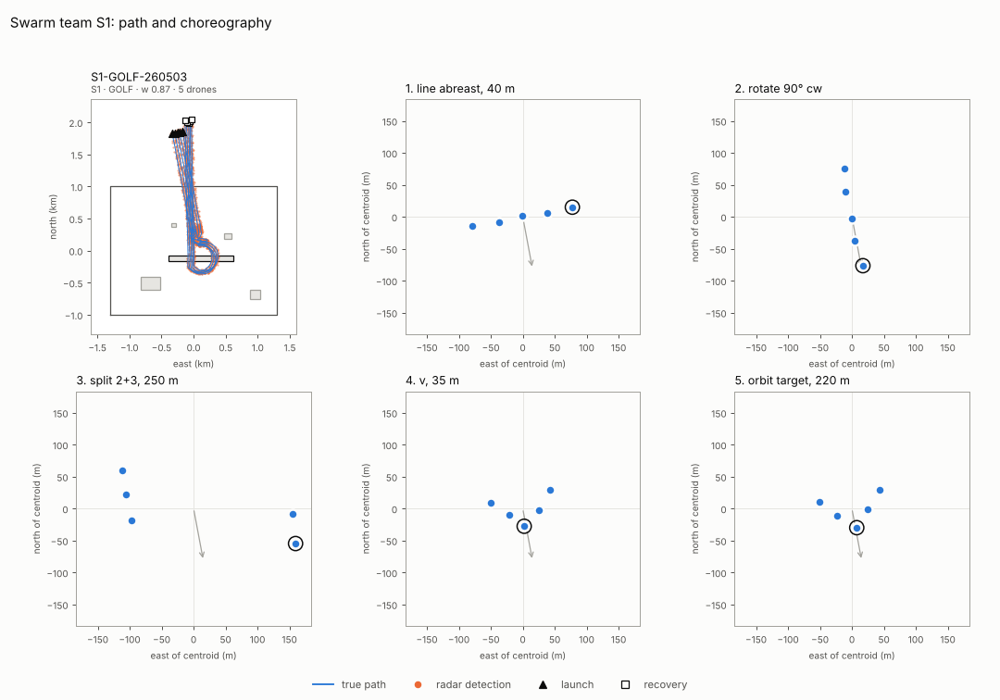
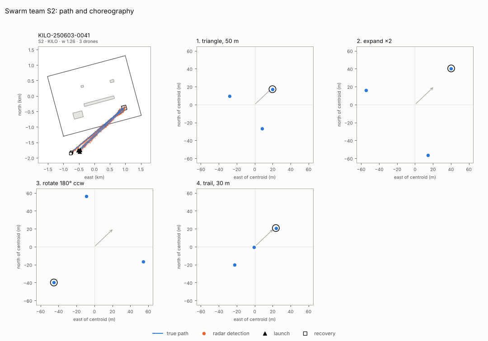

# Data card

`kairos-defense gen --seed 42` · phase 2 (complete dataset: flights, swarms, radar, RF, Remote ID, reports and assessments). All data is synthetic.

## Volumes against SPEC §8.11

| Metric | Value | Expected | Status |
|---|---:|---:|---|
| incidents | 1,878 | ≈1,900 | within ±15% |
| tracks | 1,904 | ≈1,950 | within ±15% |
| track_points | 560,884 | ≈1,000,000 | outside ±15% (56%) |
| rf_detections | 414,999 | ≈500,000 | outside ±15% (83%) |
| reports | 956 | ≈1,000 | within ±15% |
| assessments | 1,876 | ≈1,900 | within ±15% |

Track points and RF detections come in below §8.11 for the same reason: hobbyist flights last 180–720 s (mean ≈450 s) and are ≈95% of all flights (D-030, D-044). Incident, track, report and assessment counts are on target.

## Flights

| Actor type | Flown | Radar track | No track |
|---|---:|---:|---:|
| hobbyist | 1,773 | 1,773 | 0 |
| prober | 66 | 66 | 0 |
| copycat | 30 | 30 | 0 |
| swarm drones | 35 | 35 | 0 |
| **all** | 1,904 | 1,904 | 0 |

Flights heard by RF or Remote ID but never tracked by radar (no incident, D-038): 0.

## Incidents per installation and actor type

| Installation | hobbyist | prober | copycat | swarm | total |
|---|---:|---:|---:|---:|---:|
| ALPHA | 158 | 2 | 0 | 0 | 160 |
| BRAVO | 146 | 6 | 10 | 0 | 162 |
| CHARLIE | 160 | 9 | 0 | 0 | 169 |
| DELTA | 155 | 7 | 5 | 0 | 167 |
| ECHO | 133 | 5 | 5 | 2 | 145 |
| FOXTROT | 163 | 5 | 0 | 0 | 168 |
| HOTEL | 144 | 6 | 0 | 1 | 151 |
| INDIA | 121 | 5 | 10 | 0 | 136 |
| GOLF | 163 | 9 | 0 | 1 | 173 |
| JULIET | 129 | 5 | 0 | 4 | 138 |
| KILO | 161 | 3 | 0 | 1 | 165 |
| LIMA | 140 | 4 | 0 | 0 | 144 |

## Probers and copycats

| Actor | Pattern | Incidents | Bases | Time warp range |
|---|---|---:|---|---:|
| C1 | orbit | 15 | BRAVO, DELTA | 0.74–1.40 |
| C2 | figure8 | 15 | ECHO, INDIA | 0.72–1.27 |
| P1 | orbit | 6 | ALPHA, BRAVO, CHARLIE, DELTA | 0.95–1.22 |
| P2 | lawnmower | 12 | CHARLIE, DELTA | 0.76–1.39 |
| P3 | figure8 | 16 | ECHO, FOXTROT, HOTEL | 0.73–1.40 |
| P4 | perimeter | 10 | GOLF, JULIET | 0.75–1.38 |
| P5 | hover | 12 | INDIA, KILO, LIMA | 0.71–1.32 |
| P6 | transit_dips | 10 | BRAVO, CHARLIE, GOLF | 0.73–1.25 |

## Swarm incidents (§8.7)

| Incident | Team | Base | Start (local) | Tracks/drones | Warp | Status | Reports |
|---|---|---|---|---:|---:|---|---:|
| JULIET-250325-2314 | S2 | JULIET | 2025-03-25 23:14 | 3/3 | 0.77 | history | 3 |
| KILO-250603-0041 | S2 | KILO | 2025-06-03 00:41 | 3/3 | 1.26 | history | 3 |
| JULIET-260123-2157 | S2 | JULIET | 2026-01-23 21:57 | 3/3 | 1.12 | history | 3 |
| JULIET-260316-2209 | S2 | JULIET | 2026-03-16 22:09 | 3/3 | 1.18 | history | 2 |
| S1-GOLF-260503 | S1 | GOLF | 2026-05-03 22:10 | 5/5 | 0.87 | history | 2 |
| JULIET-260511-0024 | S2 | JULIET | 2026-05-11 00:24 | 3/3 | 0.92 | history | 2 |
| DEMO-SWARM-ECHO-0614 | S1 | ECHO | 2026-06-14 21:50 | 5/5 | 1.13 | live | 0 |
| ECHO-260806-2049 | S1 | ECHO | 2026-08-06 20:49 | 5/5 | 0.79 | history | 2 |
| HOTEL-260829-0036 | S1 | HOTEL | 2026-08-29 00:36 | 5/5 | 1.35 | history | 2 |

## Sensors (§8.6)

- Radar: points per track median 292, p5 108, p95 484; 0.67 points per flight second.
- RF: 414,999 detections at 0.5 Hz; bands 2.4GHz 385,822, 5.8GHz 11,309, 900MHz 17,868. RF heard 1,876 of 1,878 incidents before the radar's first point (takeoff is below the radar's 15 m floor), so incident start is the first RF detection there (D-028).
- Remote ID: 686,263 broadcasts, 1,615 distinct serials. Drones by mode (heard / flown): on 1,621/1,621, spoofed 12/12, off 0/271.

## Reports (§8.8, Appendix A)

| Source | Reports | Grades |
|---|---:|---|
| bdoc_log | 92 | A2 32, B2 60 |
| security_forces | 477 | B2 168, B3 155, C3 154 |
| local_pd | 345 | C3 170, C4 175 |
| faa | 42 | B3 42 |

| Actor type | History incidents | Reports | Per incident |
|---|---:|---:|---:|
| hobbyist | 1,773 | 730 | 0.41 |
| prober | 65 | 143 | 2.20 |
| copycat | 30 | 64 | 2.13 |
| swarm | 8 | 19 | 2.38 |

Report delay after the incident end (histogram, reports per bin):

| Source | 0–10 min | 10–30 min | 30–90 min | 1.5–6 h | 6–24 h | 1–2 d | 2–5 d |
|---|---:|---:|---:|---:|---:|---:|---:|
| bdoc_log | 88 | 4 | 0 | 0 | 0 | 0 | 0 |
| security_forces | 0 | 66 | 409 | 2 | 0 | 0 | 0 |
| local_pd | 0 | 0 | 0 | 31 | 133 | 181 | 0 |
| faa | 0 | 0 | 0 | 0 | 0 | 7 | 35 |

Security-forces styles: narrative (ALPHA, DELTA, ECHO, KILO); blotter (BRAVO, FOXTROT, GOLF, LIMA); terse (CHARLIE, HOTEL, INDIA, JULIET).

## Clue rates (§8.8)

| Clue type | Mentions | True |
|---|---:|---:|
| vehicle | 42 | 36% |
| road | 48 | 83% |
| lights | 95 | 89% |
| sound | 21 | 95% |
| launch_site | 686 | 99% |
| departure | 95 | 74% |

In the 153 security-forces and local-PD reports that can carry a vehicle, a vehicle is mentioned in 27% (model 35%) and a road in 31% (model 30%). Vehicles are true only for probers with a vehicle in their profile; every other actor's observed vehicles are wrong by construction. Hobbyist reports name the park where the operator was found, so most launch-site clues are true.

## Assessments (§8.8)

Rows: correct label (truth). Columns: label given. Live incidents get none (D-041).

| Correct \ given | hobbyist | unknown | probing | swarm | total |
|---|---:|---:|---:|---:|---:|
| hobbyist | 1,601 | 172 | 0 | 0 | 1,773 |
| probing | 32 | 63 | 0 | 0 | 95 |
| swarm | 0 | 0 | 0 | 8 | 8 |

Prober incidents labeled hobbyist: 18% (model 20%; the count includes the planted DELTA label). Nobody labels probing: no one has linked the flights yet.

## Planted items (scenario_demo.yaml, §8.10)

| Incident | Base | Launch (local) | First radar point (local) | Warp | Points | Status |
|---|---|---|---|---:|---:|---|
| P1-BRAVO-251114 | BRAVO | 2025-11-14 21:12:00 | 2025-11-14 21:13:20 | 1.00 | 272 | history |
| P1-ALPHA-260303 | ALPHA | 2026-03-03 21:52:00 | 2026-03-03 21:52:07 | 1.22 | 520 | history |
| P1-DELTA-260419 | DELTA | 2026-04-19 21:35:00 | 2026-04-19 21:35:06 | 1.00 | 494 | history |
| P1-ALPHA-260502 | ALPHA | 2026-05-02 22:05:00 | 2026-05-02 22:05:06 | 0.95 | 523 | history |
| S1-GOLF-260503 | GOLF | 2026-05-03 22:10:00 | 2026-05-03 22:10:06 | 0.87 | 2404 | history |
| DEMO-SWARM-ECHO-0614 | ECHO | 2026-06-14 21:50:00 | 2026-06-14 21:50:06 | 1.13 | 3235 | live |
| P1-CHARLIE-260710 | CHARLIE | 2026-07-10 21:30:00 | 2026-07-10 21:30:06 | 1.00 | 452 | history |
| DEMO-BRAVO-0828 | BRAVO | 2026-08-28 21:38:45 | 2026-08-28 21:40:06 | 1.00 | 438 | live |

Planted DELTA report (security_forces, B2, its only report):

> Security forces patrol observed a small drone near the fuel farm at about 21:35, est. 300 ft, a flashing white light. A white pickup was parked on County Rd 12 from 21:20 to 22:05 and left shortly after the drone flew northwest. The drone departed to the northwest at about 21:46. No contact with the operator.

Planted assessment: **hobbyist** by DELTA BDOC at 2026-04-20 09:10 local (truth: probing).

## Live incident timing (§1.2, D-003, D-033)

- Launch 21:38:45; first radar contact (T+0) 21:40:06, 81 s after launch, 71 m outside the fence.
- First detection by any sensor: 0 s before first radar contact (the terrain mask hides it from RF too, D-039).
- Orbit established (within 15 m of the radius for 10 s): T+79 s.

## Row counts

| Database | Table | Rows |
|---|---|---:|
| app | regions | 3 |
| app | installations | 12 |
| app | assets | 60 |
| app | roads | 4 |
| app | parks | 18 |
| app | sensors | 36 |
| app | incidents | 1,878 |
| app | track_points | 560,884 |
| app | rf_detections | 414,999 |
| app | remote_id | 686,263 |
| app | weather | 14,823 |
| app | base_events | 7,757 |
| app | public_events | 272 |
| app | reports | 956 |
| app | assessments | 1,876 |
| truth | track_truth | 1,904 |
| truth | true_paths | 841,465 |
| truth | clue_truth | 987 |
| truth | assessment_truth | 1,878 |

## Sample flights and swarms

Pattern figures: three flights per pattern type, in each installation's frame (km from its origin): true path (blue line) and radar detections (orange dots). Swarm figures: one event per team, then one snapshot per choreography step at that step's hold (or end): drones about their centroid, north up, the arrow is the swarm heading and drone 0 is ringed.

