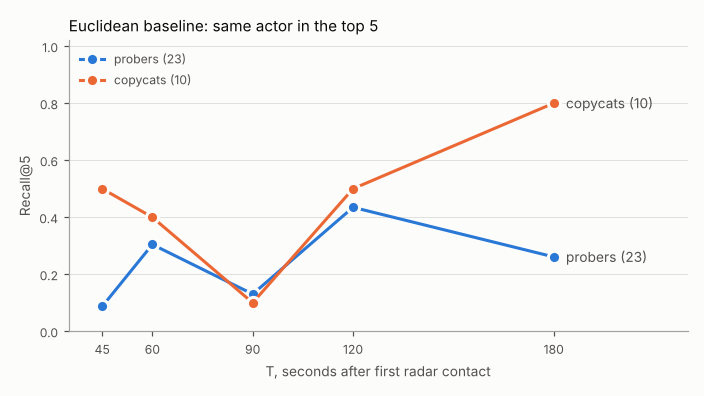

# Evaluation · euclidean baseline · 2026-10-28

`kairos-defense eval` (phase 3): the Euclidean baseline (§10.2) on the §19 protocol. No targets apply yet; these numbers are the reference for phase 4's DTW lift. Run time 23 s.

## Query sets (§19.1)

| Set | Queries | Unanswerable (no earlier same-actor track, D-009) |
|---|---:|---:|
| Probers (nights 2026-03-01 to 08-31) | 23 | 0 |
| Copycats | 10 | 0 |
| Swarm incidents | 5 | matched in phase 9 |

Each answerable query runs at T = 30, 45, 60, 90, 120, 180 s after its first radar point (165 searches). T = 30 s is below `min_track_s` (45 s): the matcher waits, which counts as a miss.

## Headline metrics (§19.3, probers unless noted)

| Metric | Value | v1 target (from phase 4) |
|---|---:|---|
| Recall@5 at T = 120 s | 0.435 | ≥ 0.80 |
| MRR at T = 120 s | 0.302 | report only |
| Time to match: top 3 by T = 90 s | 26% | ≥ 70% |
| Copycat-first rate at T = 120 s | 57% | ≤ 5% |
| Recall@5 at T = 120 s, copycat queries | 0.500 | report only |
| DTW lift | - | ≥ +0.10 (phase 4) |
| Report linkage | - | ≥ 0.70 (phase 5) |
| Forecast error at T = 90 s | - | median ≤ 400 m (phase 5) |
| Swarm top-1 | - | ≥ 0.80 (phase 9) |

## Recall by time since first contact

| T (s) | Window W (s) | Recall@5 probers | Top-3 probers | Recall@5 copycats |
|---:|---|---:|---:|---:|
| 30 | not run | 0.000 | 0.000 | 0.000 |
| 45 | 60 | 0.087 | 0.087 | 0.500 |
| 60 | 60 | 0.304 | 0.217 | 0.400 |
| 90 | 60 | 0.130 | 0.087 | 0.100 |
| 120 | 60, 120 | 0.435 | 0.348 | 0.500 |
| 180 | 120 | 0.261 | 0.217 | 0.800 |

## Per actor (Recall@5 at T = 120 s)

| Actor | Queries | Recall@5 | Found in top 50 | Median best rank |
|---|---:|---:|---:|---:|
| C1 | 5 | 0.400 | 2 | 1 |
| C2 | 5 | 0.600 | 5 | 1 |
| P1 | 4 | 0.000 | 1 | 11 |
| P2 | 4 | 0.250 | 2 | 10 |
| P3 | 5 | 0.600 | 5 | 3 |
| P4 | 3 | 1.000 | 3 | 1 |
| P5 | 4 | 0.500 | 4 | 5 |
| P6 | 3 | 0.333 | 3 | 35 |

## Latency (§10.9)

| Stage | p50 (ms) | p95 (ms) | p95 budget (ms) |
|---|---:|---:|---:|
| Query build (resample, target, PAA) | 25 | 38 | - |
| Prefilter (LanceDB search + grouping) | 64 | 83 | 50 |
| End to end | 93 | 117 | 1500 |
| DTW re-rank (50 candidates) | - | - | 800 (phase 4) |

## Demo assertions (`scenario_demo.yaml`)

| Expectation | Expected | Observed | Status |
|---|---|---|---|
| `live_first_contact_local` | 21:39:30-21:40:30, <= 100 m from fence | 21:40:06, 71 m | pass |
| `live_orbit_established_s` | T+65-100 s | T+79 s | pass |
| `live_top3_incidents` | P1-DELTA-260419, P1-ALPHA-260303, P1-ALPHA-260502 at T+90 s | 0/3 in top 3; ranks P1-DELTA-260419 -, P1-ALPHA-260303 -, P1-ALPHA-260502 - | info (target from phase 4) |
| `live_rank1_report_for` | P1-DELTA-260419 | - | pending (phase 5) |
| `forecast_error_max_m` | <= 400 m at T+105 s | - | pending (phase 5) |
| `swarm_top1` | S1-GOLF-260503 | - | pending (phase 9) |

Truth is read only by `kairos_defense.eval` to label outcomes (CLAUDE.md rule 2); every search is filtered to tracks that started before the query (rule 3).
