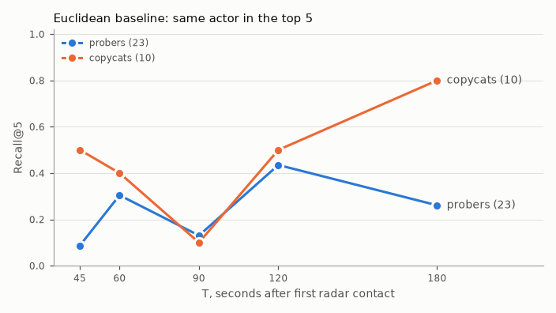

# Evaluation · DTW + fusion · 2026-10-29

`kairos-defense eval` (phase 4): the DTW matcher with fusion model `fusion-v1` on the §19 protocol, 500 candidate tracks per query. The Euclidean baseline is the prefilter order of the same candidates on the same run (D-076). Run time 36 s.

## Query sets (§19.1)

| Set | Queries | Unanswerable (no earlier same-actor track, D-009) |
|---|---:|---:|
| Probers (nights 2026-03-01 to 08-31) | 23 | 0 |
| Copycats | 10 | 0 |
| Swarm incidents | 5 | matched in phase 9 |

Each answerable query runs at T = 30, 45, 60, 90, 120, 180 s after its first radar point (165 searches). T = 30 s is below `min_track_s` (45 s): the matcher waits, which counts as a miss.

## Headline metrics (§19.3, probers unless noted)

| Metric | Value | v1 target |
|---|---:|---|
| Recall@5 at T = 120 s | 1.000 | ≥ 0.80 |
| Recall@5 at T = 120 s, Euclidean order of the same candidates | 0.478 | reference |
| DTW lift | 0.522 | ≥ +0.10 |
| MRR at T = 120 s | 1.000 | report only |
| Time to match: top 3 by T = 90 s | 96% | ≥ 70% |
| Copycat-first rate at T = 120 s | 0% | ≤ 5% |
| Recall@5 at T = 120 s, copycat queries | 1.000 | report only |
| Report linkage (T = 120 s, top 3 matched incidents, k = 5) | 1.000 (65 of 65 true-clue reports) | ≥ 0.70 |
| Forecast error at T = 90 s, median | 340 m | ≤ 400 m |
| Forecast error at T = 90 s, P80 | 495 m | report only |
| Swarm top-1 | - | ≥ 0.80 (phase 9) |

## Recall by time since first contact

| T (s) | Window W (s) | Recall@5 probers | Top-3 probers | Recall@5 copycats |
|---:|---|---:|---:|---:|
| 30 | not run | 0.000 | 0.000 | 0.000 |
| 45 | 60 | 0.826 | 0.826 | 0.700 |
| 60 | 60 | 0.913 | 0.913 | 1.000 |
| 90 | 60 | 0.957 | 0.957 | 1.000 |
| 120 | 60, 120 | 1.000 | 1.000 | 1.000 |
| 180 | 120 | 1.000 | 1.000 | 1.000 |

## Per actor (Recall@5 at T = 120 s)

| Actor | Queries | Recall@5 | Found in top 500 | Median best rank |
|---|---:|---:|---:|---:|
| C1 | 5 | 1.000 | 5 | 1 |
| C2 | 5 | 1.000 | 5 | 1 |
| P1 | 4 | 1.000 | 4 | 1 |
| P2 | 4 | 1.000 | 4 | 1 |
| P3 | 5 | 1.000 | 5 | 1 |
| P4 | 3 | 1.000 | 3 | 1 |
| P5 | 4 | 1.000 | 4 | 1 |
| P6 | 3 | 1.000 | 3 | 1 |

## Latency (§10.9)

| Stage | p50 (ms) | p95 (ms) | p95 budget (ms) |
|---|---:|---:|---:|
| Query build (resample, target, PAA) | 4 | 4 | - |
| Prefilter (LanceDB search + grouping) | 27 | 30 | 50 |
| DTW re-rank (500 candidates) | 32 | 56 | 800 (for 50) |
| End to end | 97 | 126 | 1,500 |

## Forecast and recall (§12, §13; probers)

| Measure | T = 90 s | T = 120 s |
|---|---:|---:|
| Forecast error, median | 340 m | 346 m |
| Forecast error, P80 | 495 m | 532 m |
| Queries without a forecast (no analog with a known recovery) | 0 | 0 |
| Report linkage | - | 1.000 |

Forecast error: §13 center to the true recovery point (truth). Report linkage: the share of the top 3 matched incidents' reports with a true clue, filed by T, that the hybrid search returns in its top 5 for that match (D-088). Forecast p50 / p95 8 / 9 ms; recall per matched incident 5 / 6 ms (outside the matcher's timed span).

Latency is reported, never gating (D-060).

## Demo assertions (`scenario_demo.yaml`)

| Expectation | Expected | Observed | Status |
|---|---|---|---|
| `live_first_contact_local` | 21:39:30-21:40:30, <= 100 m from fence | 21:40:06, 71 m | pass |
| `live_orbit_established_s` | T+65-100 s | T+79 s | pass |
| `live_top3_incidents` | P1-DELTA-260419, P1-ALPHA-260303, P1-ALPHA-260502 at T+90 s, with reasons | 2/3 in top 3; P1-DELTA-260419 #1 (1.00, 'Same time of night'); P1-ALPHA-260303 #2 (1.00, 'Same time of night'); P1-ALPHA-260502 #5 (0.99, 'Same time of night') | fail |
| `live_rank1_report_for` | P1-DELTA-260419 among the top 3 matched incidents, its own report rank 1 (T+120) | R-P1-DELTA-260419-1 rank 1 of 1 for P1-DELTA-260419 (match #1, score 0.0328); clues: white pickup; County Rd 12 (County Rd 12 runs through tonight's predicted zone.) | pass |
| `forecast_error_max_m` | <= 400 m at T+105 s | 139 m (radius 370 m; analogs P1-ALPHA-260303, HOTEL-250818-2126, FOXTROT-251215-2125; roads County Rd 12) | pass |
| `swarm_top1` | S1-GOLF-260503 | - | pending (phase 9) |

Truth is read only by `kairos_defense.eval` to label outcomes (CLAUDE.md rule 2); every search is filtered to tracks that started before the query (rule 3).
